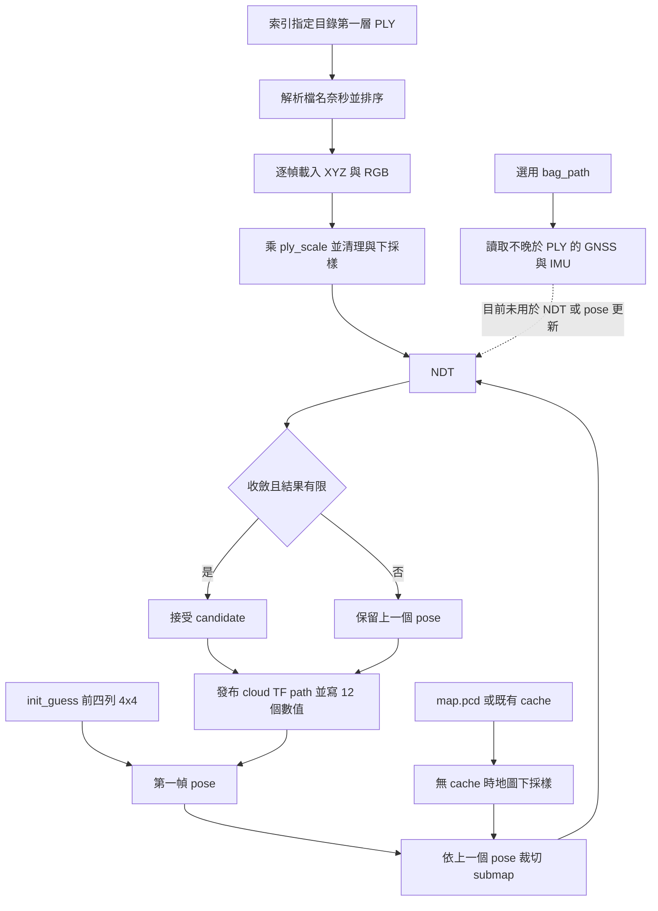

# Midterm01 題目分析與交付要求

2026-10-17 Ubuntu 實測：Docker／colcon 已成功，資料時間與索引已核對，兩條 Track 單幀及 50 幀結果見 [實測報告](UBUNTU_FIRST_RUN_20261017.md)。launch 已新增預設關閉的 RViz 開關並預設停用快取，轉檔已移除未使用的外部套件。尚未取得 Kaggle 分數；尺度／車體 frame／提交單位仍待官方契約確認。

以下為 2026-10-16 的歷史分析，涉及「尚未執行」與舊 launch 行為時，以前述實測報告為準。

更新：2026-10-16。依同目錄 [官方 PDF](<SDC 2026 Midterm01 Competition -  Localization.pdf>) 全部 24 頁、使用者提供的 Kaggle 說明、目前原始碼與 Ubuntu 資料截圖整理。使用者單人完成；本次在 Windows 靜態分析，未連線 Ubuntu 或取得定位分數。

**程式與資料都已建立，下一步是檢查 Ubuntu 既有資料、跑通目前 NDT，再保存兩條 Track 的參考結果。** 建置與執行入口見 [專案 README](../README.md)，資料實際目錄見 [data/README](../data/README.md)。

## 官方要求與證據來源

| 項目 | 題目要求／規格 | 來源 |
| --- | --- | --- |
| 定位任務 | 把影像重建點雲配準到 LiDAR map，估計每幀 pose | PDF p.5–6 |
| 兩條 Track | Track01 3011 幀、Track02 3299 幀，各自地圖 | PDF p.8 |
| 必做方法 | 自行設計 scan matching；可修改模板、用其他套件或從零實作 | PDF p.12、15 |
| 計分門檻 | 必須超過助教 baseline；兩條 Track 分別計排名 | PDF p.15、20 |
| 可用額外輸入 | 三相機、IMU、GNSS；助教 baseline 只用前相機點雲 | PDF p.8、15 |
| CSV | `idx,x,y,yaw`；資料列分別恰為 3011／3299，不含表頭 | [Kaggle 原文紀錄](KAGGLE_DATASET_SPEC.md) |
| 結果與文件 | 兩條最佳 CSV、程式、執行 README、報告與 4–6 分鐘簡報 | PDF p.21–22 |

PDF 把 `localization.cpp` 標成 TODO，但目前下載後的 package 已含基礎 NDT；應依實際程式保存 R0，再設計自己的改善。官方提供重建點雲，LoGeR 原始碼為選用，不必先重跑影像重建。

## 目前已建立的內容

- `workspace/src/localization/` 有 CMake／package、標頭、三個 C++、三個 launch、兩個 RViz 設定與轉檔工具，共 12 檔。
- `scripts/dev.sh`、`build_workspace.sh`、`check_data.py` 及獨立 Compose 已存在，尚待本次 Ubuntu 建置驗證。
- 使用者確認資料在 `~/sdc_ros2/midterm01/data`：Track1／Track2 含 map、init_guess、raw_ply、影像、bag 及 metadata；兩組 MapAnything 含 ply、index.csv、report.json。
- 截圖沒有展開 PLY 檔，也未顯示 camera_info／sample submission。本次不能從截圖證明數量、內容完整、尺度或定位正確。
- 本地 Windows 的 Track 目錄為空；Ubuntu 是獨立 checkout 與資料位置，不要求重新下載。舊下載指南與逐檔下載腳本已移除，以 [資源清單](DOWNLOADS.md) 查漏補缺。

## 目前程式如何運作



程式以 `_ts_<奈秒>` 解析 PLY，不能讀出時間的檔名會略過，沒有自動讀 MapAnything index。bag 比較的是 bag timestamp，而非 message header timestamp；目前只讀入感測器資料，沒有融合或新鮮度門檻。`init_guess.txt` 在目前程式中只初始化第一幀，不是每幀真值。

原始 source 交給 NDT，傳入初始 pose，最終 transformation 直接作為 candidate。後處理把每行 3×4 矩陣轉為 `x=pose[3]`、`y=pose[7]`、`yaw=atan2(pose[4],pose[0])`，ID 由 0 起行號產生。這些是實作契約，還需要對照官方車體 pose／ID 定義。

## 接手後先解決的問題

| 優先事項 | 已核對的事實 | 驗證與處理方向 |
| --- | --- | --- |
| 資料與時間 | check_data 只計第一層 PLY，不確認程式能解析時間 | 同時比對 PLY 數量、可解析時間數、唯一時間與官方 ID；保留索引 |
| 尺度與座標 | `ply_scale=3.0` 是現有預設，主流程未另套車體外參 | 檢查校正／報告與單幀疊圖；前相機和 MapAnything 分別核對 |
| 無 GUI 首跑 | localization launch 固定開 RViz，無 use_rviz 參數 | 先用 README 現有 `ros2 run` 命令；需要時再新增 launch 開關 |
| 唯讀 map | launch cache 預設指向資料目錄 | 首跑停用 cache，後續改為 outputs 可寫快取並記錄 Track／leaf／map 版本 |
| 已有 cache | 讀到 cache 後跳過下採樣，不驗證產生設定 | 改 voxel 時不得靜默沿用舊 cache |
| 轉檔依賴 | Python import pandas／NumPy／SciPy，轉換函式未用到它們 | 容器檢查 import，補依賴或移除未用 import 後驗證 |
| 低品質配準 | 只看收斂／有限值；min_input_points 未實際判斷 | 用短序列紀錄點數、配準與姿態變化，再決定品質門檻及回退 |
| 完整輸出 | 空 submap／壞 PLY 會終止；結果不帶時間 | 逐條核對輸出行數與 frame 對應；保留外部 frame manifest |
| 視覺化 | visualization.cpp 還是 Radar／PCD 舊介面 | 先用定位節點本身發布的點雲、TF、path；不直接套舊回放 launch |

這次是文件與分析交接，未修改上述程式行為。詳細參數與可執行指令見主 README。

## 座標、單位與資料契約

配準求出的首先是點雲座標到地圖的轉換。定義 `T_A_B` 表示將 B 中的點轉到 A：

```text
p_map = T_map_source × p_source
T_map_body = T_map_source × inverse(T_body_source)
```

第二式只在 source 尚未轉到 body、且已確認該外參定義時適用。若資料已做轉換，不再重複套用。應檢查初始矩陣與重建點雲是否具有相同 source 定義，以及提交要求的究竟是哪個車體參考點。

PLY 名稱、bag timestamp、header timestamp 與 Kaggle idx 分別核對，不把不同欄位視為同一時間或 ID。MapAnything index 中的奈秒應保留整數／字串精度，不先轉為浮點數再比對。切換三相機時保留原資料夾與 index，先驗證可用的 `ply_path` 與逐幀對應。

目前轉檔 yaw 為弧度；PDF 評分旋轉誤差以度描述。兩者不能直接混用，也不能只因評分寫 degree 就自行修改提交 yaw，須依官方 sample／補充說明確認。

## 評分與實驗證據

PDF p.19 的公式經圖像核對，是兩個 RMSE 相加：

$$
E_n = \sqrt{\frac{1}{n}\sum_{i=1}^{n}\|\Delta p_i\|^2}
+ 0.2\sqrt{\frac{1}{n}\sum_{i=1}^{n}\|\Delta\theta_i\|^2}
$$

平移誤差以公尺、旋轉誤差以度，誤差越低越好；不是將兩種誤差放入同一根號。PDF 未附完整評分程式，實際維度、角度環繞、轉換與 ID 對應仍依官方評分規格。

- **助教 baseline** 是課程計分門檻，兩條 Track 的實際數值待從官方取得。
- **自己的 R0** 是目前程式的前相機 NDT，已含清理、下採樣與局部地圖，尚待實跑。不能把這些既有功能說成自己的新增貢獻。
- **PCL 收斂／fitness** 用於配準診斷，不是正式 ATE。GNSS 允許作為輸入，PDF 沒有保證它是評分 ground truth。

先單幀，再固定短片段，再完整兩條 Track。保存 commit／未提交差異、完整參數、資料來源、frame 對應、輸出、耗時、失敗／fallback 與 Kaggle 分數。兩條 Track 共 6310 幀，完整實驗時間應由實測估算。實驗表在 [experiments/README](../experiments/README.md)。

R0 後可依失敗案例比較運動預測、配準品質門檻、重試與回退，再考慮多尺度、ICP、三相機或感測器融合。每個改動需有開關與對照；不一次換資料來源、演算法與所有參數後就把效果歸因於某一項。

## 官方期限與配分

下表照錄 PDF，年份依本次 2026 課程。工作安排使用台灣時間；PDF 未明示 Kaggle 截止時區，網站最新日期／時區及補交流程仍須另確認。

| 事項 | PDF 公告 | 頁碼 |
| --- | --- | --- |
| 分組登記 | 2026-10-16 15:00；單人一組已由使用者決定，登記狀態另查 | p.23 |
| Kaggle 截止 | **2026-10-29 09:00**；每日提交上限公告為 15 | p.16 |
| 簡報寄送 | **2026-10-29 09:00** 前寄簡報檔或連結到 `neal516.en14@nycu.edu.tw` | p.21 |
| 課堂簡報 | **2026-10-29，4–6 分鐘** | p.21 |
| E3 程式與報告 | **2026-11-05 23:59** | p.22 |
| Late submission | 公告列 11 分與 11/05 23:59，適用方式另依課程說明 | p.20 |

PDF p.20：競賽最多 56 分、報告 30 分、簡報 20 分。每條 Track 為第 1 名 28、第 2 名 26、第 3 名 24、Top 50% 21、Top 75% 18、其他超過 baseline 15、late submission 11、低於 baseline 0；兩條 Track 排名分數相加。公告上限合計 106，照錄而不自行正規化。

寄送、Kaggle 提交與 E3 上傳是交付事項，不表示本次已操作或授權後續代理自動對外寄信。

## 報告、簡報與 E3

PDF p.21 要求 pipeline、自己的貢獻、問題與解法、工作分配及比例等。單人依實際內容列出工作並記為 100%。僅使用開源專案而沒有實質修改或原創貢獻，該貢獻項目為零分；因此需保留「問題、設計、對照結果」證據。

建議報告依任務與資料、方法與座標、自己的改善、兩條 Track 實驗、失敗分析、重現方法排列。簡報控制在 4–6 分鐘，重點放自己的設計與效果。詳見 [reports/README](../reports/README.md)。

PDF p.22 的正式命名範本：

```text
<student ID1>_<student ID2>_localization.zip
localization_report_<student ID1>_<student ID2>.pdf
```

單人學號填法未另列，繳交前依課程確認，不自行補第二個學號。壓縮檔至少包含：

- 完整 `localization/` 程式資料夾，排除原始資料集。
- 自行撰寫的其他程式、腳本與必要設定。
- 兩條 Track 最佳提交 `result_1.csv`、`result_2.csv`。
- 報告 PDF，可選附簡報影片連結。
- 能重現兩條 Track 的 README、依賴、版本及最佳參數。

交付前確認 CSV 表頭／完整 ID／行數／有限值、兩條地圖未混用、最佳 CSV 與版本相符、Kaggle 實際成績已保存。現階段尚不能宣稱已超過 baseline 或完成最終交付。
