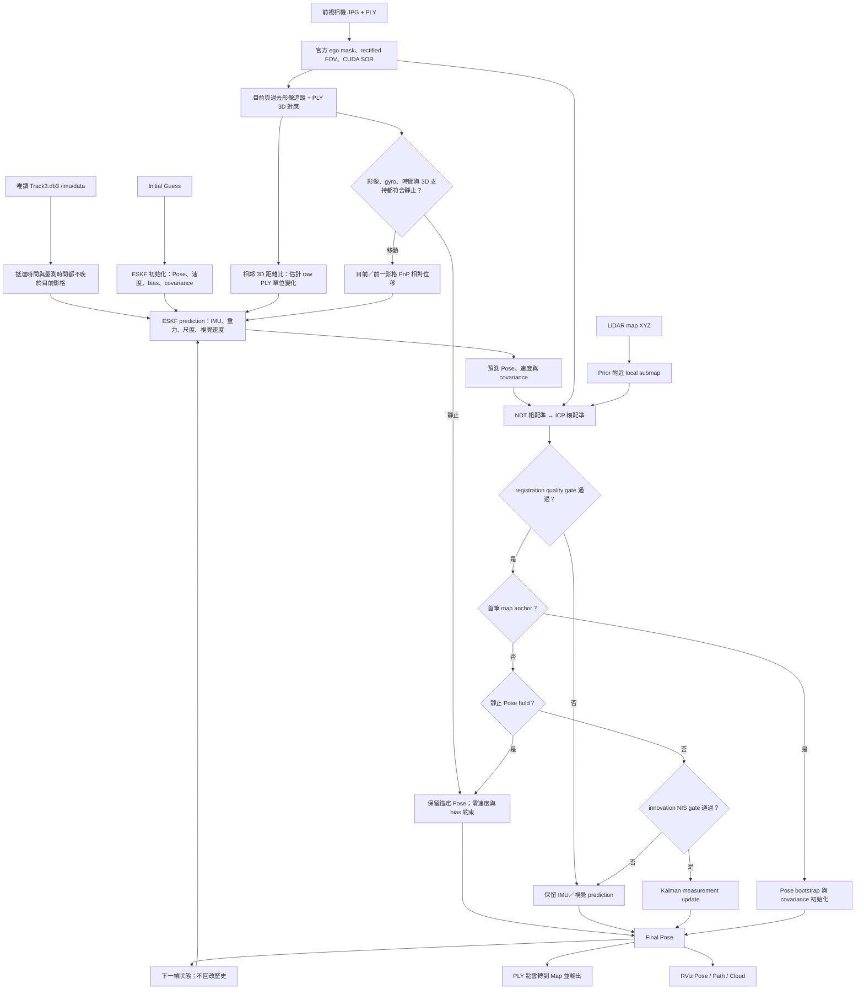

# Midterm01 GPU 定位

**Track2 現行程式（2026-10-29）：**live 版本為 `track2_causal_dual_heading_bias_v5_2`；沿用 v5.1 map registration，新增 GNSS `PoseStamped` orientation 與 IMU 的因果雙 bias 融合。[58 項合成／CUDA／runner 檢查](outputs/run/track00_test_2610291602/pytest.xml)全數通過（14.402 秒，僅既有 `Axes3D` warning）；[套用 SHA 收據](outputs/run/track00_test_2610291602/apply_receipt.json)可追溯 live source。v5 與 v5.1 已有 full，使用者回報數值為 0.53683 與 0.51617；非因果 CSV 回報 0.30488，只作唯讀比較、不用來調參。三個分數已由使用者確認為同一 Track2 競賽的 Kaggle Public Score；v5.2 尚無真實 full 或分數證據，也不保證達到 0.30488。[1527 分析索引](outputs/run/track00_test_2610291527/analysis/README.md)與[1602 驗證圖表索引](outputs/run/track00_test_2610291602/analysis/README.md)已提供 PNG／PDF 與唯讀數據。下一次 full 由使用者手動啟動。操作與參數見 [Track2 README](track2/README.md)，模型、測試與限制見 [72｜GNSS 航向因果融合](doc/72_TRACK2_GNSS_ORIENTATION_CAUSAL_20261029.md)。

**作者 Track3 CPU 本機對照：**已建立獨立研究入口 `./scripts/run_external_track3.sh --check`／`--full`，22 項作者合成測試與 4 項包裝器檢查通過。Track3 原始資料尚未準備，未執行真實定位；只有執行副本的兩處 I/O 相容修正，作者原檔保留。[資料位置、執行命令與驗證範圍](doc/70_EXTERNAL_TRACK3_LOCAL_VALIDATION.md)。完整執行仍由使用者啟動。

**作者流程也支援 Track1／2：**使用 `./scripts/run_external_track1.sh --full` 或 `./scripts/run_external_track2.sh --full`，由使用者依序啟動。兩條 `--check` 均通過 22 項作者測試與 9 項跨 Track 契約檢查，輸入為各自 `raw_ply/`、3011／3299 幀；Track2 binary 地圖另以 XYZ-only 介面讀取。尚無本次移植的真實定位或精度結果。[Track1／2 操作與設定](doc/71_EXTERNAL_TRACK12_LOCAL_VALIDATION.md)。

## Track3 原有入口

這個專案把每幀相機重建的 3D 點雲對齊 LiDAR 地圖，求出相機的位置、方向與尺度。目前版本是 **v7**（`track3_cuda_v7_multihypothesis_startup`）。

v7 改善首個定位點的選擇方式：以官方初始 pose 為搜尋起點，讓多個候選各自完成配準，再比較哪個與本幀地圖幾何最一致。首幀流程、修改原因與驗證範圍見 [v7 首幀說明](doc/59_V7_STARTUP_HYPOTHESES_20261025.md)。

**目前狀態：**141 項合成與 CUDA 檢查通過。本次文件更新時，你啟動的 [v7 full](outputs/run/track03_full_2610251527/test_info.json) 正在執行，首幀已採用新的候選；完整定位效果與成績仍待確認。[前一輪診斷與測試圖表](outputs/run/track00_test_2610251515/analysis/README.md)已保留。

要執行定位，從下方「啟動與測試」開始。要修改 IMU 外參或融合參數，直接編輯 [imu_parameters.py](track3/imu_parameters.py)，各參數意義見 [IMU 與 yaw 融合說明](doc/58_CAUSAL_YAW_AND_FUSION_TUNING_20261025.md)。

## 啟動與測試

Ubuntu 主機上管理專用容器 `midterm01_track3`：

```bash
cd /home/ricky/sdc_ros2/midterm01_gpu
./scripts/dev.sh up
```

完整定位由使用者親自啟動：

```bash
./scripts/run.sh --full
```

這會啟動 RViz，建立新的 `outputs/run/track03_full_YYMMDDHHmm/`，凍結本輪程式與設定，記錄 Git 差異及來源 SHA，再以 run 內快照執行。`flock` 避免此入口同時執行多個 GPU 工作。執行期間不要從其他入口並行啟動 GPU 配準。

停止本輪時，先在原本啟動 full 的終端機按 `Ctrl+C`。若程序仍在執行，從容器內找出對應 run 的 PID，再只送 `SIGTERM`：

```bash
./scripts/dev.sh exec ps -eo pid,args | rg '[r]un_track3.py'
./scripts/dev.sh exec kill -TERM 容器內的PID
```

核對命令中的 run 路徑後再停止；主機與容器 PID 不一定相同。runner 會記錄停止原因、已完成幀數與輸出 SHA，RViz 可以保持開啟。不需要 `docker down` 或 `kill -9`。

如要由使用者手動跑真實短段：

```bash
./scripts/run.sh --max-frames 30
```

外參直接改 [track3/imu_parameters.py](track3/imu_parameters.py) 最上方的 `IMU_RPY_DEG` 與 `IMU_XYZ_M`：前者是 IMU→PLY 的固定軸 XYZ roll/pitch/yaw（度），後者是 IMU 原點在 PLY FLU 的位置（公尺）。先只改一項有依據的假設，再用相同幀數比較；每次 run 會保存當時的程式與有效外參。改動前等正在執行的 full 結束。詳細判讀方式見 [doc52](doc/52_V5_IMU_EKF_20261025.md)。

影像尺度與靜止判斷門檻集中在 [track3/motion_parameters.py](track3/motion_parameters.py)；這些是 feature／motion evidence 的工程門檻，不能代替外參標定。30 幀短段只適合檢查啟動與資料流程，沒有 frame 950 的長靜止或 frame 2400 的轉彎；外參效果要在含有該類場景的 run 裡比較，細節見 [doc53](doc/53_V5_SCALE_STATIONARY_TURN_20261025.md)。

每次 run 的程式快照包含這兩個 Python 參數及其 SHA256。比較外參時使用相同幀數和其餘固定參數；不要依 Public Leaderboard 分數挑選。

環境檢查和合成測試使用新的跨 Track run，並在容器執行：

```bash
RUN_DIR="$(python3 scripts/create_run.py --kind test --track 00)"
RUN_PATH="outputs/run/$(basename "$RUN_DIR")"
./scripts/dev.sh exec python "$RUN_PATH/source/scripts/inspect_data.py" \
  --record-dir "/workspace/midterm01_gpu/$RUN_PATH"

# 合成測試另開新 run；先切至凍結快照目錄，避免 Python 優先載入 live source
RUN_DIR="$(python3 scripts/create_run.py --kind test --track 00)"
RUN_PATH="/workspace/midterm01_gpu/outputs/run/$(basename "$RUN_DIR")"
./scripts/dev.sh exec bash -c 'cd "$1/source" && export PYTHONPATH="$PWD:$PYTHONPATH" && exec python -m pytest -q -p no:cacheprovider tests --basetemp "$1/pytest" --junitxml="$1/pytest.xml"' \
  bash "$RUN_PATH" 2>&1 | tee "$RUN_DIR/pytest.log"
```

資料檢查只讀 PLY 時序、map XYZ、初始姿態與來源 SHA，不做定位、不讀 IMU bag。容器以唯讀方式掛載共用資料，只允許寫入 GPU 專案的 `outputs/`。

IMU 濾波模型與外參判讀見 [doc52](doc/52_V5_IMU_EKF_20261025.md)；若要自行改外參並輸出轉換後的加速度／角速度表與對照圖，使用 [IMU 各軸外參預覽](doc/54_IMU_EXTRINSIC_PREVIEW.md)。

## RViz 與 run 輸出

RViz 發布 `/track3/map`、`/track3/submap`、`/track3/current_cloud`、`/track3/pose`、`/track3/path`、`/track3/status` 和 `/track3/registration_status`，並提供 `map → track3_camera` TF。map update 通過時顯示綠色 `ACCEPTED`；配準失敗時顯示橘色 `PRIOR ONLY` 與原因；確認靜止時以藍色 `STATIONARY (IMAGE + IMU)` 顯示 pose hold 和當前點雲。靜止幀的 `map_accepted=false` 表示輸出沿用錨定位置，不表示 map registration 通過。RViz 畫面只呈現估計，不是逐幀真值，也不能單獨證明 run 成功。

主要輸出：

| 檔案 | 內容 |
| --- | --- |
| `result_3.csv` | `idx,x,y,yaw`；local 0-based 索引，yaw 為 `atan2(R10,R00)` 弧度 |
| `poses.txt` | 每幀 row-major 3×4 矩陣，共 12 值，不含 timestamp |
| `timings.csv` | `idx,original_idx,timestamp_ns,backend,load_ms,registration_ms,total_ms,map_accepted,scale` |
| `frame_manifest.csv` | 本輪索引、原始索引、整數奈秒時間戳、PLY 路徑與 SHA256 |
| `observations.jsonl` | 配準 stages、coverage、收斂、尺度、品質閘門、失敗、preprocessing、initializer、camera mask、IMU prediction／Kalman update、影像尺度、靜止和視覺速度診斷 |
| `gpu_memory.jsonl` | 此版本在初始化、map/submap 與逐幀結束等檢查點的 CuPy pool 和整卡顯存抽樣 |
| `pose_trace.jsonl` | predicted/registered/final 4×4 pose、尺度、接受狀態、原因與候選相對 prior 的 Δ；有 IMU 時另含慣性及 motion constraints 診斷 |
| `input_sources.json` | map、`init_guess.txt` 與設定檔的來源 SHA256 |
| `camera_sources.json` | 相機標定與 ego mask 的來源 SHA256；逐幀影像 SHA 記在 visual prior 診斷中 |
| `imu_sources.json` | IMU bag SHA256、topic/frame、timestamp contract、`T_ply_imu`、gravity 假設與 noise 來源；v5 IMU run 才有 |
| `test_info.json` | 狀態、版本、來源、階段耗時、接受／拒絕統計、輸出 SHA 和失敗原因 |
| `source/` | 本輪執行的程式、設定、文件與測試快照 |

成功完成 3142 幀 full run 後會在 `analysis/` 產生原有三組唯讀 PNG/PDF、README 和來源 SHA manifest；若有完整記憶體記錄，再加 `04_gpu_memory.png/pdf`。短段與失敗 run 不產生完整比較圖；畫圖失敗的狀態記在 run 的 `analysis_status.json` 和 log，定位輸出會保留。歷史 run 不搬移或補圖。人工重試圖表時使用 run 快照：

```bash
./scripts/dev.sh exec python outputs/run/track03_full_YYMMDDHHmm/source/scripts/analyze_run.py \
  --run-dir outputs/run/track03_full_YYMMDDHHmm
```

定位輸出與圖表都在 `midterm01_gpu/outputs/run/`。Kaggle 提交、E3 上傳和寄信由使用者操作。

v5 IMU full 的標準圖成功後，自動增加 `analysis/imu/` 的融合與輸入耗時 PNG/PDF、metrics 和來源 manifest；若這部分失敗，另記 `imu_analysis_status.json`，定位成功狀態保留。

<details>
<summary>歷史性能、顯存與版本限制</summary>

## 性能與顯存監測

RTX 5060 上的生成資料 GPU 測試 55 項通過，耗時 93.61 s，另有一項既有 Matplotlib `Axes3D` warning。元件 wall-time 中位數為：pixel nearest 235×、NDT voxel search 76×、ICP voxel search 59×；限定兩階段的合成 registration 為 2.22×。這些是個別元件／合成條件的比較，不是完整 Track 加速倍數。對應點、合成 solver pose/scale 與 gate 的比較皆通過。明細見[比較紀錄](outputs/run/track00_test_2610242232/comparison.json)及[GPU 測試紀錄](outputs/run/track00_test_2610242232/gpu_pytest.xml)。

原 full run [`track03_full_2610242203`](outputs/run/track03_full_2610242203/test_info.json) 已以 v4 baseline 完成 3142 幀，2926 幀接受 map 更新，耗時 6275.19 s；三組標準圖表與來源 manifest 成功產生，結果及 SHA 保存在該 run 的 [`analysis/`](outputs/run/track03_full_2610242203/analysis/README.md)。該 run 沒有使用 `v4_perf_v1`，所以不能作為加速版完整 Track 的速度或精度結果。合成元件測試的[圖表與報告](outputs/run/track00_test_2610242232/analysis/README.md)已放在該測試 run 的 `analysis/`。

版本另寫入 `gpu_memory.jsonl`，在 CUDA context、map、initializer、submap 與每幀結束等檢查點記錄 CuPy pool 和整卡顯存抽樣；每幀 observation 附帶 frame-end 樣本，`test_info.json` 記錄樣本摘要。CuPy pool 上限設定為 4096 MiB，但會依啟動時可用顯存、預留量和既有較小上限再收緊；它不是整張 GPU 的總顯存上限。符合條件時只嘗試釋放未使用的 pool cache，不釋放仍在使用的配置，也不靜默改用 CPU 或降低精度。記憶體 benchmark 的 pool reserved 壓力結果與量測限制見[性能與顯存紀錄](doc/51_PERFORMANCE_AND_MEMORY_20261024.md)。

測試與 run 證據存於 `midterm01_gpu/outputs/run/`，此目錄受 `.gitignore` 管理，不會自動隨程式同步到另一台電腦。以上 full 是舊版 v4 的歷史結果；v5 的完整定位由使用者手動啟動。

## 已知限制與歷史紀錄

初始化 scale seed `3` 沿用 CPU 範例，只是候選，不是公尺比例標定；`0.2–30` 是數值範圍。v5 以可信 map registration 建立絕對 scale；移動時 map Sim(3) 共同估 pose 和 scale，通過靜止判定且有可靠 3D 支持時才用因果 3D 對應估相對尺度並固定當幀尺度。PnP 提供區間平均速度近似量測，`1.0 m/s` 標準差仍是未校正工程假設。道路 PCA 只有無向主軸。CSV 欄位、frame 對應及 yaw 單位仍須依 Kaggle 官方模板確認。沒有獨立真值，不能把合成測試、接受率、殘差、收斂、scale 值或 RViz 畫面當成定位精度證據。

已停止的 v3 run `track03_full_2610242038` 留有 254 幀輸出，其中 2 幀接受地圖更新，最後一次在 `idx=22`；停止前後來源 SHA 相符。這是停止 run 的前綴，不是完成的 full 結果。v3 舊 solver 的 denoising-only `track03_test_2610242100` 將 frame 0 的 33,989 點減至 32,949 點（移除 1,040 點，約 3.1%），仍以 `backtracking_failed` 拒絕，提出 scale 約 2.907；未篩選 baseline 提出的 scale 約 2.902。這項對照顯示單靠該次去噪沒有解決舊 solver 的首幀失敗，不能當成 v4 的真實精度結果。

v4 真實 frame 0 短段 run [`track03_test_2610242114`](outputs/run/track03_test_2610242114/test_info.json) 通過 map registration 品質閘門。ego mask/FOV 移除 843 點，depth-normalized SOR 再移除 977 點；初始化選出的 scale 約 6.7233，NDT／point ICP 後為約 6.7935。以 scale seed 3 建立的兩個候選則收斂至約 2.7686／3.2688，cost 高於選出的 ground-height 比例候選。這是單一 frame 的閘門結果，不是獨立尺度真值，也不能證明完整 Track 軌跡精度或後續前進方向；詳細診斷見該 run 的 [observation](outputs/run/track03_test_2610242114/observations.jsonl)。

授權的 7 幀 prefix [`track03_test_2610242119`](outputs/run/track03_test_2610242119/test_info.json) 中，idx 0–5 接受地圖更新，idx 6 因迭代上限保留有效 visual PnP prior。idx 1–6 的相鄰輸出位移在各自估計的相機前向投影均為正，約 0.234–0.423 m；影像 PnP 每幀有 276–288 個內點。這是首段機制與觀測結果，沒有 ground truth，不能外推為整段精度。[圖表與數值](outputs/run/track03_test_2610242119/analysis/README.md)已保存在該 run 的 `analysis/`。本輪真實配準總額度合計 10 幀（含一個 API 失敗嘗試），已用完，未啟動新 full。

v4 的合成 initializer 檢查以 scale 7 為輸入，兩個 scale 候選分別恢復至約 7.0132 和 7.0134。這驗證的是合成幾何機制，不代表真實 Track3 的尺度或定位已修正。v1/v2 歷史 run 和首段幾何分析仍保存在 `outputs/run/`；詳見[首段資料稽核](doc/49_DATA_FIRST_FRAME_AUDIT_20261024.md)。

</details>

## 在另一台電腦建立容器

先準備 NVIDIA driver 與 NVIDIA Container Toolkit，再於主機執行：

```bash
cd /home/ricky/sdc_ros2/midterm01_gpu
TRACK3_BASE_IMAGE=sdc_midterm01_gpu_ros2:cuda12.8 ./scripts/dev.sh build
./scripts/dev.sh up
```

v4 的執行環境恢復 `PyYAML 6.0.2`，Dockerfile 安裝 `python3-opencv`；本次容器實際讀得 OpenCV `cv2 4.5.4`。若沒有相容的 CUDA 12.8／ROS 2 Humble base image，先以 `Dockerfile.base` 建立專用 base。這個工作區使用自己的 Compose project，不重啟 Docker daemon，也不停止或重建其他課程容器。

doc50 的 v4 最終 35 項合成／數值／CUDA／ROS 檢查通過，紀錄於 `outputs/run/track00_test_2610242124/`。首段固定 pose 的共同點集最近 map 點距離中位數由約 0.837 m 降到 0.182 m，地面法向差由 18.32° 降到 0.48°；這是幾何一致性，不是 ground truth 定位誤差。完整說明見[當次診斷](doc/50_STARTUP_SCALE_NOISE_FIX_20261024.md)。

<details>
<summary>v4–v6 的結果、IMU 流程與首段診斷</summary>

以下保留當時的版本紀錄。現行 v7 首幀流程以 [v7 首幀說明](doc/59_V7_STARTUP_HYPOTHESES_20261025.md)為準。

v6 的歷史生成資料與 CUDA regression 測試為 **136 passed**，耗時 46.26 s，另有既有 Matplotlib Axes3D warning；紀錄見 [測試 run](outputs/run/track00_test_2610251412/pytest.xml)。使用者之後執行的 [v6 短段](outputs/run/track03_test_2610251424/test_info.json) 已完成 1257 幀，並非 full，也沒有成績證據。下方 v4／v5 成績與診斷均為歷史紀錄。

v5 IMU full 已完成 3142 幀；使用者回報成績 1.29，v4 full 回報 1.26，借來的外部 CSV 回報 0.65；分數來源記為使用者回報。唯讀逐幀對照顯示 v5 在 frame 2200–2600 的外部軌跡差異明顯小於 v4，但前 300 幀的 yaw 差異較大；外部軌跡不是 ground truth，不能據此判定真實誤差或精確解釋分數。v4／v5 也同時改變 fusion、尺度和 stationary 策略，不能把分數差歸因於 IMU 單一因素。官方 Public 僅評估長度未知的前 5–40% prefix，轉彎區約位於全序列 70–83%，因此其改善不會直接反映在這個 Public 前段分數。分析與限制見[doc56](doc/56_V5_SCORE_AND_HEADING_DIAGNOSIS_20261025.md)及唯讀比較圖表[README](outputs/run/track00_test_2610251302/analysis/README.md)；不建議原樣重跑同一 v5 版本期待分數改善。

v5 修正版版本為 `track3_cuda_v5_clock_body_velocity_map_scale`。它延續 doc50 的初始化、相機遮罩、CUDA 去噪與 NDT→ICP 配準，以及 doc51 的 CUDA 搜尋和顯存管理；包含 ROS bag IMU、15-state error-state Kalman filter、相機擷取時間對齊、當前 IMU 座標的視覺速度量測，以及停車約束。尺度依運動狀態處理：移動時由地圖配準共同估計 Sim(3)，確認靜止且尺度證據可靠時才用因果視覺尺度並固定當幀尺度。frame 950／2400 的診斷見[舊版尺度、靜止與轉彎說明](doc/53_V5_SCALE_STATIONARY_TURN_20261025.md)，此次計時與點雲錯位修正及真實短段證據見[doc55](doc/55_V5_STARTUP_CLOCK_FIX_20261025.md)；IMU 模型與外參判讀見[doc52](doc/52_V5_IMU_EKF_20261025.md)。使用者目前在 [track3/imu_parameters.py](track3/imu_parameters.py) 設定 `IMU_RPY_DEG = (1.0, 6.0, 0.0)`；此為逐次測試中的外參假設，並未標定。

從 frame 0 重跑的 80 幀測試 [`track03_test_2610251132`](outputs/run/track03_test_2610251132/test_info.json) 接受 63/80 幀，最長連續拒絕 13 幀。相同 masked／denoised 點雲的幾何檢查顯示 frame 79 最近 map 點距離中位數，舊 v5 為 1.606 m、修正版為 0.231 m；這是幾何一致性指標，不是 ground truth 或定位精度證明。新的從頭 300 幀短段 [`track03_test_2610251140`](outputs/run/track03_test_2610251140/test_info.json) 已完成，接受 map update 268/300 幀，最長連續拒絕 13 幀。idx 299 的位置為 `(567.314498, -188.355570, 8.534851) m`、scale `7.049991`、ESKF 速度大小 `9.576343 m/s`；該幀接受 map update，拒絕連續數為 0。使用共同 12,000 點集計算的 frame 299 最近 map 距離中位數為修正版 `0.2363 m`、v4 `0.1640 m`；修正版有 88.16% 點在 0.5 m 內，v4 為 96.99%。舊 v5 的 12,000 點都超出 3 m 搜尋半徑，所以其 capped median `3.0 m` 不是實際誤差中位數。這些是幾何一致性指標，不是 ground truth。分析圖表見該 run 的 [`analysis/`](outputs/run/track03_test_2610251140/analysis/README.md)。

300 幀測試只涵蓋 frame 0–299，沒有涵蓋 frame 950 停車或 frame 2200 以後的轉彎，不能視為 full Track 已修好。時間與輸出契約稽核在該 run 的 [contract audit](outputs/run/track03_test_2610251140/contract_audit.json)：camera/IMU 雙時間因果條件及 CSV/TXT/pose trace 一致性通過；其前 80 幀 pose、尺度、map 決策和 `poses.txt` 位元組與獨立 80 幀測試完全相同。早期 v5 的 89 項生成資料 CUDA／機制測試紀錄保留於 [pytest XML](outputs/run/track00_test_2610250847/gpu_pytest.xml)，沒有替代新版本檢查或真實精度證據。

修正版機制驗證記錄在 [`track00_test_2610251134`](outputs/run/track00_test_2610251134/)。107 個 distinct tests 首輪為 106 passed、1 failed；唯一失敗是生成測試中 IMU 非單位外參做 `T E inv(E)` 往返後產生 `1.11e-16` 浮點差，舊斷言使用 `array_equal`。只將 IMU 首 anchor 斷言改為 `atol=2e-15` 後，兩個 runner case 都通過（2.27 s）；首輪其餘 106 case 保持原樣通過（43.22 s）。這是修正後每個 distinct case 均有通過證據，不代表曾有一輪未修改來源的 107/107 全通過。該測試設定明確使用 identity 合成外參；使用者的 `(1,6,0)` Python RPY 設定未改。

`track3/imu.py` 以唯讀方式逐步讀 Track3 SQLite bag 的 `/imu/data`，只消費抵達時間不晚於當前 PLY 的訊息。`track3/time_alignment.py` 從同一 bag 讀取當前影像 header 時間；IMU 只積分到已抵達、且 header 時間不晚於該影像擷取時刻的樣本。已抵達但量測時間較晚的樣本會緩存到後續影格，遲到的舊樣本不回頭修改 pose。原始 PLY 的 bag timestamp 和輸出順序不變。定位不讀取 IMU orientation 或 GNSS。`track3/inertial.py` 以 IMU 原點為 nominal state，保存 map 座標的位置、速度、姿態及 IMU accelerometer／gyroscope bias；首筆可信地圖配準初始化 pose anchor，後續配準經 NIS gate 後作 EKF 更新。配準失敗或 NIS 不接受時，輸出本幀 IMU／視覺速度 prediction；通過靜止判斷時保留上一個錨定 pose。

`T_ply_imu` 是 `imu_link` 到相機 PLY（FLU）的變換，採 `p_ply = R_ply_imu * p_imu + t_ply_imu`；輸出 map pose 時使用其逆變換。程式直接從 `track3/imu_parameters.py` 讀取使用者選定的 roll、pitch、yaw 和平移；目前 RPY 為 `(1,6,0)` 度，仍是未標定的測試設定。map 重力方向假設為 `[0,0,-9.80665] m/s²`。bag covariance 全零代表未知；濾波的 IMU noise 和配準量測標準差是未校正的 engineering priors。PLY 的 scale 把重建的 raw units 換成公尺，raw units 隨影格變化時 scale 也可能變化。Visual PnP 依目前 IMU 座標轉成速度量測再由 ESKF 融合，不是把兩套 pose 直接疊加。競賽規則見 [midterm01/AGENTS.md](../midterm01/AGENTS.md)。



靜止時 runner 仍可計算 registration 候選作診斷，但 commit 會保留錨定 pose，不採用該候選。

初始姿態來自 `init_guess.txt`。第 0 幀是第一個 pose anchor，本身沒有先前影格可供估計運動；GroundInitializer 以相機與地圖的地面平面建立 roll／pitch 和高度候選，並以非地面幾何匹配產生 translation、yaw 與 scale 候選。這些只是配準 seed，最終仍須通過 NDT／ICP 品質閘門；首筆可信 registration 會建立 map pose 與絕對 scale anchor，不將初始化跳變解釋成速度。其後移動時 registration 可共同更新 pose 與 scale；只有通過視覺靜止判定且有足夠近距離 3D 支持時，才採用因果 3D 點對長度比例並固定當幀尺度。配準若被接受，依其尺度共同更新 map anchor；若被拒絕，則沿用 prior 的 pose／尺度。靜止時 ESKF 保留錨定 pose、約束零速度並更新 bias；移動時用前後影格 PnP 相對位移形成速度量測。新機制與已知限制見 [doc55](doc/55_V5_STARTUP_CLOCK_FIX_20261025.md)。道路 PCA 是無向軸，初始化本身不能證明車頭朝道路前進方向，也不指定固定前進速度。

</details>
