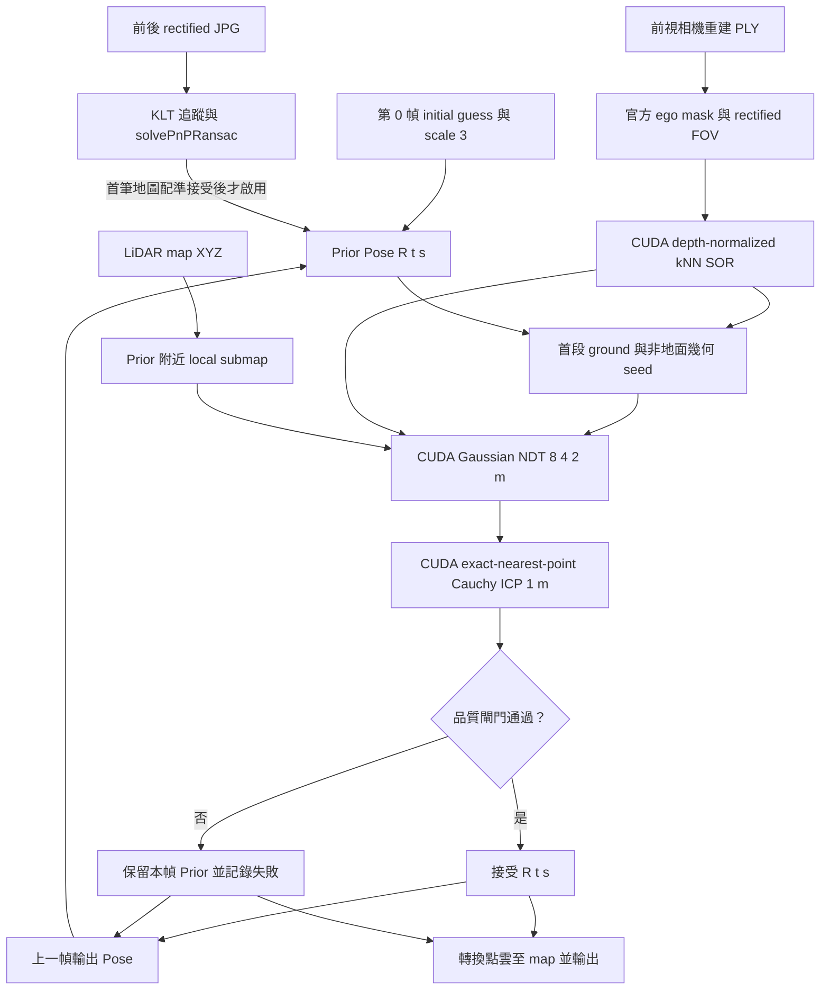

# Midterm01 Track3 GPU 定位

此份部署版本為 `track3_cuda_v4_perf_v1`，由 `track3_cuda_v4_denoise_geometry_visual_prior` 延伸，只改計算實作與顯存監測。GPU 合成等價性測試和元件微基準已通過；尚未以此版本執行完整實際 Track，因此不把元件加速比當成 full 加速比，也沒有新的實際資料精度結論。算法與量測範圍見[算法說明](doc/ALGORITHM.md)及[性能與顯存紀錄](doc/51_PERFORMANCE_AND_MEMORY_20261024.md)。

定位直接讀取官方前視相機重建 PLY，經相機遮罩、CUDA 雜訊篩除與首段幾何初始化後，配準到 LiDAR XYZ 地圖。預設以前後前視影像的特徵追蹤建立因果 visual PnP prior；不讀 IMU／bag 或 GNSS，不重建影像點雲，也不使用未來影格或事後修軌跡。競賽規則見 [midterm01/AGENTS.md](../midterm01/AGENTS.md)。



初始姿態來自 `init_guess.txt`。第 0 幀是第一個 pose anchor，本身沒有前一幀可供估計運動；尚未有 map registration 被接受時，GroundInitializer 以相機與地圖的地面平面建立 roll／pitch 和初始高度關係，並以非地面幾何匹配產生 translation、yaw 與 scale 候選；這些只是配準 seed，最終仍須通過 NDT／ICP 品質閘門。預設 `prediction` 為 `visual_pnp`：在首筆地圖配準被接受後，才用前後 rectified JPG 的 KLT 特徵與前一幀 PLY 深度估計相對運動；若影像 prior 不足或未通過檢查，沿用上一個輸出 pose。道路 PCA 是無向軸，方向由 prior yaw 選近側，因此初始化本身不能證明車頭朝道路前進方向，也不指定固定前進速度。拒絕地圖配準時，保留當前 prior 和 prior scale。

## 啟動與測試

Ubuntu 主機上管理專用容器 `midterm01_track3`：

```bash
cd /home/ricky/sdc_ros2/midterm01_gpu
./scripts/dev.sh up
```

完整定位由使用者親自啟動：

```bash
./scripts/run.sh --full
```

這會啟動 RViz，建立新的 `outputs/run/track03_full_YYMMDDHHmm/`，凍結本輪程式與設定，記錄 Git 差異及來源 SHA，再以 run 內快照執行。`flock` 避免此入口同時執行多個 GPU 工作。執行期間不要從其他入口並行啟動 GPU 配準。

停止本輪時，先在原本啟動 full 的終端機按 `Ctrl+C`。若程序仍在執行，從容器內找出對應 run 的 PID，再只送 `SIGTERM`：

```bash
./scripts/dev.sh exec ps -eo pid,args | rg '[r]un_track3.py'
./scripts/dev.sh exec kill -TERM 容器內的PID
```

核對命令中的 run 路徑後再停止；主機與容器 PID 不一定相同。runner 會記錄停止原因、已完成幀數與輸出 SHA，RViz 可以保持開啟。不需要 `docker down` 或 `kill -9`。

如要由使用者手動跑真實短段：

```bash
./scripts/run.sh --max-frames 30
```

環境檢查和合成測試使用新的跨 Track run，並在容器執行：

```bash
RUN_DIR="$(python3 scripts/create_run.py --kind test --track 00)"
RUN_PATH="outputs/run/$(basename "$RUN_DIR")"
./scripts/dev.sh exec python "$RUN_PATH/source/scripts/inspect_data.py" \
  --record-dir "/workspace/midterm01_gpu/$RUN_PATH"

# 合成測試另開新 run；先切至凍結快照目錄，避免 Python 優先載入 live source
RUN_DIR="$(python3 scripts/create_run.py --kind test --track 00)"
RUN_PATH="/workspace/midterm01_gpu/outputs/run/$(basename "$RUN_DIR")"
./scripts/dev.sh exec bash -c 'cd "$1/source" && export PYTHONPATH="$PWD:$PYTHONPATH" && exec python -m pytest -q -p no:cacheprovider tests --basetemp "$1/pytest" --junitxml="$1/pytest.xml"' \
  bash "$RUN_PATH" 2>&1 | tee "$RUN_DIR/pytest.log"
```

資料檢查只讀 PLY 時序、map XYZ、初始姿態與來源 SHA，不做定位、不讀 IMU bag。容器以唯讀方式掛載共用資料，只允許寫入 GPU 專案的 `outputs/`。

## RViz 與 run 輸出

RViz 發布 `/track3/map`、`/track3/submap`、`/track3/current_cloud`、`/track3/pose`、`/track3/path`、`/track3/status` 和 `/track3/registration_status`，並提供 `map → track3_camera` TF。通過時顯示綠色 `ACCEPTED` 及轉換至 map 的當前點雲；失敗時顯示橘色 `PRIOR ONLY` 與失敗原因，當前點雲也以橘色顯示在該幀 prior，方便檢查重疊；pose/path 使用相同 prior。RViz 畫面只呈現估計，不是逐幀真值，也不能單獨證明 run 成功。

主要輸出：

| 檔案 | 內容 |
| --- | --- |
| `result_3.csv` | `idx,x,y,yaw`；local 0-based 索引，yaw 為 `atan2(R10,R00)` 弧度 |
| `poses.txt` | 每幀 row-major 3×4 矩陣，共 12 值，不含 timestamp |
| `timings.csv` | `idx,original_idx,timestamp_ns,backend,load_ms,registration_ms,total_ms,map_accepted,scale` |
| `frame_manifest.csv` | 本輪索引、原始索引、整數奈秒時間戳、PLY 路徑與 SHA256 |
| `observations.jsonl` | 配準 stages、coverage、收斂、尺度、品質閘門、失敗、preprocessing、initializer、camera mask 與 visual prior 診斷 |
| `gpu_memory.jsonl` | 此版本在初始化、map/submap 與逐幀結束等檢查點的 CuPy pool 和整卡顯存抽樣 |
| `pose_trace.jsonl` | predicted/registered/final 4×4 pose、尺度、接受狀態、原因與候選相對 prior 的 Δ |
| `input_sources.json` | map、`init_guess.txt` 與設定檔的來源 SHA256 |
| `camera_sources.json` | 相機標定與 ego mask 的來源 SHA256；逐幀影像 SHA 記在 visual prior 診斷中 |
| `test_info.json` | 狀態、版本、來源、階段耗時、接受／拒絕統計、輸出 SHA 和失敗原因 |
| `source/` | 本輪執行的程式、設定、文件與測試快照 |

成功完成 3142 幀 full run 後會在 `analysis/` 產生原有三組唯讀 PNG/PDF、README 和來源 SHA manifest；若有完整記憶體記錄，再加 `04_gpu_memory.png/pdf`。短段與失敗 run 不產生完整比較圖；畫圖失敗的狀態記在 run 的 `analysis_status.json` 和 log，定位輸出會保留。歷史 run 不搬移或補圖。人工重試圖表時使用 run 快照：

```bash
./scripts/dev.sh exec python outputs/run/track03_full_YYMMDDHHmm/source/scripts/analyze_run.py \
  --run-dir outputs/run/track03_full_YYMMDDHHmm
```

定位輸出與圖表都在 `midterm01_gpu/outputs/run/`。Kaggle 提交、E3 上傳和寄信由使用者操作。

## 性能與顯存監測

RTX 5060 上的生成資料 GPU 測試 55 項通過，耗時 93.61 s，另有一項既有 Matplotlib `Axes3D` warning。元件 wall-time 中位數為：pixel nearest 235×、NDT voxel search 76×、ICP voxel search 59×；限定兩階段的合成 registration 為 2.22×。這些是個別元件／合成條件的比較，不是完整 Track 加速倍數。對應點、合成 solver pose/scale 與 gate 的比較皆通過。明細見[比較紀錄](outputs/run/track00_test_2610242232/comparison.json)及[GPU 測試紀錄](outputs/run/track00_test_2610242232/gpu_pytest.xml)。

原 full run [`track03_full_2610242203`](outputs/run/track03_full_2610242203/test_info.json) 已以 v4 baseline 完成 3142 幀，2926 幀接受 map 更新，耗時 6275.19 s；三組標準圖表與來源 manifest 成功產生，結果及 SHA 保存在該 run 的 [`analysis/`](outputs/run/track03_full_2610242203/analysis/README.md)。該 run 沒有使用 `v4_perf_v1`，所以不能作為加速版完整 Track 的速度或精度結果。合成元件測試的[圖表與報告](outputs/run/track00_test_2610242232/analysis/README.md)已放在該測試 run 的 `analysis/`。

版本另寫入 `gpu_memory.jsonl`，在 CUDA context、map、initializer、submap 與每幀結束等檢查點記錄 CuPy pool 和整卡顯存抽樣；每幀 observation 附帶 frame-end 樣本，`test_info.json` 記錄樣本摘要。CuPy pool 上限設定為 4096 MiB，但會依啟動時可用顯存、預留量和既有較小上限再收緊；它不是整張 GPU 的總顯存上限。符合條件時只嘗試釋放未使用的 pool cache，不釋放仍在使用的配置，也不靜默改用 CPU 或降低精度。記憶體 benchmark 的 pool reserved 壓力結果與量測限制見[性能與顯存紀錄](doc/51_PERFORMANCE_AND_MEMORY_20261024.md)。

測試與 run 證據存於 `midterm01_gpu/outputs/run/`，此目錄受 `.gitignore` 管理，不會自動隨程式同步到另一台電腦。以上 full 是舊版 v4 的歷史結果；使用 `v4_perf_v1` 的完整定位仍由使用者手動啟動。

## 已知限制與歷史紀錄

尺度初值 `3` 沿用 CPU 範例，只是初始化候選，不是已驗證的公尺比例；`0.2–30` 也是數值範圍，不是標定結果。道路 PCA 只有無向主軸，視覺 PnP 是有門檻的相對運動 prior。CSV 欄位、frame 對應及 yaw 單位仍須依 Kaggle 官方模板確認。沒有獨立真值，不能把合成測試、接受率、殘差、收斂、scale 值或 RViz 畫面當成定位精度證據。

已停止的 v3 run `track03_full_2610242038` 留有 254 幀輸出，其中 2 幀接受地圖更新，最後一次在 `idx=22`；停止前後來源 SHA 相符。這是停止 run 的前綴，不是完成的 full 結果。v3 舊 solver 的 denoising-only `track03_test_2610242100` 將 frame 0 的 33,989 點減至 32,949 點（移除 1,040 點，約 3.1%），仍以 `backtracking_failed` 拒絕，提出 scale 約 2.907；未篩選 baseline 提出的 scale 約 2.902。這項對照顯示單靠該次去噪沒有解決舊 solver 的首幀失敗，不能當成 v4 的真實精度結果。

v4 真實 frame 0 短段 run [`track03_test_2610242114`](outputs/run/track03_test_2610242114/test_info.json) 通過 map registration 品質閘門。ego mask/FOV 移除 843 點，depth-normalized SOR 再移除 977 點；初始化選出的 scale 約 6.7233，NDT／point ICP 後為約 6.7935。以 scale seed 3 建立的兩個候選則收斂至約 2.7686／3.2688，cost 高於選出的 ground-height 比例候選。這是單一 frame 的閘門結果，不是獨立尺度真值，也不能證明完整 Track 軌跡精度或後續前進方向；詳細診斷見該 run 的 [observation](outputs/run/track03_test_2610242114/observations.jsonl)。

授權的 7 幀 prefix [`track03_test_2610242119`](outputs/run/track03_test_2610242119/test_info.json) 中，idx 0–5 接受地圖更新，idx 6 因迭代上限保留有效 visual PnP prior。idx 1–6 的相鄰輸出位移在各自估計的相機前向投影均為正，約 0.234–0.423 m；影像 PnP 每幀有 276–288 個內點。這是首段機制與觀測結果，沒有 ground truth，不能外推為整段精度。[圖表與數值](outputs/run/track03_test_2610242119/analysis/README.md)已保存在該 run 的 `analysis/`。本輪真實配準總額度合計 10 幀（含一個 API 失敗嘗試），已用完，未啟動新 full。

v4 的合成 initializer 檢查以 scale 7 為輸入，兩個 scale 候選分別恢復至約 7.0132 和 7.0134。這驗證的是合成幾何機制，不代表真實 Track3 的尺度或定位已修正。v1/v2 歷史 run 和首段幾何分析仍保存在 `outputs/run/`；詳見[首段資料稽核](doc/49_DATA_FIRST_FRAME_AUDIT_20261024.md)。

## 在另一台電腦建立容器

先準備 NVIDIA driver 與 NVIDIA Container Toolkit，再於主機執行：

```bash
cd /home/ricky/sdc_ros2/midterm01_gpu
TRACK3_BASE_IMAGE=sdc_midterm01_gpu_ros2:cuda12.8 ./scripts/dev.sh build
./scripts/dev.sh up
```

v4 的執行環境恢復 `PyYAML 6.0.2`，Dockerfile 安裝 `python3-opencv`；本次容器實際讀得 OpenCV `cv2 4.5.4`。若沒有相容的 CUDA 12.8／ROS 2 Humble base image，先以 `Dockerfile.base` 建立專用 base。這個工作區使用自己的 Compose project，不重啟 Docker daemon，也不停止或重建其他課程容器。

本輪最終 35 項合成／數值／CUDA／ROS 檢查通過，紀錄於 `outputs/run/track00_test_2610242124/`。首段固定 pose 的共同點集最近 map 點距離中位數由約 0.837 m 降到 0.182 m，地面法向差由 18.32° 降到 0.48°；這是幾何一致性，不是 ground truth 定位誤差。完整說明見[本輪診斷](doc/50_STARTUP_SCALE_NOISE_FIX_20261024.md)。
