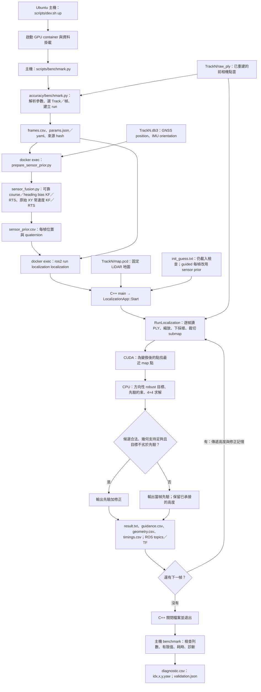
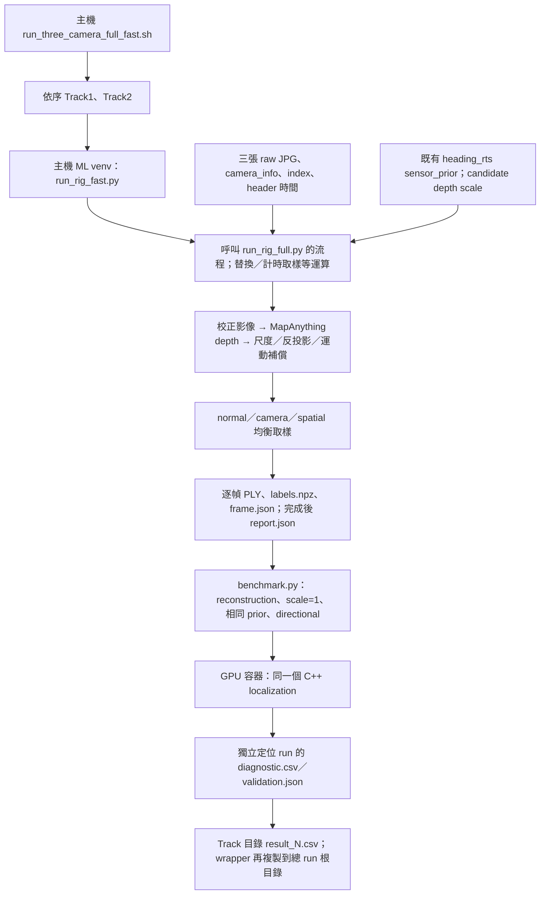

# 01｜程式架構圖與完整演算法流程

核對日期：2026-10-18（Asia/Taipei）。本文直接對照目前 checkout 的 Python、C++、CUDA、Compose 與既有輸出，從「輸入命令」一路解釋到「產生 CSV」。只整理與讀取證據，沒有重新執行定位。

**先抓住主線：平常從 Ubuntu 主機執行 `scripts/benchmark.py`，Python 先準備每幀 GNSS／IMU 先驗，再透過 `docker exec` 執行容器裡的 C++ `localization`。C++ 逐幀把影像點雲放到 LiDAR 地圖中，寫出矩陣；Python 最後檢查矩陣並產生 CSV。**

本 GPU 程式沒有作為定位入口的 `localization.py`。你看到的是 `localization.launch.py`：它是另一條 ROS 啟動路徑，負責設定參數、啟動同一個 C++ 程式。日常 benchmark **不經過它**。

閱讀本文後，再依 [28｜文件目錄與舊名對照](28_DOCUMENTATION_INDEX.md) 找歷史；實際操作命令集中在 [08｜操作手冊](08_MANUAL_WORKFLOW.md)。

2026-10-19 補充：[32｜高度漂移分析](32_HEIGHT_DRIFT_ANALYSIS_20261019.md) 新增實驗 `--height-mode anchored`，約束 Z 的總 offset 並分開記錄 `height.csv`。本文已評分主流程仍使用預設 `carry`；新候選的短測貼合未一致改善，沒有取代最佳。

同日後續 [33｜幾何高度／姿態參考](33_SURFACE_HEIGHT_REFERENCE_20261019.md) 在原 sensor prior 之外，另產生 `height_reference.csv`；`surface_tilt` 可提供保留 yaw 的有界幾何 roll／pitch。它是新的實驗分支，原已評分的固定 IMU roll／pitch／carry 主線保留。

此分支已補通用完整入口：`benchmark.py --track N --full --profile sensor_guided --sensor-fusion heading_rts --geometry-mode directional --height-mode surface_tilt`。未指定歷史 prior／cache 時，由原始 bag／map 在新 output 建立先驗與 0.3 m 高度 map，再定位；不依賴特定舊 run。`--full` 與顯式 `--frames` 互斥，預設仍只跑 50 幀；完整測試由使用者手動啟動。

後續高度候選 Track1 1.15519 未勝原最佳；[34｜位置先驗與水平觀測](34_POSITION_PRIOR_AND_HORIZONTAL_UPDATE_20261019.md) 改為原姿態／carry／directional、只換位置模型的 motion_rts 消融。GNSS 留段、864 筆短段與通用入口等價檢查已完成，後續使用者完整回報 **1.15008／0.30488**，motion_rts 已升為最佳，見 [35](35_MOTION_RTS_AND_GNSS_HEADING_20261019.md)；視覺／立面／外參檢查未通過，沒有新增 joint solver。程式預設不變；GNSS orientation 新實驗尚未升為最佳。

後續 [36｜配準與融合升級](36_REGISTRATION_AND_FUSION_UPGRADE_20261019.md) 新增實驗 `--geometry-mode gicp`：同 prior／四自由度，兩邊局部平面 covariance 的 robust cost；原 directional 完全保留。另完成 `kinematic_graph.py` 研究原型，聯合 GNSS／raw gyro／側向速度模型，尚未接入 production sensor-fusion 或 map factors。兩條留段沒有一致改善，不升為最佳。

2026-10-19 水平 map／joint 新分支見 [37｜細 map 水平觀測與跨幀聯合估計](37_HORIZONTAL_SURFEL_JOINT_20261019.md)。`--horizontal-refinement surfel_joint` 已接入通用 benchmark，0.3 m surfel／空間與時間留出／raw GNSS＋gyro＋map 平面聯合模型已有實作與短測。真實 8 組短段尚無可靠 map factor，輸出保留原 bytes；不能宣稱精度進步。預設／最佳不變，完整候選命令及未確認外參見 37。

## 1. 先看整張架構圖

2026-10-20 本輪 [39｜航向與stereo尺度](39_HEADING_AND_STEREO_SCALE_20261020.md) 新增 `turn_heading_rts`：raw GNSS block 對齊積分 IMU 方向的線性車速，取代原 course factors 再進 bias RTS；`pose_yaw` 直接換用 GNSS Pose yaw，保留同 motion XY／IMU tilt。原前相機 stereo 推導的 scale=7.404260939740923 已透過原 `--ply-scale` 實際進入 C++ 配準短測；full 通用命令見16。下圖仍描述已評分 scale3／motion_rts 主線，新版本沒有新 Kaggle 分數，程式預設保留。

2026-10-20 的來源層研究見 [38｜跨幀剛體一致性與尺度](38_SOURCE_RIGIDITY_AND_SCALE_20261020.md)：新增獨立於定位主流程的 RGB vertex 對應、剛體／相似模型與共用尺度診斷。已完成 96 對真實來源檢查與 16 場景 map 對照；沒有新 pose／可靠 factor 或精度改善證據，下面已評分主流程的 source scale=3／solver 不變。

目前已有 Kaggle 成績的前相機流程，明確指定三個選項：

```text
--profile sensor_guided --sensor-fusion motion_rts --geometry-mode directional --height-mode carry
```



若編輯器沒有顯示 Mermaid，依下面的文字順序讀即可：

```text
主機 dev.sh up
  → 主機 benchmark.py → accuracy/benchmark.py
  → 容器 Python：bag + frames.csv → sensor_prior.csv
  → 容器 C++：map + 每幀 PLY + prior → result.txt
       每幀內部：CUDA 最近鄰 ↔ CPU 四自由度最佳化
  → 主機 Python：result.txt → diagnostic.csv + validation.json
```

這張圖描述的是目前最佳 `sensor_guided + motion_rts + directional + carry`；下文保留 heading_rts 的觀測推導。程式省略選項仍預設 `legacy + fixed + off`；`legacy` 使用不同配準流程，見第 12 節。

## 2. 這套程式到底在求什麼？

每幀的影像重建點雲是「這一刻，相機周圍看見的三維形狀」；LiDAR 地圖是固定的大範圍三維參考。任務是求出這幀點雲放進地圖的位置與朝向。

用一個 4×4 的矩陣表示：

$$
T_{map\leftarrow source}=
\begin{bmatrix}R&t\\0&1\end{bmatrix},\qquad
p_{map}=R(s\,p_{raw})+t.
$$

- `p_raw`：PLY 裡的一個三維點。
- `s`：`ply_scale`，前相機流程沿用 3；不是本次證明正確的尺度校準。
- `R`：點雲座標到地圖座標的旋轉。
- `t=[x,y,z]`：點雲原點在地圖的位置。
- `pose`：程式對這個旋轉＋平移的統稱；不是只有 x、y。

每一幀都求一個 `T`，排起來就是 trajectory。地圖不會被逐幀改寫，這裡是對既有地圖做 localization。顏色 RGB 用於發布顯示，配準目標使用 XYZ 幾何。

程式發布的 source frame 名稱是 `image_point_cloud`。是否能把其原點直接當成官方要求的車體參考點，仍需對照正式 frame 契約；不能自行再乘一次外參或初始矩陣。

## 3. 主機、container、檔案與執行檔的關係

container 提供 ROS 2 Humble、PCL、CUDA 等執行環境；它不是定位演算法本身。以下是同一批檔案的兩套名稱：

| Ubuntu 主機 | GPU container | 用途 |
| --- | --- | --- |
| `midterm01_gpu/workspace` | `/root/midterm` | C++／CUDA 原始碼、build、install |
| `midterm01_gpu/scripts` | `/root/scripts` | Python／shell 工具，容器唯讀 |
| `midterm01/data` | `/root/data` | 共用原始資料，容器唯讀 |
| `midterm01_gpu/outputs` | `/root/outputs` | 新 run 與結果，讀寫 |

例如主機的 `midterm01_gpu/outputs/run/ABC/result.txt`，在 GPU 容器內叫 `/root/outputs/run/ABC/result.txt`。它們是同一個檔案，不是執行後另做一次複製。CPU 容器的 `/root/outputs` 則對應另一個主機目錄。

### 3.1 啟動與進入 container 各做什麼

以下命令在 **Ubuntu 主機** 執行：

```bash
cd /home/ricky/sdc_ros2/midterm01_gpu
bash scripts/dev.sh up
```

[`dev.sh`](../scripts/dev.sh) 組合 `docker-compose.yml` 與 GPU CDI overlay，啟動 `sdc_midterm01_gpu` project 的 `midterm01_gpu` service。`up -d --no-build` 是啟動環境；此時還沒有開始跑 Track。

```bash
bash scripts/dev.sh shell
```

這才是打開容器 shell，預設工作目錄 `/root/midterm`。單純進入 shell 同樣不會自動定位。日常 benchmark 是主機工具，內部會呼叫 Docker，因此通常留在主機執行它；若已進入容器，可以 `exit` 回主機。

### 3.2 原始碼如何變成可執行程式

修改 C++／CUDA 後，在主機呼叫：

```bash
bash scripts/dev.sh build-workspace --packages-select cuda_ndt_backend localization
```

呼叫鏈是：

```text
dev.sh build-workspace
  → docker compose exec -T midterm01_gpu
  → 容器 /root/scripts/build_workspace.sh
  → source /opt/ros/humble/setup.bash
  → colcon build（Release）
  → CMake 編譯／連結
  → workspace/install 裡的 executable 與 library
```

[`localization/CMakeLists.txt`](../workspace/src/localization/CMakeLists.txt) 明確把三個來源編成一個 `localization` executable：

```cmake
add_executable(localization src/localization.cpp src/sensor_guided.cpp src/geometry_weighting.cpp)
```

它連結 `cuda_ndt_backend` library。容器裡實際執行檔的位置為：

```text
/root/midterm/install/localization/lib/localization/localization
```

因此 `ros2 run localization localization` 的第一個 `localization` 是 package 名，第二個是 executable 名。`sensor_guided.cpp` 與 `geometry_weighting.cpp` 是連結進這個程式的函式，不是接著再啟動的兩個獨立程式。

`source /opt/ros/humble/setup.bash` 讓 shell 找到 ROS；`source /root/midterm/install/setup.bash` 讓它找到本 workspace 安裝的 package。修改 `.cpp` 但沒有重編，執行的仍是舊 binary。只改 Track／幀數不用重編；只改 Python 通常也不用重編 C++。

## 4. 第一步：主機 Python 建立這一輪實驗

以「Track1 前 50 幀、已評分方法」為例，使用者在主機輸入：

```bash
python3 scripts/benchmark.py --track 1 --frames 50 \
  --profile sensor_guided --sensor-fusion heading_rts --geometry-mode directional
```

最外層 [`scripts/benchmark.py`](../scripts/benchmark.py) 只有 import 與呼叫 `main()`；真正工作在 [`scripts/accuracy/benchmark.py`](../scripts/accuracy/benchmark.py)。它按下面順序做事：

1. **解析與檢查參數。** Track 只能 1／2；frames 必須為正整數。`sensor_guided` 未另外指定 backend 時，選 `cuda_robust_icp`。前相機未指定尺度時選 3。
2. **讀 Compose 的實際設定。** 找出容器名稱與 `/root/data` 掛載來源，避免猜主機資料路徑。若容器已有 `localization` 程序，拒絕開第二輪。
3. **若明確指定 map cache，核對身分。** 比對 Track、原 map SHA256、1 m leaf sidecar；預設不使用 cache。
4. **掃描輸入 PLY 第一層。** 從 `_ts_<正整數奈秒>` 解析時間，依時間排序。`--start-frame 0 --frames 50` 選前 50 幀；還沒載入每個 PLY 的點座標。
5. **建立唯一 run。** 位置是 `outputs/run/<名稱>_YYMMDDHHmm`，時間用台北時區；同分鐘重名加 `_2` 等。終端印出的 `Run:` 是主機路徑。
6. **保存輸入契約。** `source_input.json` 記原始 idx、timestamp、檔名、PLY SHA256、來源與尺度；實驗來源另存來源報告。
7. **產生 `params.json`／`params.yaml` 與 `frames.csv`。** 前者是實際交給 ROS node 的參數；後者是這輪影格順序。JSON 格式也可作合法 YAML 傳給 ROS。
8. **保存 Python 與 C++ 來源快照等重現資訊，準備感測器先驗。** 細節在下一節。

`frames.csv` 形狀如下；這裡是示意，timestamp 不是實際資料：

```csv
idx,timestamp_ns,filename
0,1000000001,000000_ts_1000000001.ply
1,1036000001,000001_ts_1036000001.ply
```

這個 `idx` 是本輪從 0 開始的順序。若使用 `--start-frame` 做中間短段，原序列的 idx 另保存在 `source_input.json`，局部 CSV 不能直接當完整提交。

參數有三個不同層次，名稱很像但用途不同：

| 參數 | 本流程值 | 意義 |
| --- | --- | --- |
| `--profile sensor_guided` | 使用先驗引導 | 決定整體定位流程 |
| `--sensor-fusion heading_rts` | heading bias KF／RTS | 決定先驗如何由 bag 產生 |
| `--geometry-mode directional` | 方向性 map 殘差 | 決定地圖細修的目標 |
| `--cloud-source front` | 預設 | 決定輸入哪一批 PLY |
| `--frames 50` | 50 筆 | 決定處理多少幀，不是迭代 50 次 |

## 5. 第二步：bag → 每幀感測器先驗

尚未開始配準，benchmark 先在容器執行一個 Python 前處理。呼叫形式如下，`<run>` 代表這輪實際目錄：

```text
docker exec <GPU容器> bash -c
  source /opt/ros/humble/setup.bash
  → python3 /root/scripts/prepare_sensor_prior.py
      --bag /root/data/Track1/Track1.db3
      --frames /root/outputs/run/<run>/frames.csv
      --output /root/outputs/run/<run>/sensor_prior.csv
      --fusion heading_rts ...
```

### 5.1 讀哪些感測器？

[`prepare_sensor_prior.py:load_bag()`](../scripts/prepare_sensor_prior.py) 用唯讀 SQLite 直接讀 `.db3`，透過 ROS 訊息反序列化取得：

| bag topic | message type | 真正使用的數值 |
| --- | --- | --- |
| `/localizer_node/gnss_pose` | `geometry_msgs/msg/PoseStamped` | position x、y、z；實驗 pose_heading_rts／independent_heading_rts 才加讀 orientation |
| `/imu/data` | `sensor_msgs/msg/Imu` | orientation quaternion qx、qy、qz、qw |

這個流程沒有積分 raw acceleration 或 gyro 來算位置。GNSS 是有誤差的輸入，不是評分真值。前處理直接讀完整 bag 的這兩個 topic，再查詢所選 PLY 的時間；因此只跑前 50 幀，heading 平滑仍可能利用較晚的可靠觀測，這是離線方法。

定位先驗使用 **bag timestamp**，不需要 `ros2 bag play` 逐訊息播放。時間先以整數奈秒相減，再轉相對秒數做插值，避免大 timestamp 直接轉 float 失去精度。

### 5.2 位置怎麼同步？

`make_priors()` 先對 GNSS x、y、z 使用 **5 筆觀測、二次 Savitzky–Golay** 平滑，再線性插值到每個 PLY 時刻。例如 PLY 時刻在兩筆 GNSS 之間，就依時間比例取位置，不是直接拿上一筆位置不動。

程式也檢查資料覆蓋：GNSS 間距不得超過 0.6 s，序列端點只允許最多 0.3 s 的等速度外推。這些是輸入檢查與邊界規則，不能解讀為精度保證。

### 5.3 方向怎麼同步？

先檢查 IMU quaternion 是否有限且接近單位長度，再用 **SLERP** 插值旋轉。它是旋轉空間的插值；直接把 yaw 數值平均，在 +179°／−179° 交界會出錯。

IMU 資料間距限制為 0.05 s；查詢超過端點最多容許 0.03 s，這小段使用端點方向。位置外推與方向端點規則不同。

### 5.4 heading_rts 的 Kalman filter 在哪裡？

[`sensor_fusion.py`](../scripts/sensor_fusion.py) 的 `heading_observations()` 與 `bias_rts()` 負責這一段。它估的是慢變 heading 偏差 `b(t)`：

$$
\psi_{prior}(t)\approx\psi_{IMU}(t)+b(t).
$$

GNSS 一小段移動的速度方向叫 course。車輛高速近直行時，course 可提供 heading 偏差的觀測；低速、轉彎或倒車等情況，這個近似容易失效。

實際順序如下：

1. 把原始 GNSS 分成互不重疊的 2 s 區塊，在每塊做 robust 直線速度擬合。
2. 只接受足夠樣本、速度 >5 m/s、轉向率 <2°/s、heading 範圍 <4°、course／IMU 差 <15° 等條件都合格的區塊。
3. 形成 `z_k = wrap(course_k − IMU_yaw_k)`。不把約 28 Hz 的影格插值當成 28 Hz 獨立 GNSS 觀測。
4. 用 random-walk 模型 `b_k=b_(k−1)+w_k` 做一維 Kalman filter：先預測偏差，再依觀測可信度更新；innovation 太大時降權。
5. 用 RTS backward smoother 從後往前修正估計，讓先前的 bias 也參考較晚的可靠觀測。
6. 限制 bias 在 ±10° 內、變化率不超過 0.2°/s，再插值到 PLY 時刻。
7. 用 map Z 軸旋轉左乘 SLERP 後的 IMU rotation，得到先驗 orientation。

可靠區塊不足 3 個時，明確退回原 `fixed` bias。先前估出的固定中位 bias 在 heading_rts 正常運作時只是參考，不會被當成另一筆獨立量測重複更新。

**heading_rts 的位置仍是上一小節的 GNSS 平滑＋插值。** 另一個 `motion_rts` 選項才額外對 `[x,y,vx,vy]` 做位置／速度 KF＋RTS，後續完整分數為 1.15008／0.30488（35）；兩者成績分開記錄。新增 pose_heading_rts／independent_heading_rts 也使用相同 motion XY，只改 bias 觀測。地圖細修也不是把完整車輛狀態送入 EKF 更新。

### 5.5 這階段輸出什麼？

| 檔案 | 內容／下一步用途 |
| --- | --- |
| `sensor_prior.csv` | `timestamp_ns,x,y,z,qx,qy,qz,qw`；C++ 逐幀定位的輸入 |
| `sensor_prior.json` | 時間、樣本 hash、融合設定、假設與診斷 |
| `sensor_prior.fusion.csv` | 每幀 bias、模型不確定度等；診斷用 |
| `sensor_prior.heading_blocks.csv` | 每個 course 區塊是否接受及原因 |
| `sensor_preparation.log` | Python 前處理 log |

`--prior-run` 是另外一個分支：依 timestamp 從同 Track／fusion 的既有 run 複製完全相同的 sensor priors，而不重新讀 bag 計算。它重用的是感測器先驗，不是前一輪地圖配準後的答案；三相機公平對照用這個機制。

## 6. 第三步：真正啟動 C++ localization

先驗準備成功後，benchmark 建立並執行以下命令：

```text
docker exec <GPU容器> bash -c '
  source /opt/ros/humble/setup.bash &&
  source /root/midterm/install/setup.bash &&
  exec ros2 run localization localization --ros-args
    --params-file /root/outputs/run/<run>/params.yaml
'
```

實際完整命令存到 `command.sh`。同時保存 Git commit、未提交 diff、來源快照／hash、binary hash、container 設定，啟動 `nvidia-smi` 取樣，並把 C++ 終端輸出寫入 `run.log`。

[`localization.cpp`](../workspace/src/localization/src/localization.cpp) 的呼叫順序是：

```text
main(argc, argv)
  → 建立 LocalizationApp
  → Start(argc, argv)
      → rclcpp::init，建立 image_point_cloud_localizer node
      → LoadParameters()
      → SetupRegistration()
      → SetupRosInterfaces()
      → 開啟 result.txt
      → IndexPlyFiles()
      → LoadMap()
      → RunLocalization()
      → 關閉結果；keep_alive=false 時直接 Shutdown()
```

`SetupRegistration()` 選後端並檢查 CUDA 環境；`cuda_robust_icp` 不建立舊 NDT 最佳化器。`SetupRosInterfaces()` 建立 publishers／TF，並不表示必須開 RViz。

### 6.1 map 與 PLY 何時讀？

`IndexPlyFiles()` 先建立檔名／時間清單，沒有把全部 PLY 點雲一次讀入記憶體。`LoadMap()` 在逐幀迴圈之前讀一次 map，沒有 cache 時對 map 做 1 m voxel 下採樣；有明確且已核對的 cache 時讀取衍生 PCD。

影像 PLY 則在每幀進入迴圈後才讀，因此 Track 數千幀不等於一次把數千個 source cloud 全部載入。

### 6.2 init_guess.txt 在新版還有用嗎？

`RunLocalization()` 仍先呼叫 `LoadInitialPose()`，所以 `init_guess.txt` 必須能讀取並通過檢查。但是 guided 模式進入每幀時，立刻改用對應的 `sensor_priors_[k]`。

因此，**不是先把每個 raw 點乘 init_guess，再乘 sensor prior**。第一幀 map 配準的先驗也不是固定沿用 init_guess；它由當幀感測器提供。legacy 才把 init_guess 當成第一幀追蹤初值。

`LoadSensorPriors()` 核對 CSV 的每個 timestamp、數值與預期幀數，轉成 4×4 矩陣。guided 不走舊 `OpenDB3File()` 逐幀取訊息的路徑；`params.json.bag_path` 為空，是因為 Python 已完成 bag 前處理，不是沒用 GNSS／IMU。

## 7. 第四步：C++ 每一幀的處理順序

把第 k 幀想成一次「感測器給大致位置，點雲提供局部修正」：

1. **取得當幀先驗。** XY 與完整方向來自 `sensor_prior.csv`；第 0 幀 Z 也是 GNSS prior。第 1 幀起，Z 改用上一幀已輸出的高度，因為本資料 GNSS altitude 是常數。
2. **`LoadPlyFrame()` 讀當幀 PLY。** 同時取得 XYZ 與 XYZRGB，檢查非空與點數一致。
3. **`ScalePlyPointCloud()` 乘尺度。** 前相機為 3；已校正三相機 reconstruction 必須用 1。
4. **`FilterInputCloud()` 前處理。** 刪非有限點，用 0.3 m voxel 下採樣。Voxel 是空間分格，這裡用來減點數，不代表在做 NDT。
5. **`CropSubmap(prior)` 裁局部地圖。** 以當幀 prior 為中心，map 軸向 XY 各 ±100 m、Z ±30 m；整體盒子為 200×200×60 m。空 submap 是錯誤，直接停止。
6. **呼叫 `RefineSensorGuided()`。** 這是當前方法的核心，詳見下一節。`cuda_robust_icp` 不先跑 `AlignNDT()`。
7. **接受候選或返回 prior。** 接受時輸出修正後的 pose；拒絕時仍輸出這幀 prior，修正量重設 0。這個 prior 的 Z 已包含步驟 1 的高度承接。
8. **發布與寫檔。** `PublishFrame()` 發點雲／TF／pose／path；`WritePose()` 寫一行矩陣並 flush；另寫 guidance、geometry、timings。
9. **進到下一幀。** 保存高度與 correction 記憶，但下一幀 XY／方向又會重新取得當幀感測器先驗。

例如車在移動而地圖細修被拒絕時，下一幀仍會由 GNSS／IMU 帶到新位置；不會因為這幀沒配準成功，就把上一個位置靜止複製下去。這是新版避免舊追蹤器一路偏離的關鍵之一。

## 8. 第五步：RefineSensorGuided 到底算什麼？

核心在 [`sensor_guided.cpp:RefineSensorGuided()`](../workspace/src/localization/src/sensor_guided.cpp)。它是「帶感測器先驗的 bounded robust ICP」，目前再加上 directional map 殘差。

### 8.1 四自由度是哪些？

只求先驗附近的修正：

$$
\delta=[\delta x,\delta y,\delta z,\delta\psi]^T,\qquad
u_i(\delta)=R_z(\delta\psi)R_0p_i+t_0+\delta t.
$$

`R0,t0` 是當幀 prior，`p_i` 是已縮放 source。roll／pitch 使用 IMU 給的值；最佳化不開放它們自由翻轉。Z 仍能修正，所以是四自由度，不是只估 XY／yaw 的三自由度。

### 8.2 CPU 與 GPU 怎麼互相工作？

先在 submap 內再找出所有合法修正可能用到的候選 map 點，移到 prior 附近的局部原點，降低公里級 float 座標的精度問題。候選範圍考慮 XY／yaw／Z 修正界限與 2 m 配對範圍。

每次評估候選 pose 時：

```text
CPU：用候選 R、t 變換 source 點
  → 傳 query 座標給 GPU
GPU：每個 query 找最近 map 點的 index
  → 把 index 傳回 CPU
CPU：計算殘差、robust cost、Jacobian、Hessian 與更新量
  → 嘗試新候選，再呼叫 GPU 搜尋
```

[`nearest_neighbor.cu:NearestKernel()`](../workspace/src/cuda_ndt_backend/src/nearest_neighbor.cu) 對每個 query 用一個 block、256 threads，分攤候選 map 點距離計算，再 reduction 取最小值。這是候選集合的完整搜尋，不是 GPU KD-tree，也不是 NDT。

CPU 留下的是小型 4×4 求解與權重／幾何邏輯。directional 的 map 鄰域 KD-tree／PCA 也在 CPU，實作於 [`geometry_weighting.cpp`](../workspace/src/localization/src/geometry_weighting.cpp)。

### 8.3 為什麼用表面方向？

只看最近點的歐氏距離，會把「沿牆面滑一點」與「穿過牆面」視為同樣的錯誤。但牆面通常更能約束法向位置，沿平面方向的對應不一定可靠。

`SurfaceGeometryCache::At()` 找 map 點的局部鄰域，對 covariance 做 PCA。最小特徵值對應的方向是表面 normal `n`；會拒絕太少鄰點、線狀或太厚的鄰域，並以 planarity 建立 confidence `c`。

方向性 metric 是：

$$
M=nn^T+0.05(I-nn^T),\qquad
d_{directional}=\sqrt{r^TMr}.
$$

沿 normal 的殘差完整保留，沿平面切向的平方權重是 0.05。道路平面大多約束高度，不能只因地面點多，就推論 XY／yaw 一定準；不同方向的側面幾何才可能補充約束。

### 8.4 目標函數有兩部分

先驗正則化的部分是：

$$
E_{prior}(\delta)=\frac12\left[
\frac{\delta x^2+\delta y^2}{0.5^2}
+\frac{\delta z^2}{1.0^2}
+\frac{\delta\psi^2}{(3\pi/180)^2}
\right].
$$

它的意思是：幾何必須提供足夠理由，才能把答案從 prior 拉遠。0.5 m、1 m、3° 是設計的正則化尺度，並非已用真值標定的感測器 covariance。

地圖部分使用 Huber loss：距離 ≤0.5 m 時是平方誤差，較大時改成線性成長，減弱壞點影響；歐氏距離超過 2 m 的對應，不提供更新梯度，但保留固定 cost。

更精確地說，令 `U=ρ(2)`，可靠且歐氏距離 ≤2 m 的對應使用：

$$
\ell_i=2\left[U-c_i\{U-\rho(d_{directional,i})\}\right],\qquad
E=E_{prior}+\frac{1}{N(0.3)^2}\sum_i\ell_i.
$$

其中 `2` 是 `normal_gain`；不可靠或超出配對範圍的點令 `c_i=0`，保留 `2U`。因此移到低 confidence／沒有配對的位置，不會只靠刪除壞對應就降低 cost。地圖項除以 source 點數 N，增加點數不等於任意放大地圖總權重。

`geometry=off` 的歷史版本使用等向點到點 Huber 殘差；不能把舊公式當成現行 directional 完整公式。完整設計見 [15｜方向性配準](15_GEOMETRY_DIRECTIONAL_20261017.md)。

### 8.5 怎麼解這四個未知數？

每輪固定當下最近鄰，CPU 建立殘差對修正的 Jacobian：

$$
J_i=\begin{bmatrix}
1&0&0&-v_{i,y}\\
0&1&0&v_{i,x}\\
0&0&1&0
\end{bmatrix},\qquad v_i=R_z(\delta\psi)R_0p_i.
$$

前三欄是平移的影響，第四欄是繞 Z 軸小角度旋轉的影響。加上 robust／directional 權重與先驗後，形成 4×4 的 Hessian 近似 H 與 gradient g，解 `step = −H⁻¹g`；實作使用 Eigen LDLT，不是先顯式求 inverse。

流程從零修正開始；上一幀 correction×0.8 只是另一個初值候選，必須讓當幀 cost 更好才採用。核心最多迭代 15 輪，每輪平移步長最多 0.25 m、yaw 步長最多 2°，再最多 8 次折半線搜尋。新步必須降低同一個目標且符合界限。

這些 15／8 是細修內部次數；`params.json` 裡保留的 `ndt_max_iterations=30` 屬 NDT 參數，不控制此 robust solver 的 15 輪。

### 8.6 平滑、門檻與 fallback

求出修正後，先嘗試：

```text
smoothed = 0.75 × previous_correction + 0.25 × current_correction
```

平滑的是小量修正，不是直接把整台車的移動位置拿來慢慢平均。若平滑後超界或比零修正 prior 更差，改試當幀求得的修正。

接受條件包括：

| 檢查 | 目前規則 |
| --- | --- |
| 相對 prior 的 XY 修正 | 二維距離 ≤1.5 m |
| 相對高度 prior 的 Z 修正 | 絕對值 ≤1.5 m |
| 相對 heading prior 的 yaw 修正 | 絕對值 ≤8° |
| 對應數 | 歐氏距離範圍內至少 10 點 |
| directional 幾何支持 | 至少 10 個 reliable 對應、6 個不同 map target |
| cost | 有限，且不劣於零修正 prior（容許數值容差） |

接受時 `R=Rz(δyaw)R0`、`t=t0+δt`；拒絕時輸出 prior、correction=0。沒有因拒絕就漏掉這幀。

**地圖候選被拒絕與 CUDA 執行錯誤不同。** 前者有明確原因並輸出 prior；後者丟出 exception、中止 run，不靜默切換 CPU。`guidance.csv.update_status` 記錄判定原因。

## 9. 第六步：C++ 寫出什麼？Python 又做什麼？

### 9.1 result.txt 的一行

`WritePose()` 把 4×4 pose 的前三列攤平，寫 12 個數值：

```text
R00 R01 R02 tx R10 R11 R12 ty R20 R21 R22 tz
```

最後一列 `[0,0,0,1]` 不寫，timestamp 也不寫。每讀取處理一幀就寫一行，對應 `frames.csv` 的順序。每次 flush 有助保留中斷前結果，但部分結果仍不能當完整提交。

### 9.2 ROS 發布什麼？

| 輸出介面 | 內容 |
| --- | --- |
| `/image_point_cloud` | 當幀已縮放／下採樣的 source，frame 為 image_point_cloud |
| `/image_point_cloud_submap` | 局部 LiDAR map，frame 為 map |
| TF `map → image_point_cloud` | 估計的 pose transform |
| `/transformed_image_point_cloud_pose` | 當幀 PoseStamped |
| `/localization_path` | 到目前為止累積的 path |
| `/map_pc` | 可選全局地圖；benchmark 預設不發布 |

RViz 是讀這些訊息的顯示器，不負責計算 pose。benchmark 沒開 RViz，程式仍會發布逐幀訊息。`keep_alive=false` 讓批次做完就退出。2026-10-19 另加入 `scripts/replay.py` → C++ `replay_localization`，直接讀已保存的 pose／來源點雲，在獨立 `/replay/*` topics 與 `map → replay_source` TF 重演；不重新執行本章的定位流程。[30｜回放與座標朝向](30_RVIZ_REPLAY_20261019.md) 記操作、座標及時間契約。

### 9.3 benchmark 直接轉 CSV，不再呼叫另一個轉檔程式

C++ 退出後，主機 Python 讀 `result.txt`，檢查每行恰有 12 個有限數值、行數是否等於 frames，以及程序退出碼。然後直接在 benchmark 內寫 `diagnostic.csv`：

```python
x = values[3]                    # tx
y = values[7]                    # ty
yaw = math.atan2(values[4], values[0])  # atan2(R10, R00)
```

所以 CSV 是：

```csv
idx,x,y,yaw
```

`idx` 從 0 開始，yaw 是 radians。獨立的 [`txt_to_idx_x_y_yaw.py`](../workspace/src/localization/processing_codes/txt_to_idx_x_y_yaw.py) 是另行轉既有 TXT 的工具；日常 benchmark 沒有再呼叫它。CSV 不保留 Z／roll／pitch，但原始 TXT 有完整旋轉和平移。

### 9.4 一個 run 內的檔案如何分工？

| 檔案 | 誰產生 | 用來回答什麼 |
| --- | --- | --- |
| `frames.csv`、`source_input.json` | benchmark | 哪幀、哪個時間、原始來源／尺度？ |
| `params.json`／`params.yaml` | benchmark | C++ 實際收到什麼參數？ |
| `sensor_prior.csv`／`.json` | 前處理或 exact reuse | 地圖配準之前的答案與設定？ |
| `sensor_prior.fusion.csv`／`.heading_blocks.csv` | sensor fusion 或 reuse | bias 如何估、哪些 course 可靠？ |
| `result.txt` | C++ | 每幀最終矩陣是什麼？ |
| `diagnostic.csv` | benchmark | 從最終矩陣擷取的 idx,x,y,yaw？ |
| `guidance.csv` | C++ | prior 到輸出的修正、接受／拒絕原因？ |
| `geometry.csv`／`geometry_config.json` | C++ | 地圖表面支持與弱方向？ |
| `timings.csv` | C++ | 每幀讀取、filter、crop、配準與發布時間？ |
| `validation.json` | benchmark | 退出碼、筆數、有限值、診斷是否通過？ |
| `run.log`、`sensor_preparation.log` | Python 收集 | 程序在哪一步失敗／警告？ |
| `command.sh`、`sensor_command.json` | benchmark | 實際怎麼呼叫？reuse 時沒有新的前處理命令 |
| `git_commit.txt`、`worktree.patch`、來源快照／SHA256、`binary_sha256.txt` | benchmark | 能否追到相同程式？ |
| `gpu_samples.csv`、`container.json` | benchmark | 當時 GPU／容器條件？ |

geometry CSV 描述**最終輸出 pose**；若候選被拒絕，裡面是 prior 的幾何。分析被拒候選要看 guidance 的 `candidate_*` 與 `update_status`，不能由 geometry CSV 反推候選。

`timings.csv.ndt_ms` 沿用歷史欄名，現在實際量的是 CUDA 搜尋＋CPU 細修，`fitness_ms=0`。`pipeline_elapsed_seconds` 包含感測器前處理＋ROS 執行；版本保存、來源 SHA256、cache 核對與建置另計。從 raw JPG 重建三相機的時間也不會自動算進這個 benchmark 計時。

### 9.5 哪個結果能拿去提交？

先看 validation 的 `returncode=0`、`output_complete_and_finite=true`、`validation_errors=[]`、`submission_frame_set_complete=true`，並核對 Track1／Track2 分別 3011／3299 筆資料列。50 幀或中間短段只有診斷用途。

一般 benchmark 的 CSV 叫 `diagnostic.csv`，不會自動改名 `result_1.csv`，也不會自動提交或更新每個 `latest_*` 指標。三相機 wrapper 會在完整結果通過後另外複製成 `result_1.csv`／`result_2.csv`，如下節。

這些檢查確認程式與格式完整，不能證明定位精度、官方 body frame／單位契約都正確；正式精度仍需要評分證據。最新已評分前相機分數紀錄在 [35](35_MOTION_RTS_AND_GNSS_HEADING_20261019.md)，[17](17_GEOMETRY_RESULTS_20261017.md) 保留歷史。

## 10. 你目前查看的三相機 result_2.csv 從哪裡來？

這是另一條**先從 raw JPG 重建，再接上同一套定位器**的實驗。相對於前相機流程，它主要更換 source cloud；不是換成另一個三相機 C++ solver。



### 10.1 實際呼叫順序與運算位置

```text
Ubuntu 主機：bash scripts/run_three_camera_full_fast.sh [--resume <run>]
  → 主機 outputs/ml_runtime/venv/bin/python scripts/run_rig_fast.py
      → import run_rig_full as reference
      → 用加速 rectifier／sampling 包住 reference.run(args)
      → 完成一條 Track 重建後呼叫 scripts/benchmark.py
          → exact reuse 既有 sensor_prior
          → Docker 裡的 C++ localization
      → 複製定位 CSV 到 <總run>/trackN/result_N.csv
  → wrapper 複製到 <總run>/result_N.csv
  → 再處理下一條 Track
```

MapAnything／PyTorch 在**主機獨立 ML venv**，不是 ROS 容器 Python。重建與定位雖都用 GPU，卻分別處於主機 ML runtime 與 ROS container；wrapper 依序執行，沒有每一張 JPG 推論完就立刻跑一次 localization。

原 `run_three_camera_full.sh` 直接用 `run_rig_full.py`；fast 入口保留相同算法與門檻，加速 voxel 排序、PCA、均衡取樣及校正 remap。加速一致性的已測範圍見 [25](25_RIG_PERFORMANCE_20261018.md)，不能把局部取樣倍率當整套速度倍率。

### 10.2 每一組 raw 三相機做什麼？

1. 讀 index 找同組前／左／右 JPG，核對每張原始影像與校正檔 hash。
2. 從 bag 對應每台 camera 的 header 時間。前 index 原本是 bag 時間、左右是 header 時間，不能直接相減混用。
3. `rectify()` 使用 fisheye 校正、mask，產生 448×294 影像與相應 intrinsics。
4. `PriorTrajectory` 用相同 sensor_prior 與 rig 外參估逐相機曝光時刻的 pose，作 motion compensation。首尾只明確容許最多 30 ms 外推；這不改定位先驗的原規則。
5. MapAnything 載入本地 checkpoint，在 GPU 做三視角深度推論，保留逐 view 的 depth、confidence、mask；預設不把 dense depth 寫到硬碟。
6. 以 candidate `depth_scale=0.67398047…` 縮放 camera depth，按 intrinsics 反投影成相機三維點；**baseline／rig 平移不跟著縮放**。
7. 用固定 rig pose 與逐 camera motion pose 變換，合併成前相機 FLU，對齊前相機 bag timestamp 的參考時刻。這裡已做軸與外參處理，後面的 solver 不重套。
8. 用 valid mask、confidence、有限值與原深度距離範圍等條件篩點，再做 normal／camera／spatial 均衡取樣，預算 6000 點。
9. 寫 PLY、`labels.npz` 與 `frame.json` 到暫存 frame 目錄；完成後原子 rename 成正式 frame，續跑只採信通過 hash 的已完成幀。
10. 整條 Track 完成後建立 `report.json`、`completion.json`，再用 `--cloud-source reconstruction --ply-scale 1 --source-report ... --prior-run ...` 呼叫 benchmark。

左右相機相對前相機的固定高度由校正檔保留，但不假設未知的車體離地高度；map 全局 Z 仍可隨道路變化。此尺度候選的跨場景驗證未通過，所以目前是實驗，沒有因為做了校正就證明比前相機準。

### 10.3 檔案樹與這次實際輸出

```text
outputs/run/track00_full_2610181301/
  candidate.json
  track1/
    identity.json、frames/、report.json、completion.json
    localization.log、localization.json
    result_1.csv
  track2/
    identity.json、frames/、report.json、completion.json
    localization.log、localization.json
    result_2.csv                       ← 你目前 IDE 開的這份
  result_1.csv                         ← wrapper 複製
  result_2.csv                         ← wrapper 複製
```

`frames/<原idx>/` 裡保存當幀 PLY、`labels.npz`、`frame.json`。`labels.npz` 保存選取點的 camera_id／confidence；目前 C++ solver 只讀 PLY XYZ，不把 camera_id 當額外的定位因子。

本次只讀核對的 `localization.json` 指向以下獨立定位 run：

| Track | 真正執行 C++、保存 TXT／guidance／validation 的 run |
| --- | --- |
| 1 | [track1…reconstruction…2610181312](../outputs/run/track01_full_2610181312/) |
| 2 | [track2…reconstruction…2610181356](../outputs/run/track02_full_2610181356/) |

因此想追你開的 [track2/result_2.csv](../outputs/run/track00_full_2610181301/track2/result_2.csv)，先看同資料夾的 [localization.json](../outputs/run/track00_full_2610181301/track2/localization.json)，再到它的 `run` 看 `params.json`、`source_input.json`、`guidance.csv` 與 `result.txt`。不要因為 CSV 在重建資料夾，就以為它是網路直接預測的車輛位置。

本次只讀核對：兩條分別為 3011／3299 筆，表頭正確，CSV SHA256 與 localization.json 相符，總 run 根目錄副本相同；兩輪 validation 都為退出碼 0、完整有限輸出、空 validation_errors、完整 frame set。沒有為此重跑定位。

不能沿用早期文件「還沒完成完整重建」作為現在狀態；那些敘述保留其歷史時點。整理期間同步更新的 [29｜三相機完整成績與原因分析](29_THREE_CAMERA_SCORED_ANALYSIS_20261018.md) 已記錄後續評分與診斷，請由該文件追成績來源；本文沒有另行查榜，也不把前相機分數算給三相機。

## 11. 如果我真的在 container 內使用 launch 呢？

另一條入口是：

```text
容器 shell
  → source ROS 與 workspace install
  → ros2 launch localization localization.launch.py <launch參數>
  → Python generate_launch_description()
  → Node(package='localization', executable='localization')
  → 同一個 C++ main／Start／RunLocalization
```

[`localization.launch.py`](../workspace/src/localization/launch/localization.launch.py) 定義資料路徑、profile、prior file、geometry 等參數，也可選擇啟動 RViz。它不實作配準，**也不自動從 bag 產生 sensor_prior**。

使用 guided launch 之前必須先準備對應的 prior CSV，並明確提供 `localization_profile:=sensor_guided`、`registration_backend:=cuda_robust_icp`、`sensor_prior_file:=...`、`geometry_mode:=directional` 等參數。`heading_rts` 是 Python 前處理選項，不是 C++ launch 自己會估的狀態。

直接 launch 也不會自動產生 benchmark 的來源 hash／完整 validation／diagnostic.csv。為了保留可重現資料，日常完整流程使用主機 benchmark。GUI 掛載尚須另外配置，不能只打開 `use_rviz` 就假設目前容器具備顯示環境。

## 12. 為什麼讀舊文件時看到 NDT、固定 bias 或別的結果？

這套程式經歷數個階段；舊程式和文件保留供重現：

| 階段 | 每幀初值／先驗 | 地圖方法 | 目前定位 |
| --- | --- | --- | --- |
| CPU 模板 | 首幀 init_guess，之後前一接受 pose | PCL NDT，6 自由度 | CPU 參考 |
| 首次 CUDA | 同上 | 上游 CUDA D2D NDT | GPU 歷史版本 |
| sensor_guided 初版 | 每幀 GNSS／IMU，固定 heading bias | robust 點到點，4 自由度 | fixed＋off 歷史版本 |
| heading_rts | 每幀 GNSS／IMU＋慢變 heading bias | robust 點到點，4 自由度 | 前一已評分版本 |
| heading_rts＋directional | 同上 | 表面方向性 robust 細修 | 歷史最佳 1.15275／0.30576 |
| motion_rts＋directional＋carry | 相同 heading；XY 常速度 KF／RTS | 同一個 solver | 最新最佳 1.15008／0.30488，見 35 |
| independent_heading_rts | 同 motion XY，GNSS pose yaw 假設獨立加入 bias | 同一個 solver | 實驗，未評分，見 35 |
| calibrated rig＋fast | 重用同一批 heading_rts prior | 同一個 directional solver，改三相機 source | 完整實驗輸出；後續成績與診斷見 [29](29_THREE_CAMERA_SCORED_ANALYSIS_20261018.md)，推薦最佳仍為前相機 |

`cuda_ndt_backend` 的 package 名、run 名中的 `_d2d_`、`timings.csv.ndt_ms` 和部分 TODO／log 仍保留歷史名稱。**判斷實際運算要看 profile／registration_backend／geometry 與程式分支，不能只看資料夾名稱。**

獨立 `trajectory_filter_lab.py` 是讀既有結果做後處理消融，不是每次 benchmark 都會串接的一步。三相機尺度驗證、stereo anchors 與效能 probe 也不是每幀定位都重新跑；完整 wrapper 使用凍結的 candidate。

## 13. 建議你現在怎麼讀程式

先開一份已有結果的 `params.json`、`frames.csv`、`sensor_prior.csv`、`result.txt`、`diagnostic.csv`，把同一幀串起來。之後按這個順序讀，每次只追一個問題：

| 順序 | 原始碼 | 先回答的問題 |
| --- | --- | --- |
| 1 | [scripts/benchmark.py](../scripts/benchmark.py) → [accuracy/benchmark.py](../scripts/accuracy/benchmark.py) 的 `main()` | 我的命令怎麼變成 frames／prior／ROS 命令？ |
| 2 | [prepare_sensor_prior.py](../scripts/prepare_sensor_prior.py) 的 `load_bag()`、`make_priors()` | 第 k 幀的 prior 怎麼來？ |
| 3 | [sensor_fusion.py](../scripts/sensor_fusion.py) 的 `heading_observations()`、`bias_rts()`、`fuse_priors()` | Kalman／RTS 的狀態與觀測是什麼？ |
| 4 | [localization.cpp](../workspace/src/localization/src/localization.cpp) 的 `main()`、`Start()`、`RunLocalization()` | 一次執行與每幀迴圈的邊界在哪裡？ |
| 5 | [sensor_guided.cpp](../workspace/src/localization/src/sensor_guided.cpp) 的 `RefineSensorGuided()` | 如何從 prior 求四個修正量、何時拒絕？ |
| 6 | [geometry_weighting.cpp](../workspace/src/localization/src/geometry_weighting.cpp) 的 `At()` | normal／confidence 如何改變殘差？ |
| 7 | [nearest_neighbor.cu](../workspace/src/cuda_ndt_backend/src/nearest_neighbor.cu) 的 `NearestKernel()`、`Query()` | GPU 接收什麼、回傳什麼？ |
| 8 | [run_rig_full.py](../scripts/run_rig_full.py)、[run_rig_fast.py](../scripts/run_rig_fast.py) | 三相機如何產生可供相同 solver 讀取的 PLY？ |

你能解釋「第 k 幀的 PLY＋sensor prior → 修正量 → 12 個矩陣值 → CSV 四欄」時，就已掌握主幹；再逐步讀 PCA、KF covariance 與 CUDA reduction 的細節。
