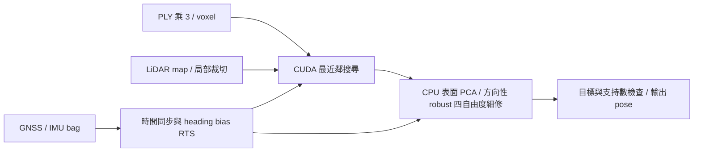

# 20｜GPU 現行算法、排名快照與精度改進方向

後續已實作 raw-image 校正三相機、固定 rig 高度、逐相機運動補償、stereo 深度尺度及側面取樣，見 [校正重建與公平對照](23_CALIBRATED_RIG_RESULTS_20261018.md)。本文件原有 merged PLY／分數分析保留為前一階段證據；新方法尚無完整 Track 或 Kaggle 成績。

更新：**2026-10-18（Asia/Taipei）**。本文初始階段核對程式、既有完整輸出與使用者新提供的兩張排行榜截圖，當時僅更新文件；同日後續的實作另見下段。使用者為 **Team 3**，沒有代為提交 Kaggle。

**同日後續實作：** 使用者要求開始三相機尺度／同步與對照，已完成工具、實驗來源介面與 12 組短段。共享尺度候選 0.87124954；發現 index 使用混合 bag／header 時間，已修正核對方式，尚未對 merged PLY 做逐相機去畸變。三相機增加幾何方向，但高度／形狀仍有不一致，沒有新精度或 Kaggle 結論，詳見 [實作與確認方法](22_THREE_CAMERA_IMPLEMENTATION_20261018.md)。下文算法分數仍屬現行前相機最佳，改善建議保留其初始假說脈絡。

## 目前成績：分數未變，排名改變

| 項目 | Track1 | Track2 |
| --- | ---: | ---: |
| Team 3 分數 | **1.15275** | **0.30576** |
| 本次截圖排名 | **第 4 名** | **第 2 名** |
| 第一名隊伍／分數 | Team 13／0.85886 | Team 12／0.28263 |
| 與第一名的分數差 | 0.29389 | 0.02313 |
| 追平第一名所需降低比例，以自身分數計 | 25.49% | 7.56% |
| 同圖 baseline | 1.79075 | 1.92587 |
| Team 3 截圖顯示 Entries | 5 | 3 |

這是使用者於本次對話提供的截圖快照，沒有查詢即時排行榜。2026-10-17 曾為第 3／第 1 名；自己的最佳分數沒有改變。第一名在兩條 Track 是不同隊伍，不能推論對方用了哪種算法。Track1 第 3 名為 Team 11／1.07618，與 Team 3 差 0.07657 分。

原圖保留在對話附件；此文件保存轉錄，未宣稱圖片已存到 repo。截圖沒有 CSV hash；與既有版本的關聯依先前使用者回報、相同分數及原完整 run 紀錄，沒有新的 submission metadata 核對。2026-10-17 的 [成績、完整 run 與 SHA256](17_GEOMETRY_RESULTS_20261017.md) 保留原貌。

評分為「平移 RMSE（m）＋0.2 × 旋轉 RMSE（°）」，分數越低越好。差 0.29389 分不等於差 0.29389 m；目前沒有分項 RMSE，無法由總分判定位置與方向各占多少。CSV 的 yaw 仍為弧度，不因評分旋轉誤差用度而改輸出單位。

## 現行算法：感測器先驗＋方向性 robust ICP

推薦命令必須明確使用：

```text
--profile sensor_guided --sensor-fusion heading_rts --geometry-mode directional
```

後端為 `cuda_robust_icp`。省略選項時程式仍是 `legacy`／`fixed`／`off`，沒有修改預設。



| 階段 | 目前實作 | 意義與限制 |
| --- | --- | --- |
| 時間與位置 | 以整數 bag timestamp 對齊 PLY；GNSS 5 點二次 Savitzky–Golay 後線性內插 | GNSS 是輸入，沒有當作真值 |
| 姿態先驗 | IMU quaternion SLERP；非重疊 2 s GNSS 區塊提供 course，僅接受高速近直行的可靠觀測 | 用 Kalman＋RTS 估慢變 heading bias；course 與 GNSS XY 相關 |
| 點雲 | `ply_scale=3.0`、source voxel 0.3 m、map voxel 1 m | 尺度沿用舊設定，尚非正式標定結論 |
| 地圖對應 | CUDA 最近鄰；局部原點減輕大座標 float 精度問題 | GPU 加速搜尋；不會自動改善量測模型 |
| 幾何與最佳化 | CPU 局部地圖 PCA；固定 roll／pitch，只估 XYZ／yaw 四自由度修正 | Huber、先驗正則化、法向／切向 metric；不是 NDT，也不是完整 GICP |
| 輸出保護 | 修正上限、alpha=0.25 correction 平滑、當幀目標核對；至少 10 個可靠對應／6 個不同 target | 拒絕時回到當下先驗；CUDA runtime 錯誤直接失敗 |

地圖先驗正則化尺度為 XY 0.5 m、Z 1 m、yaw 3°；方向性 metric 為 `M = nnᵀ + 0.05(I − nnᵀ)`，normal gain=2，Huber 門檻 0.5 m，Euclidean 對應截斷 2 m。這些是現行模型設定，並非已校準的感測器 covariance。詳細目標及導數見 [方向性配準](15_GEOMETRY_DIRECTIONAL_20261017.md)。

這是離線方法，RTS 與內插會使用較晚觀測。沒有整合原始 gyro／acceleration，也沒有完整 ESKF 或跨幀 joint optimizer；`heading_rts` 沒有改 GNSS XY，`motion_rts` 才另估位置／速度，目前僅短測。

**三相機狀態：** 本機已有完整 MapAnything merged PLY，index 與原前相機逐幀對應，初始核對見 [三相機評估](21_THREE_CAMERA_ASSESSMENT_20261018.md)。後續已加入實驗定位來源並完成短段，尚未取得分數；目前已評分主流程仍用 `raw_ply` 前相機。

## 本機證據指出的限制

本次重新讀取原已評分兩個完整 run 的 validation、guidance、geometry 摘要與 prior metadata，並重算 CSV SHA256，均與既有 provenance 相符：

| 診斷，均非真值誤差 | Track1 | Track2 |
| --- | ---: | ---: |
| 完整筆數／退出碼／validation_errors | 3011／0／空 | 3299／0／空 |
| 接受地圖更新／返回先驗 | 3011／0 | 3047／252 |
| 地圖法向 effective rank=1 | 2116／3011（70.28%） | 3034／3299（91.97%） |
| XY map correction RMS | 0.01661 m | 0.00993 m |
| yaw map correction RMS | 0.07029° | 0.03989° |
| heading 可靠區塊／總區塊 | 47／55 | 48／60 |
| heading 觀測支持範圍，相對 GNSS 起點 | 13.00–108.98 s | 15.12–116.89 s |

在第一個可靠 heading 區塊之前，現行 smoother 延用邊界 bias 均值並增加模型不確定度；這揭露觀測覆蓋限制，尚未證明起始段有錯。rank 取決於狀態尺度及既定門檻，是局部資訊診斷，不是嚴格可觀測性證明或已校準 covariance。

為什麼道路可能無法修正 XY／yaw？對理想水平地面，法向 `n=(0,0,1)`，狀態 `δ=[dx,dy,dz,dyaw]` 的法向殘差 Jacobian 是：

```text
J_normal = [0, 0, 1, 0]
```

沿路面移動或繞垂直軸轉動，點仍在同一平面，因此地面主要告訴我們高度。增加同方向的地面點或權重，無法憑空增加水平定位資訊。不同朝向、具空間跨度的可靠牆面才可能補足 XY／yaw；本地法向資訊以高度為主的結果與此相符。依退化方向保留有用約束的思路，可參考 [Zhang、Kaess、Singh 的退化分析](https://www.cs.cmu.edu/~kaess/pub/Zhang16icra.html)；上述平面推導是針對本案四自由度模型的說明。

**目前合理的推論是：XY／yaw 仍主要跟隨感測器先驗。** 小修正可能代表先驗已好，也可能是幾何不足、先驗較強或模型不符，不能直接選其中一個當成結論。Track2 的 252 次回退也不是 252 筆錯誤答案；第 410 幀是大量 source 對到同一 target，見 [調查紀錄](18_GEOMETRY_FALLBACK_20261017.md)。

## 有哪些能再提高精度的辦法

以下是依現有證據提出的候選，**本次尚未實作或取得新分數**。建議先診斷系統性誤差，再增加有效幾何，最後評估較大的融合改造。

| 優先順序 | 候選與可驗證假說 | 驗證與限制 |
| --- | --- | --- |
| 1：核對契約 | 查清 GNSS 是天線還是車體參考點、IMU／source／提交 frame、PLY 時間與尺度。若錯誤來自固定參考點或時間差，平滑無法消除 | 優先讀官方校正、擷取流程與 sample；依轉彎／速度／距離的誤差特徵交叉檢查。沒有契約或獨立幾何支持，不直接套 offset／外參 |
| 2：增加有效地圖資訊 | 優先核對三相機輸入契約與可靠側向支持，再對照現行前相機；另研究法向及空間均衡取樣、同一 target 的重複貢獻限制，之後獨立比較局部多尺度地圖細修 | 三相機抽樣視野更廣，但仍需確認尺度與重建品質。假說是缺少側向資訊、少量牆面被地面稀釋，或 1 m map 表示損失細節；單獨比較每項改動，不以降低回退數為成功條件 |
| 3：跨幀融合 | 先以既有 `motion_rts` 作位置模型消融；較完整的方向是含速度、yaw rate、慢變 bias 的 joint smoother／factor graph | 有可靠獨立相對運動或地圖因子，才可能改善低速／轉彎與觀測空窗。僅靠 GNSS 無法任意分離真實路徑與慢變 GNSS bias；較複雜不保證更準 |

契約診斷可用兩個物理模型理解，**不是要把示例數值直接套進程式**：

- 天線偏移：`p_gnss = p_body + R_body × lever_arm`。若 GNSS 已經轉成車體點，再扣一次就會引入錯誤；先確認訊息語意。[GTSAM GPS lever-arm 模型](https://borglab.github.io/gtsam/gpsfactor/)
- 時間差：近似位置差 `Δp ≈ v × Δt`，轉向差 `Δyaw ≈ yaw_rate × Δt`。10 m/s、0.01 s 對應 0.1 m 的敏感度，不代表實際存在此時間差。既有 bag/header 差最大不到 4.8 ms，尚不支持假設 0.1 s 延遲；PLY 曝光／擷取時間仍需另核對，見 [既有時間診斷](11_FILTER_ANALYSIS_20261017.md)。

多尺度配準先粗對齊，再在較細的地圖表示上細修，可減少單一尺度的取捨；這是 [Open3D 官方 ICP 教學](https://www.open3d.org/docs/release/tutorial/t_pipelines/t_icp_registration.html) 的一般方法。本案應保留四自由度、robust loss 及先驗保護，fine leaf 依實際點距離／噪聲選擇，不能把官方示例參數直接移植。細 map／新 leaf 需另建輸出快取並更新 identity 核對，不能沿用原 1 m cache。若 source 本身沒有側面或尺度有系統誤差，較細地圖也不會自動解決。

跨幀方法可參考 [GTSAM factor graph 教學](https://gtsam.org/tutorials/intro.html)，但應以原始觀測建立因子；不能把目前已含 GNSS 的配準結果當獨立地圖量測，再與相同 GNSS 重複融合。使用原始 gyro／acceleration 前，仍須核對軸、時間、重力與外參；將 geometry information inverse 直接當 covariance 也不成立。

目前不優先增加最終 pose 的 IIR 平滑、全面放大 map 權重、放寬幾何門檻或直接開放無約束六自由度。前者已有運動滯後證據，其餘無法補足缺少的資訊，也可能破壞現有保護；這些判斷不是宣稱任何候選已比較出更高分。

## 下一輪如何學到東西並確認改善

1. 以目前已評分版本及 SHA256 作對照。先讀取／分類既有直行、轉彎、低速、起始無可靠 course 與回退片段；不以 Track 或特定 idx 設客製修正。
2. **依使用者追加方向，優先驗證現成三相機的輸入契約與短段幾何支持**，通過後再與現行前相機＋directional 對照；見 [三相機評估與分步方案](21_THREE_CAMERA_ASSESSMENT_20261018.md)。法向／空間均衡取樣另作一項算法變更，保持來源、感測器先驗及其他設定相同。若可靠側向資訊仍不存在，轉向感測器契約與相對運動；多尺度細 map 再獨立消融。
3. 先以已知場景檢查地面退化、牆面可修正方向、重複 target、無重疊及 CUDA 錯誤；真實短段檢查時間／frame、支持範圍、修正與計算成本。短段只能驗證功能與假說線索。
4. 完整 Track 仍由使用者手動執行，保留唯一 run、來源／參數／SHA256、成功與失敗結果，再以 Kaggle 分數判斷實際效果。若可取得分項 RMSE，才能更直接區分平移與旋轉問題。

本次僅完成文件、截圖轉錄、既有輸出及三相機資料的只讀核對與方法查證。推薦方向代表值得驗證的假說，不是追過任何隊伍的保證。

## 程式與重現入口

- [benchmark／CLI](../scripts/accuracy/benchmark.py)、[感測器同步](../scripts/prepare_sensor_prior.py)、[heading／motion RTS](../scripts/sensor_fusion.py)。
- [四自由度求解與回退](../workspace/src/localization/src/sensor_guided.cpp)、[局部 PCA 與資訊診斷](../workspace/src/localization/src/geometry_weighting.cpp)、[CUDA 最近鄰](../workspace/src/cuda_ndt_backend/src/nearest_neighbor.cu)。
- [操作手冊](08_MANUAL_WORKFLOW.md)、[完整 directional 手動命令](16_run_geometry_directional.txt)、[原已評分版本與最佳 CSV](17_GEOMETRY_RESULTS_20261017.md)、[學習與開發原則](19_DEVELOPMENT_PRINCIPLES.md)。
