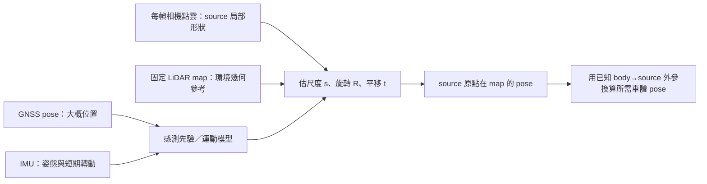

# 43｜開發進度、座標觀念與算法研究計畫

核對：2026-10-20（Asia/Taipei）；競賽規則補充於 2026-10-21 更新。原本稽核讀取原競賽 PDF 全部 24 頁，保存進度證據於 [`track00_test_2610201623/progress_audit.json`](../outputs/run/track00_test_2610201623/progress_audit.json)。本輪沒有重新定位、重建、完整 Track 或外部提交。現行規則總覽以[45｜競賽補充規則](45_COMPETITION_UPDATES_20261021.md)為準。

**目前已建立可重現且有分數支持的定位流程；主要研究問題是如何讓相機點雲提供可信的水平 map 約束，進而修正感測器的慢變誤差。完整座標鏈、來源尺度與新分支精度仍有待確認。** 最新實作不等於最佳算法，也不能由目前證據保證已達全域最佳。

## 1. 目前完成到哪裡

| 項目 | 實際進度與證據 | 尚未完成 |
| --- | --- | --- |
| 已評分主線 | 原前相機、scale=3、`sensor_guided + motion_rts + directional + carry`；Track1 **1.15008**、Track2 **0.30488**。兩份 CSV 本輪核對列數、有限值、連續 idx、SHA 與既有 metadata 相符 | 完整 body／source／GNSS frame 契約仍未認證；分數為使用者回報，沒有上傳端 SHA 獨立核對 |
| 三相機 | 已完成重建、同步、rig 內外參、完整定位與評分；Track1 1.15346、Track2 0.31064，未勝前相機主線，見 [29](29_THREE_CAMERA_SCORED_ANALYSIS_20261018.md) | 跨幀靜態形狀／深度不確定度與 camera→IMU/body 一致性 |
| 高度與固定尺度／航向實驗 | `surface_tilt`、固定新尺度、`pose_yaw` 等已實作；Track1 曾得 1.15519、1.15167、1.30507，未替換最佳，見 [33](33_SURFACE_HEIGHT_REFERENCE_20261019.md)、[40](40_SCORED_SCALE_FAILURE_AND_POSE_YAW_20261020.md) | 不能把高度更平穩或點雲更貼合，寫成 XY／yaw 更準 |
| surfel／joint | 有實作及機制測試；完整真實資料沒有可靠 factor，沒有執行有效 joint 修正，CSV 與原最佳相同，見 [37](37_HORIZONTAL_SURFEL_JOINT_20261019.md) | 有支持的水平 map 觀測 |
| 最新逐幀尺度＋慢修正分支 | `run_map_smoother.py`、Sim(3) 分層配準、慢 map anchors、GNSS bias／gyro／NHC graph；既有 44 項檢查通過，Track2 三段共 160 幀完整，兩段實際求解 graph，見 [42](42_LAYERED_SCALE_SLOW_MAP_20261020.md) | 本機尚無此分支 full／Kaggle 分數；逐幀尺度 RViz replay 尚未支援 |
| 外部參考 | 使用者提供 Track1 CSV／回報 0.65479 及學長文字方法，見 [41](41_EXTERNAL_REFERENCE_ANALYSIS_20261020.md) | 沒有對方原始碼、逐幀 ICP／尺度與真值，不能稱已重現，不能作校準標籤 |

最佳來源為 `outputs/run/track01_full_2610191750`（3011 列）與 `track02_full_2610191757`（3299 列）。本輪 CSV SHA256 分別為：

```text
Track1 781db1124f4a9a3e59a1d4adfc7ac7e3c14ff18e09b4157901f2cd807cb4466a
Track2 5b04d260123a8d87f0f0c317ddbce5b59c3ee3068cf07e020a370034a9728dbb
```

這些檢查證明檔案完整及身分一致，不是重新量測精度。本輪沒有重跑上述 44 項測試，而是讀取既有 `verification.json`；也沒有發現更新的 map_smoother 完整 run。

## 2. 官方 PDF 說了什麼，沒有說清楚什麼

截至 2026-10-20 的稽核讀取了[原競賽 PDF（000）](<Competition Regulations/90_舊版_已取代_可刪除_SDC_2026_Midterm01_Localization_24頁.pdf>)全 24 頁，並檢視頁面總覽及放大核對第 8、19 頁；預覽保存在當時 audit run。2026-10-21 新增 10 頁[補充規則 PDF（001）](<Competition Regulations/91_舊版_已取代_可刪除_Mid01_Updates_Adjustments_20261021.pdf>)，補充內容與本專案採取的規則解讀見[45](45_COMPETITION_UPDATES_20261021.md)。

- 第 5–6 頁：以影像重建點雲對預建 LiDAR map 配準，估計 vehicle pose；尺度校準、點雲處理、ICP／NDT 等是流程範例。
- 第 8 頁：前相機 `raw_ply` 是老師以 **LoGeR** 產生，三相機是 **MapAnything**；`map.pcd` 是預建 LiDAR 地圖；`init_guess.txt` 已加入噪聲。
- 原規則第 15–16 頁允許使用額外相機、IMU、GNSS；補充公告確認 Track1／Track2 的 GNSS 仍可用。Track3 不提供 GNSS pose，提供三相機／front PLY／map；預定 10/22 發布，但截至 10/21 尚未發布，資料格式、幀數、sample、IMU 與 init 均待確認。詳見[45](45_COMPETITION_UPDATES_20261021.md)。
- 第 19 頁：`score = translation RMSE (m) + 0.2 × rotation RMSE (degree)`。本機輸出 yaw 為 radians，不能直接將 radians 帶入這個 degree 權重。
- 第 24 頁：提供 IMU、quaternion 與算法等補充連結。

**原規則 PDF 正文沒有明確列出 vehicle pose 的車上參考點、GNSS 的 datum／投影／map 轉換、IMU quaternion 的 world frame、相機→IMU/body 的完整轉換矩陣。** 第 6 頁的「vehicle pose」不足以確定原點是相機、天線、IMU 或車體中心。補充公告也未提供 Track3 的 IMU／init 格式等資料契約；未公布內容保留為未知。一般教學連結不能替本資料集補出專屬安裝外參，不自行猜一個固定 offset。

## 3. 四種輸入的「座標」各代表什麼

先分清三件事：**frame 決定怎麼表示位置，calibration 決定不同 frame 怎麼轉換，accuracy 決定量測離真實值有多遠。** 同一個真實點換原點後數字會改變，不代表變得不準；兩組 XYZ 看起來接近，也不證明它們在同一個 frame。

| 資料 | 數值代表什麼 | 能提供的資訊與限制 |
| --- | --- | --- |
| GNSS pose | 程式讀 `/localizer_node/gnss_pose` 的 Cartesian x、y、z，並非直接讀經緯度 | 提供全局位置線索，但位置參考點、投影／原點及慢偏差未確認；不能當 ground truth |
| IMU | `/imu/data` 的 quaternion、angular velocity、linear acceleration | 能提供姿態估計與短期轉動資訊；gyro／acc 原本是感測器軸下的量測，並不直接提供 map XYZ；quaternion 的 world frame 也要知道 |
| LiDAR map | 固定 map frame 中環境表面的三維位置 | 是本任務配準的空間參考；不是逐幀車輛位置量測，也不是車體軌跡真值。當前流程沒有使用即時 LiDAR scan 作 odometry |
| 相機重建點雲 | 每幀 source frame 中，環境點相對來源原點的重建位置 | 能觀察附近形狀；要估尺度、旋轉、平移才能放到 map，且單一尺度未必能消除深度形變 |

標準 ROS body 常用 X 前、Y 左、Z 上（FLU），camera optical 常用 X 右、Y 下、Z 前；這是[REP-103 的座標慣例](https://github.com/ros-infrastructure/rep/blob/master/rep-0103.rst)，**不是本資料已被認證符合該慣例的證據**。map 也不能因名稱叫 `map` 就自動標東／北，其原點與方向需要資料定義，見 [REP-105](https://github.com/ros-infrastructure/rep/blob/master/rep-0105.rst)。

IMU 的 `imu_link` 是感測器 frame 名稱，不能單靠它得知 quaternion 的世界方向。有些 orientation 是上游已融合的估計；缺少絕對航向參考時 yaw 可以有任意初始 offset，見 [REP-145（Draft）](https://github.com/ros-infrastructure/rep/blob/master/rep-0145.rst)。[ROS Imu 訊息定義](https://github.com/ros2/common_interfaces/blob/humble/sensor_msgs/msg/Imu.msg)也明載全零 covariance 表示未知，不表示零誤差。

現有機器可讀證據是 [`sensor_contract.json`](../outputs/run/track00_test_2610192200/sensor_contract.json)：兩 Track 的 GNSS `frame_id` 都是空字串、IMU 為 `imu_link`、沒有 `/tf_static`。已查到的 rig 標定是 camera–camera；不能因此宣稱 camera–IMU/body 已知。這些是讀取既有 audit 的結果，本輪未重掃 bag。

## 4. 相機點雲如何變成定位

令 M 為 map、S 為 source、B 為提交所需的車體參考 frame。每幀先解：

\[
p^M_i=R^M_S(s\,p^{raw}_i)+t^M_S.
\]

`p_raw` 是一個環境點，不是車的位置；`s` 把重建距離轉到 map 的尺度；`R,t` 決定整片點雲擺在哪裡。`t` 才是 **source 原點在 map 中的位置**。例如 source 有點 `(2,0,0)`、尺度 3、沒有旋轉、平移 `(100,50,0)`，該環境點落在 `(106,50,0)`；source 原點位於 `(100,50,0)`。

若要求的車體原點與 source 不同，必須有固定的 metric 外參 `T^S_B`（將 body 座標轉到 source 座標）：

\[
T^M_B=T^M_S\,T^S_B.
\]

此式的 `T` 都是尺度已處理後的 rigid pose，不能把相機間已知的公尺 baseline 或 map 平移也乘上重建尺度。原流程不額外乘尚未驗證的 body 外參；現有 TXT／CSV 實際保留 source→map 約定。



所以「哪個座標準」需要分別回答：

1. **要把結果表示在哪裡？** 以題目所給 LiDAR map 為配準參考，仍須保留其 global datum／軸向未知的事實。
2. **哪個感測器的估計比較接近真實？** 不能一概排名。GNSS 提供全局位置但可能有慢偏差；相機對 map 的匹配在幾何充足時可提供修正，錯配／尺度形變時也會錯；IMU 擅長短期運動但有 bias。
3. **最後哪份軌跡更準？** 需要相同定義下的真值或正式評分。map 殘差小、曲線平滑、solver 收斂都不能代替它。

## 5. 已評分算法與最新模型，觀念差在哪

**已評分主線是「先有感測器定位，再做受限制的 map 細修」。** `prepare_sensor_prior.py`／`sensor_fusion.py` 對 raw GNSS 做位置／速度 KF＋RTS，使用可靠直行區塊的 GNSS course 校正 IMU heading bias，並用 quaternion SLERP 同步姿態。RTS 能用較晚資料回推較早狀態，是離線平滑。此主線沒有積分 raw acc／gyro 求位置。

之後 `sensor_guided.cpp` 保留先驗 roll／pitch，調整 x、y、z、yaw 四自由度。CUDA 負責最近鄰，CPU 解 robust directional cost 加先驗正則。接受時輸出修正，拒絕時回到當幀先驗；`carry` 承接高度。它限制錯配造成的大幅漂移，但 map 資訊弱時也容易留在 GNSS 附近。

[41](41_EXTERNAL_REFERENCE_ANALYSIS_20261020.md) 的完整輸出對照顯示，Track1 最佳相對其位置 prior 的 XY 差 RMS 約 **0.01582 m**。這說明實際水平結果主要受感測先驗支配；**不代表 GNSS 真實誤差只有 1.6 cm**。

水平資訊弱有一個容易推導的例子。若 map 只有理想水平地面，點到平面殘差為

\[
r_i=n_i^\mathsf{T}(R(sp_i)+t-q_i),\quad n_i=(0,0,1).
\]

在固定對應與無邊界的理想平面上，移動 X、Y 或繞垂直軸轉動不改變平面距離。因此單靠地面貼合，不能決定 XY／yaw；尺度、相機高度與 tilt 也可能互相補償。需要有空間分布的多方向非地面結構，以及可觀測性檢查，才能支援更多自由度。

**最新研究模型改成「讓 map 提供慢變絕對位置線索，讓感測器負責連續運動」。** 每幀 map fit 同時估 scale 與 6-DOF；其目標沒有 GNSS 殘差，GNSS／IMU 只供初值、搜尋範圍及分類參考。通過空間留出、非地面支持、尺度／水平可觀測性及相鄰位移檢查後，才形成 12 s 非重疊慢 anchor。

批次圖再估水平位置、速度、yaw、有效 gyro bias 及 GNSS XY 慢 bias，核心概念是

\[
z^{GNSS}_k=p_k+b_k+\epsilon_k.
\]

位置 `p` 與偏差 `b` 都未知。只看 GNSS，`p+c` 與 `b-c` 產生相同的量測；平滑能壓噪聲，不能憑空決定正確的絕對偏差。需要其他獨立、可靠的空間資訊，例如 map anchors。OU／初值等先驗可以選定一個數值解，但不能因此宣稱 bias 已由感測資料唯一辨識。

gyro 提供相鄰 yaw 增量，NHC 軟約束假設車輛通常不向側面滑行。NHC 是模型假設，不是新量測；輪胎側滑、相機／IMU 與車體軸不一致時都可能失效。完整三軸 acc preintegration 尚未實作，當前也沒有因加入 graph 就成為完整慣性導航。

新分支仍有重要限制：map fit 的初值與信任界依賴 GNSS，map−GNSS anchor 也共用 GNSS 噪聲，並非統計上完全獨立；一致的錯配群仍可能通過 gate。沒有 anchor 時，回傳的是本輪 `motion_rts` **sensor 初始化**，不是已評分 C++ 最佳 bytes。所有模型權重目前是共享實驗假設，沒有已校準 covariance 的宣稱。

## 6. 研究 goal 與可執行 plan

長期目標是：**在清楚的時間、frame、尺度與輸出參考點下，找出兩 Track 可重現、可解釋且正式評分更好的融合算法。** Track1 0.6 保留為研究目標，目前未達成；不承諾某個 solver 或加入更多感測器就一定達到。

本次建立的 goal 是完成「進度稽核、觀念釐清與研究計畫」；下列算法研究項目仍各自標示待辦，不因本次 goal 交付而被視為完成。

| 階段／狀態 | 要驗證的問題與工作 | 可核對的交付／完成依據 |
| --- | --- | --- |
| A．進度稽核：本輪完成 | 核對已評分最佳、最新分支、負面結果與來源 | 本文件、audit JSON、兩份最佳 SHA；不新增精度宣稱 |
| B．座標／時間／尺度契約：部分完成，優先研究 | 逐項記錄 map、GNSS、source、IMU、提交原點的已知／假設／未知；核對資料內標定與時間來源，不能用 noisy init 或外部 CSV 當標定真值 | 可追溯的 frame 表及變換方向；無法從 PDF／資料辨識的項目明列未知。跨幀／stereo 可檢查一致性，不能單獨認證車體外參 |
| C．現有新分支 full：程式與短測完成，等待使用者執行 | 直接評估逐幀尺度＋分層 map fit＋慢 bias graph；保持兩 Track 同算法／參數 | 3011／3299 列、有限 proper rotations、來源／設定／SHA、實際分數。已有手動命令，無需先證明本地精度勝出 |
| D．依 full 診斷改模型：待辦，可與 B 並行分析 | 查看尺度是否撞界、anchor 是否只集中路段、偏差是否依賴初始化、首尾／轉彎如何變化；檢查 map 與 GNSS 共享噪聲 | 說明誤差假說；必要時比較直接 map pose 因子與 map−GNSS 慢 bias 近似，避免把同份 posterior 或量測重複計數 |
| E．有針對性的幾何／時間模型：依 D 的證據決定 | 若尺度跨幀不穩，研究依深度不確定度加權或靜態跨幀追蹤；若要加入側相機，先處理來源形狀及同步。只在安裝／重力／噪聲契約足夠時研究完整 IMU preintegration | 一個改動對應一個假說；必要機制／數值／來源與輸出檢查後提供 full 命令。短段用於除錯與理解，不增設本地勝出資格 |
| F．整理最佳算法與交付：持續 | 保存所有成敗與參數依據，以同一 frame／時間／資料對照，固定可重現版本 | 正式分數＋完整來源記錄；報告能解釋每項資訊從何而來、何時不可觀。排名或單次分數改善不當作泛化證明 |

目前最直接的實驗是 C；B 的未解問題作為明確限制保留，並不新增一個必須先取得外部資料才能跑現有 full 的關卡。若 C 有改善，繼續做最少必要消融，分辨尺度、map anchors 與運動模型的作用；若退步，從已保存逐幀觀測及圖結果定位原因，不盲目放寬 gate 或按排行榜掃參數。

最新 Track2 full 命令已存在於 [16](16_run_geometry_directional.txt)／[42](42_LAYERED_SCALE_SLOW_MAP_20261020.md)，本輪核對入口程式相符，未執行：

```bash
cd /home/ricky/sdc_ros2/midterm01_gpu
bash scripts/dev.sh up
PYTHONDONTWRITEBYTECODE=1 OPENBLAS_NUM_THREADS=1 outputs/ml_runtime/venv/bin/python scripts/run_map_smoother.py --track 2 --full
```

Track1 用同一模型把 `--track 2` 改為 `--track 1`；實際完整計算與 Kaggle 提交仍由使用者手動完成。每次保存於新的 `outputs/run/track0N_full_YYMMDDHHmm`，保留已評分最佳。本次只是確認進度與建立 plan，沒有藉此啟動上述命令。

## 7. 對照程式學習的順序

1. 先看 [01 第 2 節](01_PROGRAM_FLOW.md#2-這套程式到底在求什麼) 的 `R,t,s`，理解環境點與 source 原點的區別。
2. 看 [`prepare_sensor_prior.py`](../scripts/prepare_sensor_prior.py) 的 `load_bag()`／`make_priors()`，確認讀的是哪些 topic、哪些欄位，以及 `frame_assumption`。
3. 看 [`sensor_fusion.py`](../scripts/sensor_fusion.py) 的 `position_rts()`／`bias_rts()`，區分去高頻噪聲、heading offset 與絕對位置 bias。
4. 看 [`sensor_guided.cpp`](../workspace/src/localization/src/sensor_guided.cpp) 的 prior 正則與四自由度修正，理解資訊弱時為何主要保留 prior。
5. 看 [`map_scale_icp.py`](../scripts/map_scale_icp.py) 與 [`slow_map_graph.py`](../scripts/slow_map_graph.py)，對照 map-only fit、可觀測性、`z=p+b` 與 graph；配合 [42](42_LAYERED_SCALE_SLOW_MAP_20261020.md) 閱讀共享參數的意義及限制。

適合自己推導的三個練習：水平地面為何無法決定 XY／yaw；只有 `z=p+b` 時為何存在無限多組解；相機原點與車體原點相隔固定距離時，車輛轉彎為何使兩者位置差的 map 方向隨時間改變。
