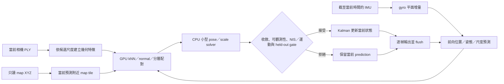

# Track3 因果配準架構與演進（2026-10-23）

## 先看目前狀態

現行 `scripts/run_track3_causal.py` 是 v2 因果前向定位入口。它以每一幀當下可用的 IMU 作短期運動預測，再自動將該幀的重建點雲配準到固定 map；配準通過幾何與運動檢查後才更新位置、姿態、速度及尺度。使用者不需逐幀量真值、挑對應點或手動配準。

v2 已完成一次真實 full： [track03_full_2610231608_0002](../outputs/run/track03_full_2610231608_0002/)。validation 記錄 3142/3142 幀輸出完整、map 更新採用 52 幀、`tracking_lost` 2357 幀、最長無 map 支持 63.0847 s，第一個 map anchor 在原始 idx 45；總耗時 931.4885 s，CSV SHA256 為 `f4a2f2af3e333574633f0347a768caa382b62bcec546b9f0f77cbe03e0919e54`。這代表程式建立過追蹤，但仍有大量失追，不能稱穩定或精度改善；目前沒有使用者回報的新分數。

原先執行中的快照（idx 0–373：geometry accepted 32、Kalman final accepted 22、lost 115；idx 0–635：58 幀 selected candidate 未收斂而另有候選顯示 converged，並有 bounds／line-search blocked）僅是該 full 尚在執行時的局部紀錄，不是全程統計。現在使用者自行啟動 legacy full `track03_full_2610231631`（PID 95805），仍在執行；不得停止或更動其程序／來源。score <1.29 仍是目標而非保證，正式分數須使用者提交取得。

## 從 legacy 到 v1，再到 v2

legacy 使用前相機點雲、固定 `ply_scale=3` 與 NDT D2D 配準，沒有 IMU／GNSS、前向 Kalman 或相鄰運動合理性檢查。使用者截圖回報 Team 3 score **106.72**，未核對上傳 bytes。本機 [legacy run](../outputs/run/track03_full_2610231431/) 有 3142 幀輸出，但 21 幀 registration 未收斂；「收斂」或輸出完整都不是精度證明。唯讀診斷記錄 [idx 22→23](../outputs/run/track03_test_2610231442/diagnosis.json) 在 0.0360 s 內跳 21.449 m，而 [idx 388→389](../outputs/run/track03_test_2610231442/diagnosis.json) 在 0.0356 s 內跳 15.330 m、yaw −170.242°。當時程式只檢查 NDT 收斂、Hessian 與數值有限，沒有阻止這類物理上可疑的相鄰跳動。固定 scale 3 也未校準。

v1 將 IMU、前向濾波、尺度估計和 map 幾何加入同一條 pipeline，卻在首次可信 map anchor 前以初值與相鄰限制作追蹤。使用者回報 full score **82.17**；本機 [v1 full](../outputs/run/track03_full_2610231521/) 有 3142 筆輸出，但 map 最終採用 0 幀、速度全零、XYZ 一直等於初始位置，尺度一直約 3。這是追蹤啟動失敗，不能據此把 3 當正確尺度。舊版本來源快照保留在該 run 的 `pipeline_sources/`；目前入口已更新，現行命令不重現 v1。

v2 的設計重點是先由 map 幾何建立第一個可信 anchor，再由前向預測連續追蹤；同時避免局部錯配以低殘差冒充有效解，或在整段都沒成功配準時仍輸出成功完成。完整初始化診斷及合成測試拆解見本檔末的證據連結。

## 為什麼沿用 ICP 元件，不等於沿用已評分核心

Track1／2 曾評分的 C++ 核心是 [`RefineSensorGuided`](../workspace/src/localization/src/sensor_guided.cpp)：roll／pitch 固定於先驗姿態、PLY scale 固定；只解 `x,y,z,yaw` 四個修正量。GNSS／IMU 先驗每幀先給大致位置與方向，幾何優化只需在其附近細修。舊 cost 還有 XY 約 0.5 m、yaw 約 3°的先驗尺度（另有高度正則項）。這些條件決定了它的搜尋範圍與解題方式。

Track3 沒有 GNSS pose 可逐幀把初始位置拉回正確街段，啟動位置與方向捕捉範圍因此更關鍵。v2 沿用的是 Python `map_scale_icp.py` 中的 `ScaleICPConfig`、`road_height`、`linear_terms`，以及 CUDA kNN／PCA／`pairs` 幾何計算；新寫的 `fit_bounded` 同時解 6-DOF pose 加 log-scale 共 7 個未知量，輸入為因果運動預測而非 Track1／2 的逐幀 GNSS pose。它沒有呼叫 C++ `RefineSensorGuided`，也不等於把已評分核心搬到 Track3。共用幾何函式或「ICP」名稱，不代表相同先驗、搜尋域、尺度、可觀測性或精度。

v2 的執行中快照與目前完整結果分開保存：當時 idx 0–373 幾何候選接受 32 幀、Kalman 最終採用 22 幀、`tracking_lost` 115 幀；idx 0–635 有 58 幀所選候選未收斂，而另有候選顯示 converged，並看到 bounds 命中與 line-search blocked。這些前綴現已成為歷史執行觀察；不能代替上述 full validation，也不能推論未選候選一定能通過其他 gate。全程 accepted/lost 數字與 CSV SHA 見該 run 的 [validation.json](../outputs/run/track03_full_2610231608_0002/validation.json)，逐幀細節見 [observations.jsonl](../outputs/run/track03_full_2610231608_0002/observations.jsonl)。

## 舊已評分 ICP 核心的獨立對照路徑

使用者提出把舊版本去除 GNSS 後直接跑 Track3，作為與 v2 不同的比較。新增入口 [`run_track3_old_icp.py`](../scripts/run_track3_old_icp.py)、runtime adapter [`old_icp_runtime.py`](../scripts/old_icp_runtime.py) 與 bridge [`old_icp_bridge.cpp`](../scripts/old_icp_bridge.cpp)，使用凍結的 `workspace/src/track3_old_icp/` 四個核心檔案。其來源 SHA 與 2026-10-19 已評分 Track1 核心相同（[provenance](../workspace/src/track3_old_icp/provenance.json)）；它是當時四自由度核心，不是後來最新含 GICP 的版本。分數不可移植到 Track3。

此對照直接呼叫原 C++ `RefineSensorGuided`，但不包含原 Track1／2 的 GNSS／RTS prior generator。每幀 prior 取上一幀輸出的 XYZ 與 roll/pitch，再用截至該時刻的 gyro 增量更新 yaw；不做速度外推，不用 GNSS、RTS、graph、v2 的 Sim(3) solver 或 Kalman。舊核心本身仍保留 XY 0.5 m、Z 1 m、yaw 3° regularizer，這些是繞著本次 motion prior 的懲罰項，**不是** GNSS observation，也沒有憑空產生 GNSS 資料。

舊核心固定尺度，預設 `scale=3`；map voxel leaf 1 m、input leaf 0.3 m、crop half-size XY 100 m／Z 30 m、最大 XY 修正 1.5 m、yaw 修正 8°、修正平滑係數 `alpha=0.25`，directional geometry 預設開啟。首次姿態可選 `ground`（預設：首幀下平面對齊 map +Z 的近似，只改 tilt，不估 scale 或 position；24°界限，並非物理標定）或 `official`（原矩陣不變）。這條路徑是凍結舊演算法做新資料比較，不是 v2 替換、精度保證或已得分版本。

它與 v2 的差別不只「有無 GNSS」：舊核心固定 scale、roll/pitch，只解 XYZ/yaw 四個量；v2 解 pose 六自由度加 log-scale 七個量，另有向前 Kalman 與幾何 bootstrap。Track3 沒有 GNSS pose 提供逐幀位置捕捉，因此即使舊 C++ 核心在 Track1 曾得分，也不能預期直接移植後同樣準。

每個 run 都在該 run 目錄內隔離編譯 frozen bridge，不覆蓋已安裝 binary，也不改主機 CPU 環境。PCL parsing／voxel／crop、normal PCA 與四未知數 solver 在 CPU；CUDA 僅使用凍結舊核心的 nearest-neighbor float kernel，不應描述為 v2 的 float64 CUDA 幾何。輸出維持九欄 timings、逐幀 flush、成功 full 的 analysis hook；全程零接受時明確失敗。獨立編譯與 CPU 合成測試目前仍在執行，尚未宣稱通過；GPU bridge 尚未驗證。

目前文件建議的手動對照 full 命令為：

```bash
cd /home/ricky/sdc_ros2/midterm01_gpu
bash scripts/dev.sh up
PYTHONDONTWRITEBYTECODE=1 OPENBLAS_NUM_THREADS=1 outputs/ml_runtime/venv/bin/python scripts/run_track3_old_icp.py --full --ply-scale 3 --initial-tilt ground --geometry-mode directional
```

legacy full 仍由使用者手動執行中（PID 95805）；此命令是比較路徑，待主 agent 完成編譯與 CPU synthetic 檢查並依程序狀態安排後使用，不代表助理已啟動或已驗證。

## 點雲配準與 scale 的物理意義

令 `p_raw` 為影像重建 PLY 的一個點，`s` 為三軸共用的尺寸倍率，`R,t` 為它在 map 中的旋轉和平移，則

`p_map = R (s · p_raw) + t`。

配準就是程式調整 `s、R、t`，讓 PLY 中的地面、牆面、柱子等幾何與同一處 map 幾何相符。`scale=3` 意味著 PLY 原始座標的 2 個長度單位被當成 6 個 map 長度單位；它不縮放 map 或車輛 global XY，也不是 IMU 係數或相機內參。舊 legacy 將 3 固定不變；現行 `--initial-scale 3 --scale-mode estimate` 只把 3 當未校準起始 seed，程式逐幀估計候選並經檢查後才採用。

配準使用分層 robust point-to-plane 幾何。對應點的基本殘差是 `r = nᵀ(R(s·p_raw)+t−q)`，其中 `q` 是 map 點、`n` 是其法向。地面與立面分層、空間與法向均衡配對，訓練配對用於求解，空間 held-out 區塊用來檢查泛化；另加 source 全點到 training map 最近距離的覆蓋代價，距離先截在 2.5 m，再平方計入代價，避免只貼上一小面牆而忽略其餘點。尺度需有幾何支持，並受範圍與逐幀步長限制；XY、yaw、scale 退化或 held-out 不合格時不更新。這些 gate 是工程保護，不是測得的精度界限。

v2 首次初始化在官方初始旋轉附近搜尋 ±24°，用 map/source training ground plane 方向形成姿態候選，並以初始高度提出尺度 seed；另在未校準工程範圍 0.5–16 內比較 7 個 log 間隔尺度 seed 與起始 seed。未知車高不是已知真值。候選按各自公尺尺度重算 source normals／品質。CUDA cache 對原始點、normal、ground、quality 保留四個來源物件的 identity 與 GPU tensors，不額外保存尺度欄位。訓練幾何 cost 下降時以受限 line search 接受小步；收斂可由原 `small_step` 判定，或由實際接受的小步加上 cost 連續三次穩定判定。撞到參數邊界的候選不接受。

## IMU 預測與 Kalman 更新

濾波器用 11 維誤差狀態：位置 `p`（3）、速度 `v`（3）、左乘姿態誤差 `δθ`（3）、垂直 gyro bias `b_g`（1）、log 尺度 `λ=log(s)`（1）。機械上可把它想成：IMU gyro 提供相鄰時刻間的短期轉角，map 配準提供帶不確定度的當前幾何位置／姿態／尺度觀測。兩者都可能有誤差，不能把 map 當無誤差真值。

位置按常速度前向預測 `p⁻=p+vΔt`。gyro 先投影到方向四元數給出的世界 +Z，再假設它與 map +Z 平行，形成平面旋轉增量，扣除垂直 bias。這是平面運動近似：不使用 IMU 絕對 yaw，不把加速度雙積分成位置，也沒有聲稱已知相機—IMU 外參。加速度只作初始化重力方向 sanity。IMU 僅使用 timestamp 不晚於當前影格、且仍新鮮的樣本；不向未來插值。訊息 covariance 全零表示未知，不代表感測器零誤差，符合 [ROS 2 Humble Imu 訊息定義](https://raw.githubusercontent.com/ros2/common_interfaces/humble/sensor_msgs/msg/Imu.msg)。

map 候選形成位置、旋轉及 log-scale 殘差，Kalman 依各自不確定度計算更新；協方差以 Joseph 形式更新。NIS、平移／旋轉物理跳動、尺度域與步長、posterior bounds、配準退化或 held-out 檢查任一不通過，就拒絕該 map 更新，保留本幀前向預測並照常輸出，不凍結舊 pose。初始速度為零，因此若首次 map anchor 一直失敗，IMU 單靠 gyro 不能提供前進距離，位置仍可能停在起點；長於 2 秒沒有 map 支持標記 `tracking_lost`。目前沒有 global relocalization。

IMU 姿態假設 world +Z 與 map +Z 平行；source→map 初始矩陣只核對程式慣例與 proper rotation，未完成物理座標標定。raw PLY 上游軸向、相機—IMU 外參、pose 參考點、IMU／相機時間對齊、官方 sample 的 yaw 語意仍有未知。濾波噪聲、速度 40 m/s、角速度 90°/s、尺度 0.5–16、初始旋轉 24°、初始化／追蹤平移界限及尺度每幀 log 步長 ±0.15，都是明示工程安全域，不是實測標定或按榜分最佳化的數字。

## 因果資料流與 CPU／GPU 分工



CUDA 重用既有 kNN／PCA／配對，float64 PCA eigendecomposition 每批最多 256；從當前預測建立 100 m half-cube tile，GPU 0.3 m voxel 保留原始首點，與舊 PCL centroid 不等價。原始 map 只讀 XYZ、沒有 timestamp；ASCII 一次串流建立約 0.69 GB float32 XYZ cache，不減點。小型最多 7 變數配準 solver、11 維 Kalman、SQLite／ASCII／I/O 與少量數值邊界裁決留在 CPU。CUDA 不可用或出錯時不靜默回退 CPU。

整條定位只向前走，不用 RTS、backward smoothing、batch graph、未來資訊或舊 pose 回寫。每幀輸出 `Run:`、`Frame i/N`、固定 9 欄 `timings.csv`，以及 `Graph: executed=false, applied=false`；完整成功才輸出 `Finished`、CSV 與 Validation。若 map 採用數為零，runner 明確報錯，不印成功的 `Finished`。成功 full 的唯讀圖表寫在該 run 的 `analysis/`，不改 pose／CSV，產圖耗時與定位計時分開。

## 驗證證據、限制與手動入口

v2 通過 59 項不同 CPU／CUDA 機制／合成檢查：CPU 45、既有 CUDA 幾何 8、新 source-cache 1、最終因果 CUDA 5；重跑項目不重複計數。合成已知尺度 8.7、帶噪傾斜 20° 場景中，CUDA 與 CPU 結果最大差在 1e-5 內；合成 3／5 幀前綴逐 byte 一致；zero-accepted case 明確失敗。這些測試沒有跑真實 Track 配準，也不等於精度證據。檢查記錄見 [53 初始化修正與驗證](53_TRACK3_INITIALIZATION_REPAIR_20261023.md)、[CPU／CUDA 測試目錄](../outputs/run/track03_test_2610231550/) 與 [合成 prefix/bootstrap](../outputs/run/track00_test_2610231601/)。首三幀靜態地面 PCA 顯示 source/map 法向差約 18.5–18.9°，只是初始化線索，非唯一根因或完整座標標定。

**最新真實 run 診斷待補：** 使用者已啟動 [track03_full_2610231608_0002](../outputs/run/track03_full_2610231608_0002/)，PID 77284 尚在執行／等待唯讀審查。執行中 prefix 已有部分 accepted／rejected 與收斂觀察，詳見上節；它們不是完整序列結果。最終軌跡、尺度分布、accepted/rejected 全程統計、validation、分數與上傳 bytes 核對狀態均待 run 結束後補記，不預判結果。分數 106.72（legacy）與 82.17（v1）均為使用者回報歷史，非真值，也不能推回尺度。

完整定位仍由使用者手動啟動；以下是現行 v2 full 命令，不會重現 v1：

```bash
cd /home/ricky/sdc_ros2/midterm01_gpu
bash scripts/dev.sh up
PYTHONDONTWRITEBYTECODE=1 OPENBLAS_NUM_THREADS=1 outputs/ml_runtime/venv/bin/python scripts/run_track3_causal.py --full --scale-mode estimate --initial-scale 3
```

`initial-scale 3` 是起始 seed，不是已校準值。短段可以用於機制／故障檢查，但不是 full 的額外資格門檻；只有 full 提交產生正式成績。不能按歷史分數反推尺度、把拒絕率／殘差／平滑軌跡當準確度，或手動修 CSV。
