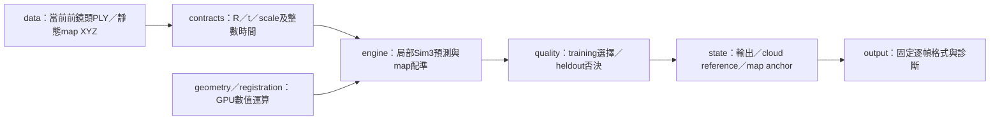
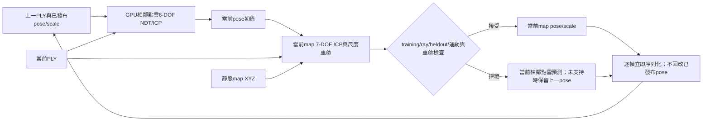
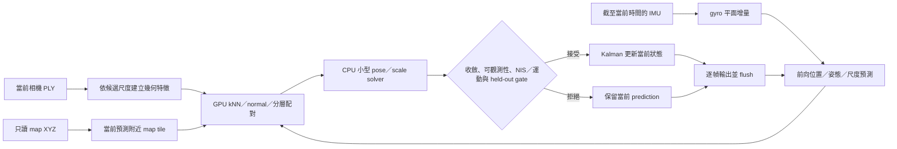

# Track3 因果配準架構與演進（2026-10-23）

## 2026-10-24 Track3 核心全新重寫：可觀測性導向 C++／CUDA ICP v1

本節記錄獨立的新實作 `track3_cpp_cuda_observable_icp_v1`。入口為 [`track3_rewrite/run.py`](../track3_rewrite/run.py)，原生程式位於 [`workspace/src/track3_rewrite/`](../workspace/src/track3_rewrite/README.md)，模組責任見兩份 README。這是從零撰寫的新 C++／CUDA solver，不沿用 `scripts/`、`track3_clean/` 或舊 CUDA solver 的程式；既有 `track3_clean/` 與 v2／v2 fast 保持各自獨立，沒有在本節宣稱它們已修復或被取代。

### 資料流程與座標模型

流程以 CPU 參考模板 `midterm01/workspace/src/localization/src/localization.cpp` 的資料路徑為起點：讀取當前 PLY、縮放與取樣、裁切 map、對齊、更新當前 pose、逐幀輸出。模板在本工作中只讀；沒有直接修改模板檔，也沒有複用其中 AlignNDT 數值實作。相機點採用 `p_map = s R p_raw + t`，其中 `R` 為 proper rotation，尺度 `s` 獨立保存，核心數值使用 float64；原始 map／PLY 本身為 float32。

來源 raw voxel leaf 0.1 對應模板 0.3 m 與名目倍率 3；map leaf 1 m、crop XY 100 m／Z 30 m 亦取自模板。名目 scale 3 僅是未標定 seed。首幀另由當前 training source 下平面及 map 下方近水平面，以 PCL RANSAC 得到方向／高度比例的尺度假設；它不是相機外參或絕對尺度標定。

首幀由 GPU point-to-point 7-DOF ICP 分別從兩種 seed 求解，以 training cost 選 winner，held-out 只可否決 winner。後續先在上一個受支持相機的公尺座標中估計 pair Sim3，再以 `Tmap_prev * Tlocal` 組合 map pose；當前 `scale` 直接取 local fit 的 scale，不再乘舊 scale。Map使用pair提供的當前scale；6-DOF point-to-plane map fit 只更新 Hessian 可觀測方向，未觀測 mode 保留 prior。

### 目標函數、可觀測方向與數值界線

每個 source 固定以 `i % 5 != 0` 作 training，其餘作 held-out。training 使用 fixed-source rows；matched robust cost 為 `1 - exp(-||e||² / (2 sigma²))`，並含 plane confidence；missing correspondence cost 為 1。`sigma = association_radius / 3` 是工程 residual scale，不是校準過的噪聲模型。Map plane 與 pair point objective 分開處理。

Hessian先以source RMS特徵長度，將旋轉／log尺度參數轉成與平移可比的數值單位，再以 `sqrt(float64 epsilon) * lambda_max` 作 eigen cutoff，並設 `1e-14` 數值下限。只要 rank 大於 0，即允許在可觀測子空間內 partial update；Map的6-DOF平面更新不要求rank7；需要完整Sim3的bootstrap／pair則要求其7個局部數值方向可解。數值步長 trust cap 為 radius／5°／0.1 log-scale，分別限制平移、旋轉與 log-scale 更新，是求解器數值步長限制，不代表車輛運動量測或物理上限。

候選至少需要 training support 7、held-out support 3；training 與 held-out cost 不得比 seed 差（`1e-10` 數值容差），且數值有限、rotation proper，才標記 supported。Point Sim3另外明列相對該fit seed的尺度域 `[0.5, 2]`，停止於尺度域的解不採用，避免source縮成一個target點的退化最小值；這是未標定的工程搜尋域，不是每幀尺度真值或榜分調參。Bootstrap另有獨立地面高度比seed。這些是本版的有限支持裁決，不是精度門檻或精度證明。此版沒有舊 absolute-residual、ray、multi-seed-consensus 或 physical post-fit gates；不得把門檻減少描述成修復舊版失鎖。

### CUDA／CPU 職責與追蹤狀態

大量工作由新 CUDA 實作執行：voxelization、精確 bounded nearest-neighbor、每個 CUDA thread 的 3×3 Jacobi PCA、point／plane residual、gradient 與 Hessian／右端項的 deterministic reduction。每個 thread 僅保存 3×3 PCA 工作資料，不使用 cuSOLVER batch workspace。CPU 保留 PCL 解析、一次小型 ground RANSAC、bbox／I/O、hash 及小型 7×7 eigensolve。外部依賴為CUDA、PCL、Eigen與系統OpenSSL（當前幀SHA256），launcher主要用Python standard library；獨立解析ASCII PCD時才用NumPy作批次I/O。CUDA 失敗即 fail，沒有 CPU fallback。程式設有 dense grid 32 million cells 的界限；本 native CUDA runner 不使用 Torch allocator cap，也沒有宣稱 4 GiB 全卡 VRAM 上限。舊版 PCA256 程式未修改。

狀態分開追蹤 published estimate、last supported cloud 與 last map time。map 與 pair 可以分別支持；兩者都不支持時 hold published estimate，且不換 cloud reference。`unsupported_seconds`記錄未獲任何map支持的時間；另記 `map_partial_update`、`last_full_rank_map_ns` 與 `seconds_without_full_rank_map`，追蹤完整數值秩支持的年齡。`tracking_lost`在後者超過2秒時標記，因此部分平面更新不會冒充整個pose已恢復；這些秩仍只描述當前對應下的局部線性化，不是真實全局精度。流程不讀 IMU／GNSS／外部預測，不使用未來幀，也不離線回改已輸出 pose。這是 native 應用，尚未接 ROS 2／RViz；使用容器中的 PCL／CUDA 不等於 ROS node。

Runner 保留固定 console、9 欄 `timings.csv` 與 `observations.elapsed_seconds` 契約。`registration_candidates.jsonl` 在 commit 前記錄所有候選，包含首幀失敗候選；`native_status` 記錄 stage、idx、failure 與 partial counters。`source_frames.jsonl`只在使用當前PLY時記錄其SHA，定位前不預讀未來PLY payload；定位完成後再核對。成功full後才透過既有 `plot_run_analysis.py` subprocess對該run只讀產圖；圖表或其狀態檔寫入失敗保留定位成功。Finished的total是native pipeline（包含native map準備與逐幀I/O），隔離build／wrapper cache/hash準備另外保存在log，不攤入frame時間。

### 已完成檢查、未解事項與精度限制

run [`track03_test_2610240045`](../outputs/run/track03_test_2610240045/) 記錄 12項GPU機制測試通過，涵蓋 nearest-neighbor／邊界 tie、voxel、PCA、7 維 gradient、已知 Sim3、單平面 rank 3 僅更新 Z 並保留 XY、無重疊拒絕、尺度合成、causal state、eigensolve與單點target尺度塌縮拒絕。gradient 有限差分以 `eps=1e-6` 在 nearest-neighbor 切換附近的初次比對差 1.36e-5；該失敗紀錄保留。`eps=1e-7` 在原允差 1e-5 下通過，沒有修改 core 或放寬允差。最終紀錄另外核對：1e-6的差分兩端有1個training對應切換，1e-7則0個，支持先前差異來自穿越對應邊界。已知合成pose平移差6.21e-7m只描述合成例，不代表真實定位精度。

真實 3142 幀 dry-run 通過，僅盤點輸入，不執行真實定位。map/cache SHA盤點記於同一run；原生GPU合成3／5幀已完成，TXT／CSV／frames前三幀逐byte一致，見 `native_fixture_verified_summary.json`。5幀map4採用／pair4採用，idx3的map仍有held-out否決；這是合成機制紀錄，不是接受率或真實精度改善。另9項launcher／I/O檢查通過，包含獨立PCD轉cache、輸出篡改偵測、既有輸出保護、延後PID的SIGINT轉送、畫圖失敗隔離。`native_failure_summary.json`保留首幀無支持與SIGINT的失敗stage／idx／原因及候選／來源SHA。另一次真正經launcher的隔離build與CTest通過，最終見 `track03_test_2610240727`，來源SHA與最後程式一致；較早0716只作中間紀錄。沒有新真實短段定位、full 或正式分數；新版本真實精度未知。Map在bootstrap後使用pair的當前尺度，仍可能累積尺度漂移；最近鄰仍可能錯配，且存在尺度偏差、動態物體、全局多解及長段漂移風險；局部支持與 held-out 通過不保證正確解或全局唯一性。

完整定位只由使用者手動啟動。下方 [50 指令表](50_COMMAND_REFERENCE.md)提供本版 full 命令；不得將計畫或 dry-run 記為定位成功。

原生程式亦拒絕覆寫既有輸出檔。省略 `--map-cache` 時，新launcher以獨立ASCII PCD parser在本輪run內建立未裁切／未降採樣的float32 XYZ NPY，不依賴歷史runner或pose。資料行留出只避免這些source rows參與擬合，鄰近點仍相關，不能當獨立真值驗證。

## 2026-10-24 clean 架構重建：獨立 local-Sim3 pair model

新入口 `scripts/run_track3_clean.py` 對應 method=`track3_clean_local_sim3_v1`，核心 package 位於 [`track3_clean/`](../track3_clean/README.md)。這是一次架構重建並引入新的局部座標 pair model；**不宣稱修好定位精度**。package 不 import 舊 runner 或 tracker，只抽取已有 float64 CUDA kNN／PCA／registration／visibility／sampling primitives；逐項來源與 SHA 記於 [`provenance.json`](../track3_clean/provenance.json)。算法推導集中在本文件，package README 僅提供模組導航與現況。

### 輸入與尺度契約



輸入限前鏡頭 PLY、LiDAR map XYZ 與初始化 pose。不讀 IMU、GNSS、外部預測或舊 pose，不使用未來資料，也不回寫先前 pose。每個 map estimate 滿足

`p_map = s R p_raw + t`。

4×4 pose 只存 proper rotation `R` 與平移 `t`，尺度另存為 `s`。對 pair registration，target 是上一個受支持相機的公尺座標 `previous.scale * previous.raw`；fit 當前 `s/Rlocal/tlocal`。組合為 `Tmap_current = Tmap_previous * Tlocal` 且 `s_current = fit.scale`，不能再乘一次舊尺度。如此將局部配準 target 留在相機公尺座標，並使 scale 語意明確。

### 狀態、品質裁決與重捕獲

`state.py` 分開保存 published estimate、最後受支持的 cloud reference、最後 map anchor。當幀 map 與 pair 都拒絕時輸出 hold estimate，但不以 unsupported cloud 更新 pair reference；下一幀 pair elapsed 仍相對最後受支持 cloud 計算。lost 依最後 map 支持時間判定，2 秒是沿用的工程假設，不是標定量。

`quality.py` 僅用 training 資料篩選候選並裁決共識，held-out 資料在 winner 固定後只能否決，不能參與選擇。Bootstrap 的 coarse 候選會保留在最後 ambiguity 裁決中；局部 restart 不能抹掉另一個仍受 training 支持的粗解。這些規則定義如何拒絕多解，不構成全局唯一性或精度證明。

數值配準元件仍是既有 robust P2D NDT surrogate＋point-to-point ICP／Sim3；不是重新宣稱另一種 NDT likelihood。保留 float64／int64、PCA 每批256、source最多12000點、raw leaf0.03與map leaf0.25m、2／1m NDT與1.5／0.75m ICP、150迭代及原幾何／視線門檻，沒有按榜分調整。CPU 保留解析／hash、小型矩陣求解、初始化的少量PCA與數值邊界裁決；CUDA故障直接失敗。新的pair模型估當前尺度，使用三尺度初值與共識，與舊固定尺度六自由度pair不同，真實資料是否受益仍待手動定位驗證。

`registration.with_config()` 共用 map tensor/index，但不改寫共用 scene 的搜尋域。`GeometryUnavailable` 只表示觀測缺少幾何支持：pair缺少支持仍可嘗試當前map；CUDA／程式異常不轉成一般拒絕。Bootstrap失敗會保存全部候選與各原因計數到 `failed_frame_diagnostics.json`，runtime另記失敗stage／idx及traceback；失敗不印成功Finished。固定console、9欄timings與 `observations.elapsed_seconds` 保持；full成功後只讀產圖仍在該run的analysis/。

### 本輪執行狀態與在跑程序

本輪證據集中 [`track03_test_2610240007`](../outputs/run/track03_test_2610240007/README.md)。[30項CPU檢查](../outputs/run/track03_test_2610240007/cpu_checks_final.log)涵蓋已知變換／變尺度pair、Jacobian、平面退化拒絕、候選共識與heldout隔離、拒絕後reference／elapsed、無CPU fallback的錯誤界線、固定輸出與CLI成功／中斷處理。CPU合成3／5幀完整engine序列及TXT／CSV前三幀逐byte相同，見[合成紀錄](../outputs/run/track03_test_2610240007/synthetic_cpu_summary.json)；它們是生成房間點雲，不是真實前鏡頭精度。較早初次合成測試的timing backend標籤仍沿用CUDA預設，已保留，正式本輪CPU證據改用明確 `cpu_reference_clean_local_sim3_ndt_icp` 標籤。

真實3142幀[full dry-run](../outputs/run/track03_test_2610240007/dry_run_full.json)通過，沒有CUDA初始化或配準，dry-run本身不驗map payload SHA。另一次[唯讀輸入盤點](../outputs/run/track03_test_2610240007/input_and_primitive_audit.json)核對idx0／1444／3141的PLY解析與原參考voxel取樣完全同列、57,358,377點map/cache的SHA與schema，並核對抽取CUDA_SOURCE字串逐byte相同及PCA批次上限256。這不是新CUDA實際運算或相機座標物理認證。

舊full `track03_full_2610232327` 的PID7688在本輪唯讀檢查時仍執行。較早快照idx1444有map連拒582幀、unsupported20.945650097秒、lost而pair仍接受；這不推定其最終狀態或根因。131個舊source的前後SHA另保存在同一研究run；不停止、不改其程式／結果，也未並行啟動GPU或真實定位。新入口沒有真實短段／full／新分數，GPU整合及正式精度均未驗證。

詳細模組責任見 [`track3_clean/README.md`](../track3_clean/README.md)，手動入口見[50](50_COMMAND_REFERENCE.md)。此分支的新架構與 pair model 尚未提供精度結論；full 仍由使用者手動執行，不增加精度資格門檻。

## 2026-10-24 v2 fast backend：固定工作量的 200 幀對照

這是舊前鏡頭 map-only v2 的執行加速分支，入口 `scripts/run_track3_map_only_fast.py`，method=`track3_forward_gpu_structural_ndt_icp_reacquisition_v2_fast`，backend=`cuda_float64_fused_pairs_statistics_streams_ndt_icp_v2_fast_no_imu`。它不改 `track3_clean/`，也不改 v2 的物理解或門檻；仍只用前鏡頭和 LiDAR map XYZ，不接 IMU／GNSS、外部預測或未來資料，不回修先前 pose。

CUDA fast path 融合 transform（R/t 以 by-value 傳入）、candidate pairs、matched transform／residual／precision 與 robust normal-equation 的 GM/H/b 統計；exact kNN 保持。每個 worker 固定重用一條 CUDA stream，整組固定 3 條 persistent streams；出錯時先 join 工作，再傳遞例外。PCA 每批256、float64／int64、原點數、三尺度 seed、150 iterations、原幾何／視線／共識門檻及 CPU 7×7 solver 均保留。這是計算路徑融合與併發配置變更，不是減少工作量或放寬接受條件。

初期真正並行版在 [`track03_test_2610240042`](../outputs/run/track03_test_2610240042/validation.json) 的 idx127 遇 CUDA OOM，保留 127 幀。研究將 cuBLAS workspace 按 `(thread, stream)` 的生命週期累積定位為原因；固定 worker stream 後，5 幀 `track03_test_2610240050` allocated 193,218,560 bytes，對照舊配置 495,208,448 bytes，20 輪 fake-job stream 管理檢查通過。保護中的 v2 full 已依使用者授權 SIGINT，留存 2025/3142 幀、map採用721、最後 map idx862、lost1107；速度分支沒有修復這個 full 的失鎖問題。

最終同算法對照 [`final_200_comparison.json`](../outputs/run/track03_test_2610232356/final_200_comparison.json) 對比基線 `track03_test_2610232248` 與 fast `track03_test_2610240052`：registration median 1473.078968→574.460491 ms（2.56428×），整段 338.130684→148.823299 s（2.27203×），frame median 1489.154892→595.508803 ms。兩者 map 182/200、pair 198/199、lost0；805 fits 的 checks／reasons／accepted／各層 iterations、support、stop 全部相同，無 iteration differences。最大 pose element 差1.1369e-13、scale差5.862e-14；5／200 TXT及CSV前綴逐byte相同，141個stage source manifests與輸入／map／init／PLY SHA相同。這些是同一有限研究段的工作量等價與速度證據，不是完整3142幀速度或精度證明。

fast run Torch peak allocated／reserved 為1,025,714,688／1,763,704,832 bytes（約0.955／1.643 GiB）；4 GiB budget只限制Torch allocator，不代表整張卡VRAM上限。本輪沒有新正式分數，不能將 v2 稱為精度已修好或直接推薦作精度更佳版本。200幀命令及狀態見[50](50_COMMAND_REFERENCE.md)；該安裝後5幀驗證當時仍待最終核對。

## 歷史接續：v2 前鏡頭結構均衡、map NDT／ICP與重捕獲，已測200幀

使用者明確授權「可以測試200幀，請完整修好」並要求繼續；本輪只做授權的有限段，沒有full或提交。現行`run_track3_map_only.py`已更新method為`track3_forward_gpu_structural_ndt_icp_reacquisition_v2`。同一CLI現在執行v2，不能重現1912的v1；原source快照及歷史輸出保留。仍固定前鏡頭`Track3/raw_ply`及原LiDAR map XYZ，不接IMU／GNSS，不讀外部預測、不作未來回修。

### 修正模型

- 一般map tracking也加入原有2／1m NDT粗層，接1.5／0.75m ICP，對0.95／1／1.05三個尺度seed各自求解。原150迭代預算、點數、殘差／coverage／held-out／ray／收斂／共識門檻保留。
- [`track3_structural_weights.py`](../scripts/track3_structural_weights.py)只由當前training點做1.5m半徑PCA，以上一pose將法向轉到map方向，按最大絕對分量分X／Y／Z方向，無有效平面者另成一類。每類內保留raw0.2-unit空間塊權重，各非空類總票數均衡；held-out不參與PCA或計數。這組取樣權重在當幀所有seed／line search中固定，不會因當前map配對或優化尺度而變動；不是已標定covariance。首次bootstrap仍用原training初始化。
- 一般追蹤域仍2m／8°；拒絕或pair不支持後進入`relocalizing`，使用原bootstrap既有8m／30°域。超過2s仍標`lost`，但會持續以當前幀重捕獲；採用map後回`tracking`。這是狀態恢復，不回寫任何先前pose。
- Pair仍用原相鄰40m/s／90°/s gate。Map改比較「距最後採用map anchor的位移／角度」和「同一anchor的實際經過時間×原速率上限」，保留原地板；另記錄相對pair prior的修正量。累積prior回正與單幀車輛運動不再混算。
- Runner預設`--vram-budget-gib 4`，只限制Torch allocator，非driver／NVRTC／cuSOLVER等全部VRAM上限、不保證不OOM；PCA每批256、網格界限、CUDA失敗不切CPU保留。補齊中斷／失敗原因、記憶體及stage/state診斷，固定console／CSV不變。

### 驗證範圍與量測

聚合證據在 [`track03_test_2610232000`](../outputs/run/track03_test_2610232000/README.md)。40項機制／I/O／權重與恢復回歸通過；合成CPU/CUDA配對權重最大差6.66e-15、pose最大差1.01e-16、scale差0、checks相同。5幀 [`2001`](../outputs/run/track03_test_2610232001/validation.json) 與200幀 [`2248`](../outputs/run/track03_test_2610232248/validation.json) 的TXT／CSV前5幀逐byte一致；131個來源SHA亦相同且與現行程式一致，見 [prefix/source證據](../outputs/run/track03_test_2610232000/prefix_and_source_identity.json)。

200幀完整，map182採用／18拒絕、pair198/199採用、lost0、最長無map0.107871264s；19次重捕獲嘗試、14次重新取得map支持。idx125拒絕後idx126恢復，idx199仍取得map支持，未重現舊版126起連續失鎖。總338.130684431s；後續registration中位1473.08ms，讀檔中位20.85ms。分段中位：source geometry16.43ms、pair192.64ms、一般map1228.27ms、重捕獲map1458.02ms；取樣集合不同，不能直接相加。主要耗時仍在map，本輪未宣稱顯著加速。Torch peak allocated/reserved約0.86／1.41GiB，非完整程序VRAM峰值。

這次修正及200幀檢查處理的是已觀察到的失效鏈，**沒有證明全3142幀或正式精度已可用**；少數歧義仍明確拒絕，物理frame與絕對尺度仍未完整標定。不新增full資格門檻，完整計算仍使用者手動，現行命令見[50](50_COMMAND_REFERENCE.md)。

### 學長1.02結果的唯讀比較

使用者另提供`outputs/Others_track3_T3g.csv`並回報**1.02**，3142筆、idx0–3141、SHA`bf95936d9db848e458ccfac53df2625da6d70e412d311fa523a1c2ca6ad5f3ee`；未獨立核對上傳bytes。它只作外部預測，solver不讀該檔；不按它擬合偏置／尺度／yaw／時間或回寫輸出。詳見 [`track03_test_2610232251`](../outputs/run/track03_test_2610232251/README.md)，[圖PNG](../outputs/run/track03_test_2610232251/prediction_comparison.png)／[PDF](../outputs/run/track03_test_2610232251/prediction_comparison.pdf)。

相同前200幀直接按idx比較，水平差異RMS：舊77.96版37.145m、1912 v1為3.271m、現行v2為1.272m；yaw差異RMS依弧度解讀分別5.807°／1.280°／0.975°。這些是預測差異，不是ATE或新分數。idx199水平差分別63.954／7.732／0.822m。舊77.96版全程XY只跨5.98×3.69m，與外部約326m的起終點位移明顯不同；1912則從idx125的0.934m差距，在失去map支持後累積至idx1039的77.849m。這與獨立map幾何診斷時間點相符，但不能據CSV指認學長算法、真值或直接求相機外參。初始化仍有1.483m預測差，未用固定offset扣除。

## 最新失效診斷：前鏡頭沿面歧義與失鎖後無恢復流程

使用者要求重新分析原因，並固定先用前鏡頭、暫不接 IMU。手動 full [`track03_full_2610231912`](../outputs/run/track03_full_2610231912/validation.json) 僅保存 1040/3142 幀，以未完成狀態結束，map 98 採用／942 拒絕；最後 map idx125、首次 lost idx181、lost859，最長無 map32.893173258s。`validation_errors=[]`，結束原因未記錄，不能推定 CUDA OOM 或使用者中斷；沒有新正式分數，不推薦原樣重跑此版。下文「沒有 full」是開發當時狀態，現以本段為準。

本輪在 [`track03_test_2610231928`](../outputs/run/track03_test_2610231928/README.md) 完成 22 次獨立當前幀 GPU fit、10 對 RGB 關聯檢查及既有 run 唯讀盤點；**不產生新軌跡、不回寫舊 pose、不執行新 full**。6 個原樣控制的 pose／scale 逐值重現，129 個生產 Python 檔與原 run 快照一致，原 run 檔案 SHA 不變。根因與限制如下：

1. **同表面上的不同解仍有低最近鄰殘差。**idx126 的兩解原點差0.651m／角度差1.915°，同一批source點的3D差中位數1.249m。在兩側均有有效map平面的3627個近水平面點，沿面差中位數1.069m、法向差卻僅0.0113m。這支持沿面滑動的歧義；rank7與幾何留出通過都不保證配對正確或全域唯一。資料見 [surface診斷](../outputs/run/track03_test_2610231928/surface_sliding_000126.json)。
2. **一般map tracking實際只做ICP。**NDT只用於bootstrap與相鄰PLY；一般map呼叫`use_ndt=False`，僅0.95／1.05兩個尺度seed。38次重啟拒絕中32次有不同解、6次只有一個supported候選。idx126加入既有NDT粗層後，兩解位置差降至0.395m，但這只是單幀幾何對照，不是精度或全程修復。
3. **累積先驗修正與單幀運動共用限制。**一般map域2m／8°，interior另保留0.05m邊距。idx130所選候選距上一輸出1.959m，當幀motion上限1.444m；連續拒絕後的回正量也被當作單幀運動。以原初始化8m／30°域獨立診斷，idx130／150能找到一致候選（修正prior約1.97／4.46m），idx140仍歧義，見 [重捕獲診斷](../outputs/run/track03_test_2610231928/reacquisition_summary.json)。不能由此宣稱放大域即可修好；未套用motion gate或產生修正軌跡。
4. **lost只有標記、沒有恢復狀態。**相鄰pair採用1034/1039仍不能提供全局map支持；末次map後尺度固定6.830640209，繼續傳播六自由度pose。取得第一次anchor後不再進bootstrap，也沒有因lost切入重捕獲流程，故無map支持可持續32.89s。

8對有足夠留出的相鄰RGB輔助模型倍率約0.99498–1.00321，Sim3未一致勝過剛體；未支持失效起點有突然大尺度跳變，但不能排除區域深度形變／動態／誤配。原helper欄名`*_m`在此一律為raw PLY units，並非公尺或真值。物理frame／原點／尺度仍未完整標定。

研究圖：[PNG](../outputs/run/track03_test_2610231928/failure_mechanisms.png)／[PDF](../outputs/run/track03_test_2610231928/failure_mechanisms.pdf)。下一版先處理有辨識力的前鏡頭幾何、map多尺度粗細配準，以及追蹤／失鎖／重捕獲與預測誤差的分開處理；本輪沒有修改生產solver、放寬gate或宣稱可用精度。LiDAR地圖`midterm01/data/Track3/map.pcd`仍在且只讀，57358377個XYZ＋intensity點；目前bag沒有逐幀LiDAR PointCloud topic。

## 最新前向入口：相鄰點雲初始化＋map ICP，全程不接 IMU

已新增 [`run_track3_map_only.py`](../scripts/run_track3_map_only.py) 與 [`track3_map_only.py`](../scripts/track3_map_only.py)，method 為 `track3_forward_gpu_ndt_icp_adjacent_cloud_visibility_v1`。這是一個新的完整定位入口，full 仍由使用者手動執行；本輪只做有限研究段、單幀／相鄰幀實驗及乾跑，**沒有新 full 或 Kaggle 分數，不能宣稱正式精度已可用**。先前「沒有 full runner」限定下方較早的獨立幀研究階段，現以本節為準。

### 為什麼加入相鄰點雲，而不先接 IMU

相機視線診斷 [`track03_test_2610231825`](../outputs/run/track03_test_2610231825/visibility_summary.json) 對先前48候選補查可見深度：首幀尺度6.39973的 training／held-out `median(abs(log(source_depth/map_depth)))` 為0.0655／0.0847，尺度2.71355則約0.246／0.201。後者雖然最近鄰殘差小，卻有大量點落在地圖沿相機視線的表面之前或之後。這是新的一致性線索，仍不是獨立標定或真值。

[`track3_visibility.py`](../scripts/track3_visibility.py) 將 map 轉回候選相機座標，以raw的 `Y/X,Z/X` 方向作角度近鄰，搜尋投影半徑0.02內最多24個map點，取最前方深度。大量變換／索引／歸約在GPU，CPU只保留小矩陣／報告。它假設PLY原點是相機中心、+X向前，尚未物理認證；靜態LiDAR遮擋、稀疏點、動態物體、近處0.25m取樣與「24鄰點中最前方」近似均有限制。100個固定分散raw檔的靜態抽查都為正X，並不等同逐幀外參認證。

另外試過把視線配對直接拿來做projective ICP。正式保存的 [`track03_test_2610231833`](../outputs/run/track03_test_2610231833/projective_refinements.json) 八個獨立幀雖部分代價下降，都停於 `no_projective_descent`；這個分支**不接入前向runner**，helper也永遠不認證accepted。可用 `track3_visibility.py --research-run <獨立幀研究run> --refine` 在新研究目錄重現，不能用它離線回寫軌跡。

RGB原始vertex配對在 [`track03_test_2610231831`](../outputs/run/track03_test_2610231831/summary.json) 檢查7對raw來源；4對相鄰幀有足夠空間留出支持，Sim3相對倍率約0.99981–1.00103，較長間隔0→8／16／32因留出配對不足而不估計。報告中歷史 `*_m` 欄在這個實驗明確覆寫為 **raw PLY units**，不是公尺或里程真值。相鄰幾何因此值得作初始化，但不能直接當已標定里程計。

[`track03_test_2610231836`](../outputs/run/track03_test_2610231836/) 的獨立相鄰幀GPU剛體配準，使用首幀暫定6.4倍率，只比較4對來源，不生成Track軌跡；第0→1幀提供初值後，第1幀map從0.9／1.0／1.1倍尺度起點都收斂到6.36719，held-out median／P90約0.150／0.430m。相鄰RGB留出殘差也有保留，並非所有場景都改善，不宣稱視覺真值或尺度已標定。這個單幀機制結果促成本輪前向入口。

### 每幀流程與拒絕時的行為



首幀以當前training的NDT／ICP及可見深度，從3／6／9 seed與官方／training-ground方向假設選初值；再做三個尺度重啟。**6.4不是手動指定的新常數**，只是本機首幀的求解結果。地面初始化、步長、候選選取皆排除source held-out區塊；早期獨立幀研究的ground假設曾由全source估計，不能把該部分描述為完全隔離的留出初值，新研究入口亦已修正並升為v2-training-initialization。

有首個anchor後，將上一PLY按上一pose與scale放進map座標，對當前PLY做固定該尺度的相鄰6-DOF配準；用它初始化當前map的7-DOF ICP，測試0.95／1.05倍尺度起點。map追蹤修正域為2m／8°，log-scale逐幀域±0.15；前向相鄰運動使用40m/s、90°/s與小步地板。這些是工程安全假設，並非IMU訊息covariance、物理標定或榜分調參。

training與held-out的視線支持率至少0.6，median absolute log-depth ratio至多0.15，另保留原幾何coverage／held-out距離／資料rank及局部重啟一致性檢查。用training可見深度排除「縮小後仍貼到地面」的候選，再檢查局部重啟，而非放寬舊幾何gate或把兩個不同尺度都接受。這只檢驗局部可重現性，**沒有證明global唯一解或真實pose誤差界限**。

map拒絕時若相鄰配準通過，就輸出當前相鄰點雲預測、保留舊尺度；若兩者都不支持，保留上一pose並記錄缺少支持，長於2s標記失追。首幀無anchor直接失敗，不印成功Finished。原始PLY／map／舊CSV不改，也不把首次定位推遲後用未來幀回填。

### 已完成的前向檢查與手動full

32幀研究 [`track03_test_2610231845`](../outputs/run/track03_test_2610231845/validation.json) 完整：map31採用／1拒絕（idx4重啟不一致），31個相鄰pair通過，失追0，最長無map支持0.036031395s；總73.098s，bootstrap約7.05s，後續registration median1.519s。5幀 [`track03_test_2610231847`](../outputs/run/track03_test_2610231847/validation.json) 亦完成，與32幀的TXT／CSV前5幀**逐byte相同**，見 [prefix證據](../outputs/run/track03_test_2610231802/real_prefix_5_32.json)。接受率／有限軌跡／前綴一致性只證明機制和因果序列化，不是正式精度。

100幀研究 [`track03_test_2610231848`](../outputs/run/track03_test_2610231848/validation.json) 完整：map74採用／26拒絕、98/99相鄰pair通過，失追0，最長無map支持0.145396566s，idx66完成tile切換；總179.218s，後續registration median1.498s，Torch peak allocated／reserved約0.89／1.42GB。其前5／32幀TXT與CSV也[逐byte一致](../outputs/run/track03_test_2610231802/real_prefix_5_32_100.json)。最後補上ray勝出候選必須本身屬於RMS共識群的防護，對已存100幀[唯讀裁決核對](../outputs/run/track03_test_2610231802/decision_membership_audit.json)完全不變；沒有回寫任何pose或CSV。最新來源的5幀重驗另存 [`track03_test_2610231856`](../outputs/run/track03_test_2610231856/validation.json)。

最終[32項CPU／CUDA／I/O檢查](../outputs/run/track03_test_2610231802/final_verified_32_tests.log)通過，為21項核心、5項visibility、6項新runner輸出／時間與共識防護檢查。較早的合併測試曾因研究入口與unit module同名而載入錯檔；unit已改為 `tests/test_track3_registration_core.py`，失敗log保留，正式驗證以本連結為準。程式保留失敗實驗，不以同一檢查反覆執行累加項數。

程式沿用固定 `Run:`、逐幀 `Frame i/N`、9欄timings、Graph=false與成功Finished／CSV／Validation格式。初始化map準備獨立計時，後續tile重建屬當幀registration；每個run保存來源／輸入SHA及程式快照。map／相鄰scene共用CUDA kernel module，避免逐幀反覆載入而累積module；PCA仍每批256。啟用deterministic Torch與cuBLAS工作區設定，沒有靜默CPU fallback。full成功才自動產該run的analysis/標準圖；研究短段不產完整軌跡圖。

完整3142幀CLI乾跑通過；本輪沒有執行full或提交。研究／完整命令在[50](50_COMMAND_REFERENCE.md)。取得正式成績仍須使用者手動full與提交；不因本機已接受多幀就宣稱達到1.29或地圖精度已可用，IMU整合仍暫緩。

## 18:00 後接續：先重建 map-only NDT／ICP，IMU 暫緩

**目前還不能宣稱地圖定位精度可用。**使用者已完成舊核心 full `track03_full_2610231748`，回報 **77.96**；本機輸出 3142 幀全數 accepted，但 XYZ 只涵蓋約 6×4 m 的水平範圍。這顯示原 accepted 判斷不足以證明追蹤成功；分數來源是使用者回報，上傳 bytes 未核對，原 `test_info.json` 的 score 仍為 null，歷史檔案不改。

本輪新增獨立 [`track3_registration.py`](../scripts/track3_registration.py) 與 [`test_track3_map_registration.py`](../scripts/test_track3_map_registration.py)，先測當前點雲對靜態地圖的配準。完全不讀 IMU／bag／舊定位 pose，不接 Kalman、gyro、GNSS、RTS 或 graph；沒有生成軌跡、提交 CSV 或執行 full。這是配準實驗入口，舊定位入口保留歷史，不能把新版研究命令當作已修好的 full。

### 要解的問題、模型與可檢驗預測

未知數為當前旋轉 `R`、平移 `t` 與正尺度 `s=exp(lambda)`，仍用 `q=R(s p_raw)+t`。`init_guess` 只作搜尋起點；[官方整合規則的 Dataset 頁](<Competition Regulations/00_SDC_2026_Midterm01_Localization_整合新版_20261022.pdf>)明列它是 **Initial pose with added noise**，不能固定它或把初始高度換算結果當真值。首幀下平面對 map +Z 僅作另一組初值假設，最終求解沒有固定地面角、車高或尺度。

粗層 P2D NDT 在 2／1 m voxel 以 XYZ 求均值與 covariance，至少 6 點才建立 Gaussian，對小 eigenvalue 作明示數值正則化。殘差為 `r_i=q_i-mu_j`，`z_i=r_i^T C_j^-1 r_i`；比較附近 4 個 Gaussian，使用有界 robust loss `rho(z)=z/(z+9)`。這是自訂 P2D NDT surrogate，**不是 PCL／Magnusson 的原 likelihood，也不是舊 CUDA D2D**。[PCL 官方教學](https://raw.githubusercontent.com/PointCloudLibrary/pcl/master/doc/tutorials/content/normal_distributions_transform.rst) 可對照 voxel Gaussian、尺度與初值的意義。

細層用 robust point-to-point ICP，搜尋半徑依序 1.5／0.75 m，避免 nearest-point 配對與 point-to-plane 接受代價不一致。對完整固定的 source training 集合計算代價；失去配對的點支付飽和代價，且 ICP 代價在搜尋半徑處連續。source 的每個 0.2 raw-unit 空間塊各給一票，權重同時進入目標及梯度，避免近處密集地面壓過遠處幾何。0.2 是取樣單位，沒有宣稱已知其公尺尺度。

每步以 `delta=[delta_t,delta_theta,delta_lambda]`，`x=R(s p)`，使用 `J=[I,-[x]_cross,x]`；旋轉繞 source 原點，不繞遠方 map 原點。GPU 組裝 residual／Jacobian／7×7 normal equations，CPU 只解小矩陣、更新 SO(3) 及裁決 bounds。line search 在相同 source、相同權重、相同 loss 上重新配對比較。最後一層必須實際小步或 cost＋步長穩定；iteration limit、撞域與無下降不當作收斂。預算從初版每層 50 增至 150，是因實測仍在下降卻撞 iteration limit，不放寬精度／接受門檻。

初始化工程域為尺度 0.5–16、平移距初值 8 m、旋轉距初值 30°；這些是有限搜尋域，並非已知噪聲或校準範圍。這一版沒有 global relocalization。點到面 Jacobian 另用於資料幾何可觀測性檢查；不從點對點離散取樣、solver damping 或假先驗製造 rank，也不把 Hessian 當成已校準 covariance。單一平面無法提供完整 7-DOF，三個交會平面也存在尺度與平移共同變動的 gauge，測試有明列這個反例。

預先依 raw source 空間 hash 留出約 1/5 區塊；它們不選步長、初值或候選。這是同場景幾何泛化檢查，目標 map 仍共用，**不是獨立真值精度測試**。若演算法正確，已知變換的 map-derived source 應找回正確 `R,t,s`，無重疊／退化應拒絕；若真實 PLY 幾何足以定位，多個初值應收斂到接近的解，而不只是有相近的殘差。

### 初值歧義與目前實測

先用 training cost 選已收斂且在域內的候選，避免舊 v2「未收斂候選遮住已收斂候選」問題。再檢查 training 上同樣合理的多個解：至少兩個初值支持，位置差不得超過 0.5 m、旋轉 2°、log-scale 0.1；合理候選帶採最佳 training RMS 的 1.5 倍＋0.05 m。這些都是可重現性工程檢查，不是誤差保證或測得的統計 confidence；validation 不決定比較集合。

研究 [`track03_test_2610231814`](../outputs/run/track03_test_2610231814/) 使用 SHA 核對的原 map XYZ cache，從官方起點裁 65 m half-cube、GPU 0.25 m voxel 保留原始首點，共 355,702 map 點，其中 173,944 點有支持的局部平面。第一輪 8 個獨立影格為 0、1、2、4、8、16、24、32；每幀比較官方／ground 兩種方向與尺度 seed 3／6／9，共 48 次。它們各自從相同官方起點搜尋，沒有接前一幀或形成軌跡，不能把後幀拒絕解讀成連續 tracker 的失敗率。

8 個 multi-start 最終全部拒絕。首幀有兩個局部通過解：尺度 **2.71355** 與 **6.39973**，held-out 最近 map 點距離 median／P90 分別約 **0.168／0.364 m** 與 **0.151／0.393 m**，但位置／尺度不同，最終因 `ambiguous_initialization` 拒絕。這是「低 map 殘差仍可能錯配」的實測反例，不挑其中一個當尺度標定值，也不為提高接受率鬆 gate。

5 組從真實 map 製造的已知 Sim(3) source，比較 ICP 有／無 NDT，共 10 次。NDT＋ICP 的 5 組平移誤差皆小於 0.003 m；較難的 12°／15°初始旋轉偏差，純 ICP 分別殘留約 1.08／3.66 m，NDT＋ICP 回到約 0.001 m。含 15% 人工 outliers 的例子雖找回正確變換，仍因 validation 拒絕；不以知道合成答案為由放寬 production gate。**map-derived source 與 target 本來就高度一致，這些公釐數字只驗證求解機制，不能轉述成真實相機定位精度。**

21 項 CPU／CUDA 機制檢查見 [`final_mechanism_tests.log`](../outputs/run/track03_test_2610231802/final_mechanism_tests.log)，涵蓋 Sim3 Jacobian／weighted robust gradient 數值微分、已知變換、固定尺度、無重疊、單平面及三平面 gauge、搜尋半徑連續性、validation 不影響 fit、候選選擇／歧義拒絕、CPU／CUDA voxel covariance／kNN／fit。早期測試失敗及修正前實驗一併保留在各自 run，不用成功 log 取代它們。

GPU 負責 crop／voxel、NDT 均值 covariance、kNN、點雲變換、PCA、殘差、Jacobian 及批量 reduction；float64／int64 保持，3×3 `eigh` 每批最多 256。CPU 保留磁碟／ASCII 解析、少量 3×3／7×7 求解、來源 hash／JSON 及 bounds；CUDA 失敗直接失敗，只有明確 `cpu_reference` 用於配對驗證，沒有靜默 fallback。

最終來源快照、重跑及單一真實數值配對在 [`track03_test_2610231818`](../outputs/run/track03_test_2610231818/research_summary.json)。CPU／CUDA 使用同一355,702點map、同一raw點、同一config／官方姿態／scale seed9，pose最大元素差 `1.78e-15`、scale差 `3.55e-15`，checks相同；CPU fit **4.883 s**、同步CUDA fit **1.330 s**，約3.67倍僅適用這個配對例子，不含map準備，也不是full效能。CUDA總準備8.011s包括SHA／crop／建模，CPU reference另建模5.132s，兩者不能直接比較準備加速。PyTorch peak allocated／reserved約0.80／1.28GB，不是整張GPU的所有使用量。

該run的 [`registration_evidence.png`](../outputs/run/track03_test_2610231818/registration_evidence.png) 與 [`first_frame_ambiguity.png`](../outputs/run/track03_test_2610231818/first_frame_ambiguity.png) 展示已知變換／真實候選及首幀兩個不同解。這些是本輪配準機制研究圖，不是短段完整軌跡圖或真值對照；重現入口為 `scripts/plot_track3_registration_research.py --run <研究run>`，只讀原研究輸入，來源SHA另存 `research_plot_manifest.json`。

現階段未達使用者「map 精度可用」目標，IMU 整合繼續暫緩。下一個需要回答的是：如何以獨立深度尺度／可辨識的非共面幾何區分相似 map 解，再研究因果 scan-to-scan 的初始化支持；不能讓濾波器把有歧義的配準包裝成可信量測。研究重現命令集中 [50](50_COMMAND_REFERENCE.md)，正式 full 及外部提交仍由使用者手動執行。

## 歷史定位流程與整併來源

本文件整併原 51～53，說明 Track3 的模型、開發經過與實際失敗。原文件及 SHA 保存在 [整併前原件](../outputs/run/track03_test_2610231612/original_documents/)，原始 run、CSV 與程式快照保持不變。使用者不需逐幀量真值、挑對應點或手動配準。

本輪 map-only 研究以外，保留兩條歷史定位流程：

| 流程 | 每幀解什麼 | 位姿起點 | 目前用途 |
| --- | --- | --- | --- |
| `run_track3_causal.py`，v2 | 6 個姿態量＋尺度，接前向 Kalman | 過去 IMU、速度與 map 狀態 | 已完成 full，但大量失追；保留研究與失敗證據 |
| `run_track3_old_icp.py`，舊核心對照 | XYZ／yaw 四個修正量，尺度固定 | 上次輸出位置＋截至當下 gyro | 已完成 full1748，使用者回報77.96；保留凍結核心與失敗證據 |

v2 已完成一次真實 full： [track03_full_2610231608_0002](../outputs/run/track03_full_2610231608_0002/)。validation 記錄 3142/3142 幀輸出完整、map 更新採用 52 幀、`tracking_lost` 2357 幀、最長無 map 支持 63.0847 s，第一個 map anchor 在原始 idx 45；總耗時 931.4885 s，CSV SHA256 為 `f4a2f2af3e333574633f0347a768caa382b62bcec546b9f0f77cbe03e0919e54`。這代表程式建立過追蹤，但仍有大量失追，不能稱穩定或精度改善；目前沒有使用者回報的新分數。

使用者另行啟動的 legacy NDT full [track03_full_2610231631](../outputs/run/track03_full_2610231631/validation.json) 已完成：3142 幀、22 幀未收斂，最大相鄰平移仍為 21.4499 m，尚無新分數。這是 NDT 分支，與本次提供的舊 robust ICP 對照不同。所有完整定位及提交由使用者手動啟動；score <1.29 是目標而非保證。

## 從 legacy 到 v1，再到 v2

legacy 使用前相機點雲、固定 `ply_scale=3` 與 NDT D2D 配準，沒有 IMU／GNSS、前向 Kalman 或相鄰運動合理性檢查。使用者截圖回報 Team 3 score **106.72**，未核對上傳 bytes。本機 [legacy run](../outputs/run/track03_full_2610231431/) 有 3142 幀輸出，但 21 幀 registration 未收斂；「收斂」或輸出完整都不是精度證明。唯讀診斷記錄 [idx 22→23](../outputs/run/track03_test_2610231442/diagnosis.json) 在 0.0360 s 內跳 21.449 m，而 [idx 388→389](../outputs/run/track03_test_2610231442/diagnosis.json) 在 0.0356 s 內跳 15.330 m、yaw −170.242°。當時程式只檢查 NDT 收斂、Hessian 與數值有限，沒有阻止這類物理上可疑的相鄰跳動。固定 scale 3 也未校準。

v1 將 IMU、前向濾波、尺度估計和 map 幾何加入同一條 pipeline，卻在首次可信 map anchor 前以初值與相鄰限制作追蹤。使用者回報 full score **82.17**；本機 [v1 full](../outputs/run/track03_full_2610231521/) 有 3142 筆輸出，但 map 最終採用 0 幀、速度全零、XYZ 一直等於初始位置，尺度一直約 3。這是追蹤啟動失敗，不能據此把 3 當正確尺度。舊版本來源快照保留在該 run 的 `pipeline_sources/`；目前入口已更新，現行命令不重現 v1。

v2 的設計重點是先由 map 幾何建立第一個可信 anchor，再由前向預測連續追蹤；同時避免局部錯配以低殘差冒充有效解，或在整段都沒成功配準時仍輸出成功完成。完整初始化診斷及合成測試拆解見本檔末的證據連結。

## 為什麼沿用 ICP 元件，不等於沿用已評分核心

Track1／2 曾評分的 C++ 核心是 [`RefineSensorGuided`](../workspace/src/track3_old_icp/src/sensor_guided.cpp)：roll／pitch 固定於先驗姿態、PLY scale 固定；只解 `x,y,z,yaw` 四個修正量。GNSS／IMU 先驗每幀先給大致位置與方向，幾何優化只需在其附近細修。舊 cost 還有 XY 約 0.5 m、yaw 約 3°的先驗尺度（另有高度正則項）。這些條件決定了它的搜尋範圍與解題方式。

Track3 沒有 GNSS pose 可逐幀把初始位置拉回正確街段，啟動位置與方向捕捉範圍因此更關鍵。v2 沿用的是 Python `map_scale_icp.py` 中的 `ScaleICPConfig`、`road_height`、`linear_terms`，以及 CUDA kNN／PCA／`pairs` 幾何計算；新寫的 `fit_bounded` 同時解 6-DOF pose 加 log-scale 共 7 個未知量，輸入為因果運動預測而非 Track1／2 的逐幀 GNSS pose。它沒有呼叫 C++ `RefineSensorGuided`，也不等於把已評分核心搬到 Track3。共用幾何函式或「ICP」名稱，不代表相同先驗、搜尋域、尺度、可觀測性或精度。

完整 v2 [拒絕診斷](../outputs/run/track03_test_2610231612/v2_full_rejection_diagnosis.json) 顯示：3048 幀帶有未收斂原因、1735 幀帶有邊界原因；原因可重疊。103 幀所選候選未收斂，但其他候選顯示已收斂。程式先從全部候選挑最低 training cost，之後才拒絕未收斂解，因此確有「失效候選遮住其他收斂候選」的邏輯問題。這不代表改選另一候選就一定準確：其他候選仍可能缺乏幾何支持，或無法通過留出與運動檢查。本輪保留 v2 來源與輸出，沒有把放寬門檻當修復，也不推薦原樣重跑。執行中 idx 0–373 的 22 筆採用、idx 0–635 的 58 幀選取問題，僅作早期快照，最終應看上述全程統計。

## 歷史：舊已評分 ICP 核心的獨立對照路徑

使用者提出把舊版本去除 GNSS 後直接跑 Track3，作為與 v2 不同的比較。新增入口 [`run_track3_old_icp.py`](../scripts/run_track3_old_icp.py)、runtime adapter [`old_icp_runtime.py`](../scripts/old_icp_runtime.py) 與 bridge [`old_icp_bridge.cpp`](../scripts/old_icp_bridge.cpp)，使用凍結的 `workspace/src/track3_old_icp/` 四個核心檔案。其來源 SHA 與 2026-10-19 已評分 Track1 核心相同（[provenance](../workspace/src/track3_old_icp/provenance.json)）；它是當時四自由度核心，不是後來最新含 GICP 的版本。分數不可移植到 Track3。

此對照直接呼叫原 C++ `RefineSensorGuided`，但不包含原 Track1／2 的 GNSS／RTS prior generator。每幀 prior 取上一幀輸出的 XYZ 與 roll/pitch，再用截至該時刻的 gyro 增量更新 yaw；不做速度外推，不用 GNSS、RTS、graph、v2 的 Sim(3) solver 或 Kalman。舊核心本身仍保留 XY 0.5 m、Z 1 m、yaw 3° regularizer，這些是繞著本次 motion prior 的懲罰項，**不是** GNSS observation，也沒有憑空產生 GNSS 資料。

舊核心固定尺度，預設 `scale=3`；map voxel leaf 1 m、input leaf 0.3 m、crop half-size XY 100 m／Z 30 m、最大 XY 修正 1.5 m、yaw 修正 8°、修正平滑係數 `alpha=0.25`，directional geometry 預設開啟。首次姿態可選 `ground`（預設：首幀下平面對齊 map +Z 的近似，只改 tilt，不估 scale 或 position；24°界限，並非物理標定）或 `official`（原矩陣不變）。這條路徑是凍結舊演算法做新資料比較，不是 v2 替換、精度保證或已得分版本。

它與 v2 的差別不只「有無 GNSS」：舊核心固定 scale、roll/pitch，只解 XYZ/yaw 四個量；v2 解 pose 六自由度加 log-scale 七個量，另有向前 Kalman 與幾何 bootstrap。Track3 沒有 GNSS pose 提供逐幀位置捕捉，因此即使舊 C++ 核心在 Track1 曾得分，也不能預期直接移植後同樣準。

每個 run 都在該 run 目錄內隔離編譯 frozen bridge，不覆蓋已安裝 binary，也不改主機 CPU 環境。PCL parsing／voxel／crop、normal PCA 與四未知數 solver 在 CPU；CUDA 使用舊 nearest-neighbor float kernel，不應描述為 v2 的 float64 CUDA 幾何。其核心四檔、最近鄰原碼與已安裝 CUDA library SHA 均已核對歷史來源；每個新 run 會再檢查。輸出維持九欄 timings、逐幀 flush、成功 full 的 analysis hook；全程零接受時明確失敗。原float矩陣不作正交化或離線修正，序列化旋轉檢查採bridge一致的1e-3數值容差，沒有改動配準接受條件。

獨立編譯與 [11 項 CPU／CUDA 合成檢查](../outputs/run/track00_test_2610231633/old_icp_tests.json) 通過；包含無重疊時拒絕並保留當前 prior、CPU／CUDA pose 對照至 1e-5、3／5 幀矩陣與 CSV 前綴逐 byte 一致。參見 [前綴證據](../outputs/run/track00_test_2610231633/old_runner_cuda_prefix.json)。首幀實際 PLY 的 [靜態初始化檢查](../outputs/run/track03_test_2610231612/old_core_initial_ground_check.json) 得到下平面 RMS 0.01122 m、3447 點支持、tilt 修正約 19.13°；這只是初始化候選，不是地圖定位精度。當時尚未執行真實舊核心full，後續使用者已完成full1748並回報77.96，現況以前文為準。

目前文件建議的手動對照 full 命令為：

```bash
cd /home/ricky/sdc_ros2/midterm01_gpu
bash scripts/dev.sh up
PYTHONDONTWRITEBYTECODE=1 OPENBLAS_NUM_THREADS=1 outputs/ml_runtime/venv/bin/python scripts/run_track3_old_icp.py --full --ply-scale 3 --initial-tilt ground --geometry-mode directional
```

此命令已通過 3142 幀乾跑與上述合成串接檢查，完整定位由使用者手動啟動。入口遇到其他定位程序仍在執行會拒絕啟動，避免兩條流程爭用 GPU。要保留官方原始初始化作對照，可另行手動將 `--initial-tilt ground` 改為 `official`；不替使用者自動啟動消融或 full。

## 點雲配準與 scale 的物理意義

令 `p_raw` 為影像重建 PLY 的一個點，`s` 為三軸共用的尺寸倍率，`R,t` 為它在 map 中的旋轉和平移，則

`p_map = R (s · p_raw) + t`。

配準就是程式調整 `s、R、t`，讓 PLY 中的地面、牆面、柱子等幾何與同一處 map 幾何相符。`scale=3` 意味著 PLY 原始座標的 2 個長度單位被當成 6 個 map 長度單位；它不縮放 map 或車輛 global XY，也不是 IMU 係數或相機內參。舊 legacy 將 3 固定不變；現行 `--initial-scale 3 --scale-mode estimate` 只把 3 當未校準起始 seed，程式逐幀估計候選並經檢查後才採用。

配準使用分層 robust point-to-plane 幾何。對應點的基本殘差是 `r = nᵀ(R(s·p_raw)+t−q)`，其中 `q` 是 map 點、`n` 是其法向。地面與立面分層、空間與法向均衡配對，訓練配對用於求解，空間 held-out 區塊用來檢查泛化；另加 source 全點到 training map 最近距離的覆蓋代價，距離先截在 2.5 m，再平方計入代價，避免只貼上一小面牆而忽略其餘點。尺度需有幾何支持，並受範圍與逐幀步長限制；XY、yaw、scale 退化或 held-out 不合格時不更新。這些 gate 是工程保護，不是測得的精度界限。

v2 首次初始化在官方初始旋轉的 24° 旋轉角範圍內搜尋，用 map/source training ground plane 方向形成姿態候選，並以初始高度提出尺度 seed；另在未校準工程範圍 0.5–16 內比較 7 個 log 間隔尺度 seed 與起始 seed。未知車高不是已知真值。候選按各自公尺尺度重算 source normals／品質。CUDA cache 對原始點、normal、ground、quality 保留四個來源物件的 identity 與 GPU tensors，不額外保存尺度欄位。訓練幾何 cost 下降時以受限 line search 接受小步；收斂可由原 `small_step` 判定，或由實際接受的小步加上 cost 連續三次穩定判定。撞到參數邊界的候選不接受。

## IMU 預測與 Kalman 更新

濾波器用 11 維誤差狀態：位置 `p`（3）、速度 `v`（3）、左乘姿態誤差 `δθ`（3）、垂直 gyro bias `b_g`（1）、log 尺度 `λ=log(s)`（1）。機械上可把它想成：IMU gyro 提供相鄰時刻間的短期轉角，map 配準提供帶不確定度的當前幾何位置／姿態／尺度觀測。兩者都可能有誤差，不能把 map 當無誤差真值。

位置按常速度前向預測 `p⁻=p+vΔt`。gyro 先投影到方向四元數給出的世界 +Z，再假設它與 map +Z 平行，形成平面旋轉增量，扣除垂直 bias。這是平面運動近似：不使用 IMU 絕對 yaw，不把加速度雙積分成位置，也沒有聲稱已知相機—IMU 外參。加速度只作初始化重力方向 sanity。IMU 僅使用 timestamp 不晚於當前影格、且仍新鮮的樣本；不向未來插值。訊息 covariance 全零表示未知，不代表感測器零誤差，符合 [ROS 2 Humble Imu 訊息定義](https://raw.githubusercontent.com/ros2/common_interfaces/humble/sensor_msgs/msg/Imu.msg)。

map 候選形成位置、旋轉及 log-scale 殘差，Kalman 依各自不確定度計算更新；協方差以 Joseph 形式更新。NIS、平移／旋轉物理跳動、尺度域與步長、posterior bounds、配準退化或 held-out 檢查任一不通過，就拒絕該 map 更新，保留本幀前向預測並照常輸出，不凍結舊 pose。初始速度為零，因此若首次 map anchor 一直失敗，IMU 單靠 gyro 不能提供前進距離，位置仍可能停在起點；長於 2 秒沒有 map 支持標記 `tracking_lost`。目前沒有 global relocalization。

IMU 姿態假設 world +Z 與 map +Z 平行；source→map 初始矩陣只核對程式慣例與 proper rotation，未完成物理座標標定。raw PLY 上游軸向、相機—IMU 外參、pose 參考點、IMU／相機時間對齊、官方 sample 的 yaw 語意仍有未知。濾波噪聲、速度 40 m/s、角速度 90°/s、尺度 0.5–16、初始旋轉 24°、初始化／追蹤平移界限及尺度每幀 log 步長 ±0.15，都是明示工程安全域，不是實測標定或按榜分最佳化的數字。

## 因果資料流與 CPU／GPU 分工



CUDA 重用既有 kNN／PCA／配對，float64 PCA eigendecomposition 每批最多 256；從當前預測建立 100 m half-cube tile，GPU 0.3 m voxel 保留原始首點，與舊 PCL centroid 不等價。原始 map 只讀 XYZ、沒有 timestamp；ASCII 一次串流建立約 0.69 GB float32 XYZ cache，不減點。小型最多 7 變數配準 solver、11 維 Kalman、SQLite／ASCII／I/O 與少量數值邊界裁決留在 CPU。CUDA 不可用或出錯時不靜默回退 CPU。

整條定位只向前走，不用 RTS、backward smoothing、batch graph、未來資訊或舊 pose 回寫。每幀輸出 `Run:`、`Frame i/N`、固定 9 欄 `timings.csv`，以及 `Graph: executed=false, applied=false`；完整成功才輸出 `Finished`、CSV 與 Validation。若 map 採用數為零，runner 明確報錯，不印成功的 `Finished`。成功 full 的唯讀圖表寫在該 run 的 `analysis/`，不改 pose／CSV，產圖耗時與定位計時分開。

## 驗證證據、限制與手動入口

v2 通過 59 項不同 CPU／CUDA 機制／合成檢查：CPU 45、既有 CUDA 幾何 8、新 source-cache 1、最終因果 CUDA 5；重跑項目不重複計數。合成已知尺度 8.7、帶噪傾斜 20° 場景中，CUDA 與 CPU 結果最大差在 1e-5 內；合成 3／5 幀前綴逐 byte 一致；zero-accepted case 明確失敗。這些測試沒有跑真實 Track 配準，也不等於精度證據。檢查記錄見 [CPU／CUDA 測試目錄](../outputs/run/track03_test_2610231550/) 與 [保留的合成 CUDA／prefix 測試 log](../outputs/run/track03_test_2610231550/cuda_runner_tests.log)。首三幀靜態地面 PCA 顯示 source/map 法向差約 18.5–18.9°，超過 v1 的 15° 初始化域，這是 v2 採用 24°域的幾何依據，並非完整座標標定。

合成檢查能抓實作錯誤，不能替代真實場景的初值、尺度與幾何歧義。v2 full 已完成，失追結果見本文開頭；尚無該 full 分數。106.72（legacy）與 82.17（v1）均為使用者回報歷史，非真值，也不能推回尺度。舊核心對照則完成不同的 11 項檢查，兩組測試不混稱實際定位改善。

以下保留 v2 的實際 full 命令供識別來源，不推薦原樣重跑已知大量失追版本；當時提供的舊核心對照也已完成並回報77.96，新map-only完整命令見[50](50_COMMAND_REFERENCE.md)：

```bash
cd /home/ricky/sdc_ros2/midterm01_gpu
bash scripts/dev.sh up
PYTHONDONTWRITEBYTECODE=1 OPENBLAS_NUM_THREADS=1 outputs/ml_runtime/venv/bin/python scripts/run_track3_causal.py --full --scale-mode estimate --initial-scale 3
```

`initial-scale 3` 是起始 seed，不是已校準值。短段可以用於機制／故障檢查，但不是 full 的額外資格門檻；只有 full 提交產生正式成績。不能按歷史分數反推尺度、把拒絕率／殘差／平滑軌跡當準確度，或手動修 CSV。
