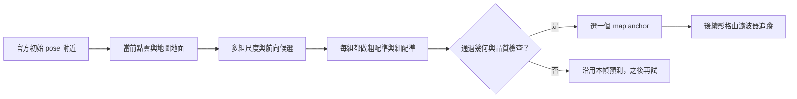

# v7 首幀怎麼重新選定位起點

建議保留官方 `init_guess.txt`，把它當搜尋起點，讓首幀點雲和 LiDAR 地圖決定實際 pose。v7 會把幾個合理的初始化候選都完整配準，再從通過檢查的候選中挑一個。你啟動的 full 已寫出新的首幀結果，完整定位效果仍待本輪結果確認。

## 首幀處理流程

可以把首幀想成：官方 pose 先帶我們到地圖上的大致位置，再用眼前這一幀的點雲比對周圍幾何。舊版會先挑一個候選，再做完整配準；v7 把選擇延後，讓每個候選都完成配準後再比較。

這樣改的原因是：舊結果中，開頭幾幀的地圖配準方向明顯改變，濾波器又拒絕了部分大幅更新。因此要先檢查第一筆定位是否過早選中另一個局部解。這仍是根據紀錄提出的假說，沒有真值能直接判定哪個方向正確。

1. **找到附近地圖。**從官方初始 pose 附近取一塊 LiDAR 地圖，作為搜尋範圍與粗略位置參考。地圖只使用 XYZ 座標。
2. **整理當前點雲並找地面。**先套用相機遮罩及去噪，再讓影像點雲與地圖中的路面傾斜方向對上。這幫助修正 roll／pitch（側傾與俯仰）；平坦地面本身無法告訴我們絕對尺度或車頭方向。
3. **準備幾個起始猜測。**程式沿用原有的兩種尺度來源與最多兩種 yaw（航向角）來源。它們都是供搜尋使用的候選：初始 pose 的高度除以影像地面距離不是實測相機高度；地圖道路的主方向也沒有「車頭往前或往後」的正負資訊。
4. **逐一配準與評分。**每個候選都跑 NDT（由粗地圖格開始對齊）和 ICP（逐步細化點的位置），再用同一批非地面點比較與地圖的幾何吻合程度。候選還要通過收斂、幾何可觀測性、點數覆蓋及搜尋範圍檢查；低殘差本身不足以讓候選過關。
5. **建立第一筆可信定位。**從合格候選中選出幾何分數較好的 pose 和尺度，作為後續濾波追蹤的起點。這次初始位置的修正不會被當成車輛移動，也不會拿來計算車速。若所有候選都失敗，就保留本幀的預測 pose 和原尺度，後續影格再試初始化。



## 這輪首幀實際選了誰

這次有四個候選，完整配準後有兩個通過檢查。v7 對這兩個結果使用同一批非地面點評分，選出了不同於舊版的起點：

| 首幀結果 | 航向角 | 共同幾何分數，越低越吻合 |
| --- | ---: | ---: |
| 舊版選中的候選 | 169.21° | 0.07617 |
| 本輪 v7 選中的候選 | 162.66° | 0.04692 |

也就是說，**以前提早被捨棄的猜測，完整配準後反而更符合本幀地圖幾何。**這是這次修正已在實際首幀發生的行為；幾何分數較低仍不等於已知真實誤差較小。

## 目前驗證到哪裡

141 項生成資料與 CUDA 檢查通過，包括候選失敗時改選其他候選、候選順序交換後結果相同，以及全數失敗時保留 prior。這證明新增機制照預期運作，並不證明真實 Track3 精度改善。

前一輪圖表把既有 v6 開始幾幀的預測、地圖候選和最終輸出畫在一起，也用合成點雲顯示候選如何通過或遭拒。前者是舊版診斷，後者是人工生成場景；兩者都不是本輪 v7 full 的成果圖。本次文件更新時 full 正在執行；完整結束後，圖表會存入該 run 的 `analysis/`。

日後要手動啟動新一輪完整定位，使用固定命令：

```bash
cd /home/ricky/sdc_ros2/midterm01_gpu
./scripts/run.sh --full
```

新定位 run 與圖表會放在 `midterm01_gpu/outputs/run/track03_full_YYMMDDHHmm/`。

## 技術與驗證依據

<details>
<summary>展開數值、歷史診斷與驗證檔案</summary>

### 候選評分和門檻

GroundInitializer 原本會由尺度與 yaw 組合產生候選：兩種尺度乘上最多兩種 yaw，實際數量可能較少。尺度來源是設定 seed `3`，以及初始 pose 相對地面高度除以相機點雲估出的地面距離；高度不是獨立實測值。兩個 yaw 來源是 initial guess 的 yaw 和附近地圖地面 PCA 主軸（道路平面主方向）。PCA 主軸正負不明，所以只取較接近初始 yaw 的方向。

v7 對每個候選依序使用 8／4／2 m 的 NDT 格子及 1 m ICP 細配準，且所有候選共用以原始 prior 為中心的同一地圖區域。完成精修後，以同一批非地面影像點、同一批地圖點及相同角度權重計分，避免不同候選各用不同資料比較：

\[
C(T,s)=\frac{\sum_i w_i\,0.3^2\log\!\left(1+\frac{\min(d_i^2,0.75^2)}{0.3^2}\right)}{\sum_i w_i}.
\]

其中 $d_i$ 是套用候選 pose $T$ 和尺度 $s$ 後，影像點至最近地圖點的距離。超出 0.75 m 的點仍以截斷距離計分，並保留在分母中；0.3 m 與 0.75 m 沿用原初始化最後階段的設定，並非為本次成績另行掃參數。

候選需先通過既有 registration gate（收斂、可觀測、既有對應點 coverage、pose 和尺度有效），再通過非地面特徵加權 coverage 至少 0.6，以及 grounded 平移不超過既有 25 m 界限。通過者才依上式由低分選出；全部失敗時不建立 anchor。

首個 map anchor 交給 ESKF（誤差狀態卡爾曼濾波器）時，直接用配準結果初始化 pose；不以雜訊初始 pose 的 NIS gate 否決首個合格錨點。速度與 bias 回到既有初始化設定，不由這次位置跳變推算。這個 bootstrap 行為沿用 v6；v7 新增的是完整配準後才選候選。

### 舊版觀察及其限制

v4、v5 full 與既有 v6 短段的首幀幾何 map anchor yaw 約 169.207°。既有 v6 到 idx 10 時，map 候選 yaw 約 159.844°，ESKF 的 prediction／final yaw 約 167.037°；該次量測的 NIS（標準化創新量）為 29.651，高於 22.458 gate，因而遭拒。這指出首段的幾何候選與後續濾波器拒絕行為值得檢查，**不能用來判定任何角度是真值**。

idx 0 到 10 的相機 header 時間相隔 0.360 s。已保存的每幀 gyro 最大值乘以區間時間後加總約 1.63°；這是粗略上包絡，並非重新積分，也不是車輛轉向真值。idx 10 的 PnP 旋轉率約 0.036 rad/s，同樣只是模型估計。IMU 抽樣、未標定外參及視覺估計仍可能造成差異。

既有 v6 短段在結果 metadata 記錄 1257 幀。該 run 的 `result_3.csv` 有 3142 列，而且 SHA 與 metadata 不符；其修改時間早於本次工作。此 CSV 不作為診斷依據，也沒有改寫它或舊 run。診斷使用的 pose trace、observations 與其他歷史輸出 SHA 均符合原紀錄，稽核細節見下列檔案。

### 本輪首幀的實際紀錄

使用者啟動的 run 為 `track03_full_2610251527`；本次更新時仍在執行。idx 0 共評估四個候選，索引 0、1 未收斂；索引 2、3 通過品質檢查，最後選擇索引 2。共同評分使用 3992 個非地面特徵，沒有使用後續影格：

| 候選索引 | XY 位置（m） | yaw（度） | scale | 共同 cost | 加權 coverage |
| --- | --- | ---: | ---: | ---: | ---: |
| 2，本輪選中 | (659.197906, -222.052519) | 162.655742 | 6.412735 | 0.046922 | 0.987755 |
| 3，對應舊版選擇 | (658.768810, -220.280918) | 169.207410 | 6.793453 | 0.076173 | 0.855191 |

數值取自該 run [observations.jsonl](../outputs/run/track03_full_2610251527/observations.jsonl) 的第一行 `initialization.refinements`／`selection`；首筆輸出可核對 [pose_trace.jsonl](../outputs/run/track03_full_2610251527/pose_trace.jsonl)。這些檔案仍持續追加，本次文件只讀取已寫出的首幀，沒有改寫執行快照或定位結果。

### 檢查與圖表

- 最終生成資料／CUDA suite：141 passed、227.42 秒，另有既有 Matplotlib `Axes3D` 警告。[pytest.xml](../outputs/run/track00_test_2610251515/pytest.xml)、[test_info.json](../outputs/run/track00_test_2610251515/test_info.json)。
- 本次核對 60 個程式、設定與測試檔符合受測來源 SHA：[live source check](../outputs/run/track00_test_2610251515/live_source_check.json)。
- 既有 v6 起始 pose、prediction、map 候選和 NIS 圖：[01_saved_startup_diagnosis.png](../outputs/run/track00_test_2610251515/analysis/01_saved_startup_diagnosis.png)／[PDF](../outputs/run/track00_test_2610251515/analysis/01_saved_startup_diagnosis.pdf)。
- 合成場景的候選分數、coverage 和注入失敗案例：[02_synthetic_startup_selection.png](../outputs/run/track00_test_2610251515/analysis/02_synthetic_startup_selection.png)／[PDF](../outputs/run/track00_test_2610251515/analysis/02_synthetic_startup_selection.pdf)。已知 scale=7 的生成案例估到 7.013634，位置差 0.02309 m；刻意注入的 24 m 錯誤候選遭拒後，alternate 候選位置差 0.01334 m。這些數字只描述合成資料，不是 Track3 定位誤差。
- [完整圖表說明、數值及來源 manifest](../outputs/run/track00_test_2610251515/analysis/README.md)；[診斷用歷史輸出 SHA 稽核](../outputs/run/track00_test_2610251515/historical_output_check.json)。
- 歷史 frame 0–10 的唯讀證據：[startup_evidence.json](../outputs/run/track00_test_2610251509/startup_evidence.json)、[sensor_evidence.json](../outputs/run/track00_test_2610251509/sensor_evidence.json)；v6 短段紀錄：[test_info.json](../outputs/run/track03_test_2610251424/test_info.json)。

</details>
