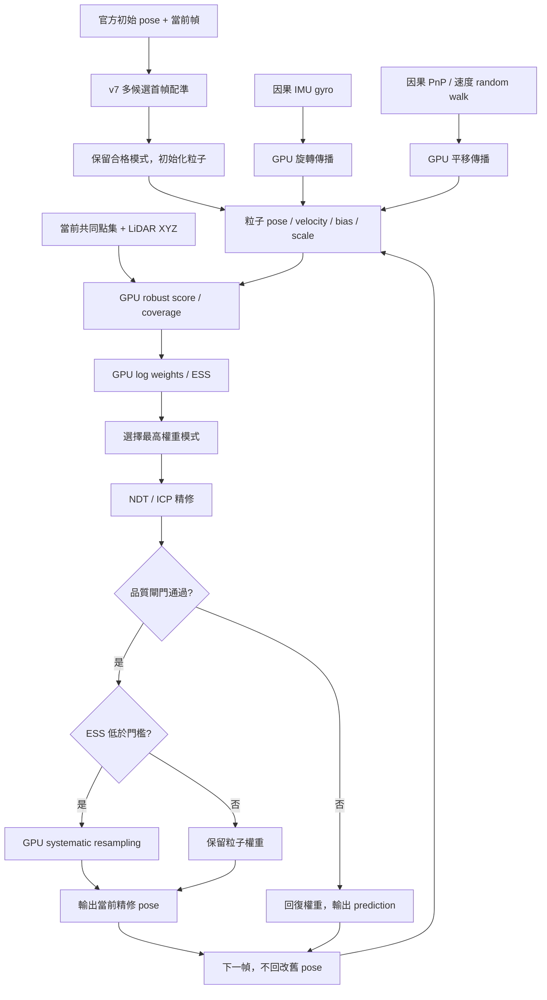

# v8：GPU 粒子定位與取消 Kalman

## 目前進度與下一步

v8 是一個待驗證的定位版本。它把多個 pose（位置與方向）和 scale（點雲尺度）假設保留為粒子，在 GPU 上評分當前影像點雲與 LiDAR 地圖的吻合程度；新路徑不使用 Kalman filter、Kalman gain、NIS gate 或 covariance update。

v8 已完成 168 項合成與 CUDA 回歸檢查，並核對 CSV／TXT、整數奈秒時間及來源 SHA。**目前沒有 v8 真實 Track3 定位或精度改善證據。**開發期間保護的 v7 full 已自然完成 3142 幀，來源與輸出 SHA 全數相符；之後才完成新版 GPU 檢查與套用，沒有中斷 v7。

使用者手動啟動完整定位，命令仍是：

```bash
cd /home/ricky/sdc_ros2/midterm01_gpu
./scripts/run.sh --full
```

完整定位和成功 full 的標準圖放在新建的 `outputs/run/track03_full_YYMMDDHHmm/`。v8 額外的 ESS／權重、coverage／重採樣及耗時圖已接入 `scripts/analyze_monte_carlo.py`，成功 full 的標準圖完成後自動產生於 `analysis/monte_carlo/`，附來源 SHA manifest；失敗另記 `monte_carlo_analysis_status.json`，保留定位成功狀態。現有[本次圖表](../outputs/run/track00_test_2610251625/analysis/README.md)全部來自合成資料，不是 v8 full 圖。

## 從觀察到假說

v7 已可在首幀建立多個候選並讓各自完成配準；這些候選適合避免太早丟棄其中一個幾何解。不過，後續追蹤仍依賴單一預測狀態和 Kalman 更新。如果 prediction 和 map registration 的方向不同，單一狀態可能拒絕本幀地圖解或困在另一個局部解。

因此 v8 測試的假說是：在每幀繼續維持多個因果 pose／scale 解，使用同一批當前點和地圖支持更新它們的相對權重；遇到歧義時，多峰分布比單一平均 pose 更能保留選擇。Monte Carlo Localization 使用樣本近似位置分布是既有方法；本專案的資料權重、proposal 和門檻則是本次工程實作，不能從論文直接推出會改善此 Track 的精度。[Fox 等人，AAAI 1999](https://robots.stanford.edu/papers/fox.aaai99.pdf)

粒子數有限，初始假設也有限。分布仍可能漏掉真實解、因多次更新而退化，或被地圖重複幾何誤導。下述設計是待以合成測試、受授權的短段和使用者日後 full 結果檢查的機制，不是真值精度結論。

## v8 每幀怎麼運作

1. **由 v7 首幀流程建立錨點。**官方初始 pose 仍用來取附近 submap。GroundInitializer 產生 scale／yaw 候選；每個候選分別跑完整 NDT→ICP 和現有品質閘門。v8 將所有通過閘門的 seed 留作粒子起點，以有限 Gaussian 擾動擴展 pose 與 log-scale。初始粒子不是從全地圖均勻撒出；它是官方先驗與當前首幀幾何的局部初始化。
2. **以因果資料預測粒子。**IMU gyro 在每段相鄰影格時間內傳播方向，並依 IMU→PLY 外參轉成相機點雲座標的旋轉。有效視覺 PnP 位移用來預測平移；沒有 PnP 時，速度依 random walk 傳播。粒子另加位置、gyro bias 和 log-scale 的擾動。當前影格只使用已抵達且時間不晚於相機影像的 IMU 樣本。沒有重力補償，也不把 accelerometer 積分成位置，避免以未驗證的重力方向和 bias 累積漂移。
3. **讓所有粒子共用當前觀測。**由當前遮罩後點雲抽出相同 voxel sample；依方位角與仰角格給點權重，讓一面特別密集的牆不獨占分數。每個粒子把這批點轉到 map，使用 CUDA nearest map-point search 算 robust 距離代價和半徑內 coverage。每個候選使用同一點集、同一張局部地圖和同一評分規則。
4. **在 GPU 更新權重。**令粒子 (j) 的距離代價為

   \[
   C_j=\sum_i a_i\,\sigma^2\log(1+d_{ij}^2/\sigma^2),\quad \sum_i a_i=1,
   \]

   其中 \(d_{ij}\) 是粒子轉換後的點到 map 最近點距離，超出搜尋半徑的點留在代價中作為截斷懲罰。v8 設定 \(\sigma=0.3\,m\)。將其轉成 tempering score：

   \[
   \log \tilde w_j=\log w_j-\frac{N_{eff} C_j}{2\sigma^2},
   \qquad w_j=\frac{\exp(\log\tilde w_j)}{\sum_k\exp(\log\tilde w_k)}.
   \]

   指數形式的權重累加、log-sum-exp 正規化及有效粒子數
   \(ESS=1/\sum_j w_j^2\) 都在 CUDA 上。`effective_points=8` 是為影像點雲相關性設定的溫和權重倍率，不是量測出的獨立點數，也不是校準過的高斯機率或可直接解讀的可信度。
5. **選模式並精修。**先選本幀權重最高的粒子作起點，跑 NDT/ICP 並檢查收斂、可觀測性、coverage 和 scale。精修只產生當前輸出，不把同一批地圖點再當另一筆獨立量測，也不將粒子 posterior 回置到精修 pose。
6. **確認接受後才提交權重與重採樣。**配準通過且本幀有 cloud likelihood 時，若 `ESS < 0.5 × particle_count`，使用 GPU `cumsum` 與 systematic resampling（系統式重採樣）抽出下一幀粒子；重採樣後仍保留已選中的模式代表，避免均勻權重的索引順序改變輸出模式。配準拒絕時回復本幀權重，輸出 prediction；靜止時維持錨定 pose。本版固定 256 粒子，沒有 KLD-sampling 或自適應粒子數。`cloud.committed`／`rolled_back` 分開記錄實際提交與回復，ESS 是嘗試更新後、重採樣前的值。

粒子距離、權重和、正規化、ESS、前綴和、NDT/ICP 的小型線性方程、GroundInitializer 線性方程及 line-search 內積，v8 都指定由 CUDA 執行。CPU 仍負責檔案 I/O、OpenCV 影像追蹤／PnP、控制流程與少量診斷資料搬回；這些不是點雲或粒子 likelihood 的 CPU 降級路徑。CuPy `cumsum` 是 systematic resampling 前綴和所使用的 GPU operation。[CuPy 文件](https://docs.cupy.dev/en/stable/reference/generated/cupy.cumsum.html)



## 直接改哪些參數

粒子與似然設定集中在 [`track3/monte_carlo_parameters.py`](../track3/monte_carlo_parameters.py)。先保持單一組設定，參數的作用如下：

| Python 常數 | 目前候選值 | 調整效果與限制 |
|---|---:|---|
| `PARTICLES` | 256 | 增大可增加局部候選覆蓋與 GPU 工作量，不能保證較準。 |
| `SEED` | 20261025 | 固定 CUDA 隨機數產生器初始種子，方便同版本重現；不同種子是不同抽樣，不是獨立精度證據。 |
| `PARAMETERS['max_points']` | 512 | 限制每個粒子共同評分的點數，減少運算量；變更會改似然統計。 |
| `robust_m`、`radius_m` | 0.3 m、1.5 m | 分別決定 robust 距離尺度與搜尋半徑。半徑外的點不消失，會以截斷距離計分。 |
| `effective_points` | 8.0 | 決定單幀雲幾何分數對權重的作用大小；不是有效獨立點數標定。越大越容易集中到少數粒子。 |
| `ess_fraction` | 0.5 | ESS 低於粒子數的一半便重採樣；這是演算法門檻，不是精度門檻。 |
| `bootstrap_*_std_*` | 0.5 m、5°、0.05 | 首個 map anchor 周圍 pose／log-scale 粒子擾動，單位如名稱；不是外參標定誤差。 |
| `position_diffusion_m_sqrt_s` | 0.1 | 每段依 \(\sqrt{\Delta t}\) 加入的位置擾動，單位 m/√s。 |
| `velocity_diffusion_mps_sqrt_s` | 2.0 | 無 PnP 時速度 random walk 擾動，單位 (m/s)/√s。 |
| `visual_velocity_std_mps` | 1.0 | PnP 區間平移速度的不確定度假設，單位 m/s；不是獨立速度真值。 |
| `log_scale_diffusion_sqrt_s` | 0.15 | log-scale 每段隨時間的擾動幅度，無因果尺度量測時保持尺度探索。 |

本表是本版的工程預設值；合成檢查通過仍不代表精度最佳化或真實資料上最合適的值。改參數時直接改此 Python 檔、一次改一項有物理／數值理由的設定，再以同一份合成條件比較。

相機與 PLY 的座標外參尚未標定；修改外參時要記錄假設和來源，不能以粒子收斂當成標定結果。

**參數來源核對：**v8 runner 透過 `resolve_motion_config()` 讀取 [`track3/imu_parameters.py`](../track3/imu_parameters.py) 的 `GYRO_NOISE_DENSITY_RAD_S_SQRT_HZ` 與 `GYRO_BIAS_RANDOM_WALK_RAD_S_SQRT_S`，也用同檔案的 `IMU_RPY_DEG`／`IMU_XYZ_M` 建立外參。`MAP_POSITION_STD_M`、`MAP_ROTATION_STD_DEG`、`YAW_ROBUST_ENABLED`、`YAW_HUBER_SIGMA` 是舊融合參數，v8 不讀取。粒子首錨點的 gyro bias 擾動仍取 `config/track3.json` 中的 `imu.initial_std[12:15]`，它只生成初始樣本，不進行 covariance 更新。有效值與來源要以每輪保存的 `parameters.json` 為準。

## 驗證到哪裡

| 項目 | 狀態 |
|---|---|
| 程式機制 | 已實作；GPU 權重、ESS、系統式重採樣、失敗回復、靜止、因果時序與 solver 檢查通過。 |
| 合成檢查 | 最終同一輪 168 passed，272.08 s；有既有 Matplotlib Axes3D warning。專項先前 25 passed。 |
| 真實短段 | 尚未授權、尚未執行。 |
| Track3 full／成績 | 尚未以 v8 執行，沒有精度比較或成績證據。 |
| 診斷圖 | 合成模式／權重及 3 幀 runner 檢查圖已產生；未執行 v8 full，沒有真實 full 圖。完整診斷繪圖的 4 項 CPU 檢查也包含於最終 suite。 |

驗證結果、run ID、來源 SHA 和圖表應只在完成實測後寫入對應唯一 `outputs/run/`；不要把測試通過、map acceptance、ESS 或 registration residual 說成軌跡精度。

## 已知限制

- 256 粒子只是局部有限樣本，初始粒子從官方 guess 附近與首幀合格幾何候選生成。若正確模式沒有抽中，後續局部搜尋可能無法找回。
- 系統式重採樣在分布尖銳時會複製粒子；無 PnP 的平移 prediction 依賴未校準 random-walk 速度，不會依 IMU 加速度估計。失去地圖支持時，粒子可能漂移或全部被低 coverage 排除，GPU 程式會回報失敗，不靜默改用 CPU。
- robust likelihood 使用經角度加權的點雲幾何分數作 tempering；點雲點與相鄰影格高度相關，權重不應解讀成校準後的 Bayesian posterior 或信賴區間。
- NDT/ICP 在目前選中的粒子附近找局部最優解。它可能幫助輸出精度，但精修本身沒有被當作獨立的 Bayesian measurement；多模態粒子與精修結果未必一致。v8 不用 future frame、RTS、backward smoothing、GPS 或定位後軌跡修正。
- IMU gyro 外參與 noise 仍是假設。沒有加速度位置積分也代表低視覺支援時，平移不會有物理慣性模型保證。
- 圖表、格式完整或高接受率不能證明精度；要判斷是否優於 v7，須在程式與輸入完全可追溯的完成 run 上，按官方規則或獨立真值評估。

## 環境與可追溯證據

首輪 151 passed／15 failed，失敗均因容器缺少 `libcurand.so.10`；已固定加入 `nvidia-curand-cu12==10.3.9.90`，保存 wheel SHA 和安裝紀錄。`create_rng()` 明確載入 NVIDIA wheel 的 library，缺失時直接失敗，不用 CPU 隨機數替代。requirements、Compose 的 library path 和專用 GPU image 建置來源同步更新；既有容器補上同一 wheel，沒有重啟 v7 或 Docker daemon。

第二輪專項遇到合成測試場景仍有幾何重疊：11 m 寬地圖平移 10 m，不能假定 coverage 必為零。改用保證不重疊的 24 m 合成假設，沒有修改算法參數或門檻。第三輪專項 25 項通過；最終 suite 的完整結果見下列證據。

- [最終 pytest XML](../outputs/run/track00_test_2610251625/pytest_attempt_04.xml)、[來源 manifest](../outputs/run/track00_test_2610251625/pytest_attempt_04.source_manifest.json)、[測試資訊](../outputs/run/track00_test_2610251625/test_info.json)。
- [合成圖表與方法](../outputs/run/track00_test_2610251625/analysis/README.md)、[圖表來源 SHA](../outputs/run/track00_test_2610251625/analysis/manifest.json)。
- [v7 完成後核對](../outputs/run/track00_test_2610251625/v7_after_completion_check.json)、[依賴套件 SHA](../outputs/run/track00_test_2610251625/dependency_manifest.json)。

run 內 `source/` 是最終測試當時的快照，README／本文件的測試結論在驗證後另外整理；執行程式與設定 SHA 另由 `live_source_check.json` 對照。本版沒有真實短段／full／榜分改善證據。

容器重建檢查另發現快照以 copyfile 保存來源時不保留 executable mode；Dockerfile 改以 `COPY --chmod=755` 明訂 entrypoint 可執行。重新建置與不啟動 GPU 計算的 image 啟動／依賴載入檢查通過。這是最終回歸測試後的環境修正，未改算法與參數；證據為 `container_build_attempt02.log`、`built_image_check_attempt02.log`。
