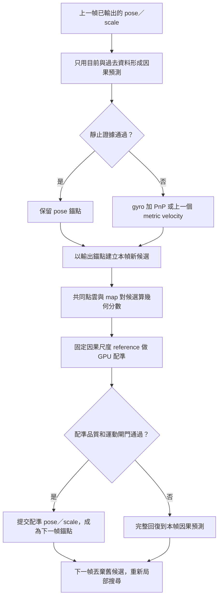

# v8 Track3 失敗診斷與 v8.1 局部搜尋修正

這份文件回答兩件事：v8 為何在開始一段直線後逐漸失去 map 配準，以及 v8.1如何避免亂數尺度候選直接改動輸出狀態。現有證據支持「尺度候選選擇與 pose 跳動先破壞幾何支援，之後才出現長段停車與連續拒絕」；不是只有停車判斷造成結果消失。

v8.1 已套用；最終完整合成／CUDA 回歸套件 178 passed，耗時 263.91 秒；第一輪專項另有 44 passed／91.51 秒。沒有跑 v8.1 真實短段或 full，也沒有 ground truth 精度比較，因此目前只能說程式機制已實作並通過這輪專項檢查，不能說 Track3 已修好或 v8.1 更準。

## 先看 v8 實際發生什麼

v8 full 確實輸出了 3142 幀，但只有 637 幀接受 map 更新；最後一個接受點在 idx 2440，後面 701 幀都沒有再接受 map。輸出檔存在不等於後段定位仍有地圖校正。v8 沒有記錄可用的正式分數，`test_info.json` 的 `score` 是 `null`。

| 觀察 | v8 紀錄 | 代表什麼 |
| --- | ---: | --- |
| 最大單幀位置變化 | idx 416：10.56443 m／0.03600007 s，約 293.46 m/s | 估計中出現了無法由正常車輛運動解釋的跳動；不是 ground truth 誤差量測。 |
| 對照現有運動閘門 | 81 次平移超過 50 m/s；診斷另計 252 次 yaw rate 超過 2 rad/s | v8 未用這組既有上限拒絕配準輸出；v8.1 對非 bootstrap 的已接受配準再做同來源的運動合理性檢查。 |
| 尺度與點雲支援 | idx 479 首次小於 1；idx 521 開始出現 insufficient voxel support | 尺度已在停車前下滑，點雲經 voxel 化後無法提供足夠幾何支援。 |
| 尺度變化來源（idx 300–599 的累積 log 尺度變化） | 預測 +0.3241；選中粒子 −3.4850；配準精修 +0.0577 | 這段輸出尺度縮小主要跟選中粒子的尺度有關；配準精修只小幅抵銷，沒有把尺度拉回。 |
| 後段配準 | 3142 幀中 637 幀 map accepted；最後 accepted idx 2440；末段拒絕 701 幀 | 長段拒絕不是只有 CSV 顯示或最後畫圖失敗，map 更新本身已停止。 |
| 靜止判斷後 PnP 缺口 | v8 本次紀錄 `pnp_skipped_after_stationarity_rejected` 為空 | 新增的 PnP 流程修正沒有在這次 v8 run 觸發，不能把它當成 v8 失效主因。 |

關鍵順序是：idx 416 已有最大 pose 跳動，idx 479 尺度首次小於 1，idx 521 點雲支援不足；這些都早於長時間停車診斷區間。縮小的尺度讓同一批重建點在公尺座標中更擠，voxel 支援隨之變少，配準較難找到足夠對應；後面即使影像還有變化，map 更新也可能持續被拒絕。這是從 run 的時序、點數與配準原因推得的機制解釋，沒有外部真值證明 pose 真正偏差多少。

### 圖表

以下圖表只讀取 v8 已完成的 run，未重跑定位。圖上的 pose、scale、coverage、ESS 或接受狀態都是估計診斷，不能當成 ground truth 精度。

- [01｜整體軌跡、尺度與接受狀態 PNG](../outputs/run/track00_test_2610252220/analysis/01_v8_failure_overview.png)／[PDF](../outputs/run/track00_test_2610252220/analysis/01_v8_failure_overview.pdf)
- [02｜尺度變化、選中候選與點雲支援 PNG](../outputs/run/track00_test_2610252220/analysis/02_v8_scale_support_chain.png)／[PDF](../outputs/run/track00_test_2610252220/analysis/02_v8_scale_support_chain.pdf)
- [03｜停車、再起步與輸出狀態 PNG](../outputs/run/track00_test_2610252220/analysis/03_v8_stop_resume.png)／[PDF](../outputs/run/track00_test_2610252220/analysis/03_v8_stop_resume.pdf)
- [圖表說明與限制](../outputs/run/track00_test_2610252220/analysis/README.md)

## 為什麼 v8 會把尺度帶偏

v8 用同一組粒子權重跨影格累積幾何分數；新一幀的粒子分數是加到舊權重上。選出的粒子會立刻成為當幀配準 seed 的 pose 和 scale，而 registration 的尺度正則化與點雲取樣也以這個 scale 作基準。於是「某次候選剛好較低」不只影響搜尋排序，也會改變下一步要配準的尺度座標與資料支援。idx 300–599 的 log 尺度分解與 v8 source 寫出的資料流一致：主要下降來自選中粒子，NDT／ICP 精修只略微回升。

舊流程在配準拒絕時會恢復預測 pose／scale，但已接受的配準可能把被粒子選擇與其 scale seed 影響的結果提交為狀態；之後仍保留跨幀粒子權重。這使「上一幀最後真正輸出的 pose」和「下一幀使用的隨機候選族」沒有被強制保持一致。這是程式流程與實際尺度分解共同支持的原因假說，不代表每一幀都由同一個因素造成。

## v8.1 怎麼改

v8.1把 Monte Carlo 限定為**當幀局部幾何搜尋**：用亂數探索附近的 pose／scale 假設，但不把候選分數解讀成機率，也不跨影格保存一個 importance-weighted posterior。它不是新增 Kalman filter，也不是宣稱精確的 Bayesian particle filter。



每一幀的運作順序如下：

1. **先形成不受 RNG 影響的輸出 prior。**以最後一個已提交 pose／scale 為錨點，依因果 gyro 推進姿態；平移依可用的 PnP 位移或上一個 metric velocity 推進。若判定靜止，就保留 pose 錨點。隨機數只改候選，不改這份 prior。
2. **重新提出本幀候選。**將候選分布重設在目前因果預測附近，並保留一個未受擾動的預測候選。舊影格權重不帶到新影格。第 0 幀仍依既有 v7 幾何初始化流程逐一精修合格候選、建立一個 map anchor；這不是宣稱後續保存多峰機率分布。
3. **用共同資料排序局部候選。**所有候選使用同一份當前點雲和 map 鄰近區域，計算 robust point-to-map cost、尺度懲罰與 coverage。分數只排序這一幀；ESS 只表示這批分數集中程度，不是可信機率、真實不確定度或精度。
4. **尺度 seed 和尺度基準分開。**被選候選可以作為 registration 起始值，但點雲 voxel sampling 及 log-scale prior 都固定參照因果預測尺度 `scale_reference`，不會讓隨機 seed 自己移動尺度正則化中心。
5. **只在通過檢查後提交。**配準品質通過，且非 bootstrap 配準的平移／旋轉速度沒有超過既有 visual prior 上限（50 m/s、2 rad/s）時，registration 結果成為新輸出與下一幀錨點。否則 pose 和 scale 一起回復至本幀 prior，候選的亂數尺度不能漏進輸出。
6. **GPU 保持點雲數值路徑。**候選座標、最近鄰幾何分數、CUDA registration、Hessian／梯度累加及 Monte Carlo 分數與 ESS reductions 使用 CuPy／CUDA；影像讀取、OpenCV optical flow／PnP 和檔案 I/O 仍在 CPU。v8.1 不加 CPU 點雲 fallback。

50 m/s 與 2 rad/s 取自既有 `visual_prior` 限制，並非本次從真值重新標定的車輛運動上限。它們只用來擋掉明顯不合理的已接受 map 跳動，不能保證其餘配準正確。

### 靜止判斷與 PnP 的另一個修正

v8.1 把 PnP 評估放到最終 stationary 判斷之後：若影像和 gyro 初步看來安靜，但附近 3D 點支援不足而撤銷 stationary hold，流程仍可評估當幀 PnP 位移。第一輪合成專項測試以生成影像和深度不一致的點雲觸發此分支，確認 PnP 有被計算；v8 的完整 run 本身沒有這個觸發紀錄。因此這是避免另一條退化路徑的流程修正，不是本次 v8 尺度塌縮的觀測主因。

## 目前驗證到哪裡

| 工作 | 狀態 | 解讀限制 |
| --- | --- | --- |
| v8 3142 幀 run 與輸出讀取 | 已完成、唯讀分析 | 無 ground truth；formal score 為 null；輸出完整不表示定位正確。 |
| 三組 v8 診斷圖 | 已產生 PNG／PDF | 用於定位模式與程式診斷，不是精度圖或真值比較。 |
| v8.1 第一輪專項合成檢查 | 44 passed，91.51 s | 包含尺度 rollback、固定尺度 reference、運動閘門、PnP 分支，以及 120 幀直行—停車—再起步狀態機制；其中 map correction 是合成注入，不是真實 registration 精度。 |
| v8.1 完整合成／回歸 suite | 178 passed，263.91 s | 同一凍結來源完整通過；有既有 Matplotlib Axes3D warning。 |
| v8.1 真實 Track3 短段／full | 尚未執行 | 沒有授權的真實定位；此文件不宣稱已改善真實 Track3。 |
| 正式成績或真值誤差 | 無 | v8 score 為 null；v7／外部 CSV 不作真值。 |

第一輪測試 log 和 JUnit 記錄在 [pytest_attempt_01.log](../outputs/run/track00_test_2610252220/pytest_attempt_01.log) 與 [pytest_attempt_01.xml](../outputs/run/track00_test_2610252220/pytest_attempt_01.xml)。該輪 source SHA 見 [pytest_attempt_01.source_manifest.json](../outputs/run/track00_test_2610252220/pytest_attempt_01.source_manifest.json)。最終完整 suite 見 [pytest_attempt_02.xml](../outputs/run/track00_test_2610252220/pytest_attempt_02.xml) 與 [最終受測來源](../outputs/run/track00_test_2610252220/pytest_attempt_02.source_manifest.json)。這些合成檢查只驗證狀態交易與計算路徑，不代替使用者手動跑 full。

## 下一步

完整合成 suite 和診斷語義更新已完成。使用者可在 Ubuntu 主機手動啟動新的完整 Track3；本次沒有啟動真實定位：

```bash
cd /home/ricky/sdc_ros2/midterm01_gpu
./scripts/run.sh --full
```

runner 會建立新的唯一 `outputs/run/track03_full_YYMMDDHHmm/`，記錄當輪 source SHA、輸出、耗時和失敗資訊。新的 full 和圖表不得覆寫 v7／v8 歷史 run。判讀時先看 pose jump、scale、cloud voxel support、registration rejection reason、stationary/PnP 狀態及輸出 SHA；不把接受率、ESS、coverage、GPU 使用率或輸出完整當成精度證明。若沒有獨立 ground truth，結論只能是「機制及數值行為有／沒有符合預期」，不能稱作更準。

## 附錄：run ID、數值與 SHA

### v8 full 證據

- Run：[track03_full_2610251835](../outputs/run/track03_full_2610251835/test_info.json)，版本 `track3_cuda_v8_monte_carlo_no_kalman`，status `success`，3142 幀；score 與 score source 為 null。
- Map 更新：637/3142；stationary frames 1242；last accepted idx 2440；最後 701 幀無 map accepted；最長連續拒絕 1320 幀。
- 最大 pose step：idx 416，10.5644300006 m／0.03600007 s，293.455818 m/s；最壞 prediction-to-final gap 10.5357353 m。
- 尺度支援：首個 scale < 1 在 idx 479；首個 insufficient voxel support 在 idx 521。
- idx 300–599 的 log scale 累積分解：prediction `+0.3241064540`；accepted particle selection `−3.4850248028`；registration refinement `+0.0577304997`。
- 診斷 metrics：[saved_v8_metrics.json](../outputs/run/track00_test_2610252220/analysis/saved_v8_metrics.json)，SHA256 `76759dd9f8c03f5b241edfdebc40df93462a2e173ecff03b613b7d977928ae59`。
- 診斷程式：[analyze_saved_v8.py](../outputs/run/track00_test_2610252220/analyze_saved_v8.py)，SHA256 `49f5b461e3778dc9261aef0d24c0d0df1e531cba21b3bedaf9995295fd642531`。
- v8 `source_manifest.json` SHA256 `57850830770842bfc1f203fdeeaf20739219a8a2e42d45e640e99ece83eebbb9`；比對時 `source_mismatches=[]`，現有 outputs 除 canonical CSV 檔名外 SHA 相符。
- v8 run 原 `result_3.csv` 的記錄 SHA，以及同 run `result_3_monte.csv` 實際 SHA 均為 `a6b42c95a6ce526c08f7033c4e198b8e4379c493db83fb3274e95bce2e2c8380`。只讀取 alias 驗證，沒有改名原檔或回寫 metadata。
- 圖表 manifest：[analysis/manifest.json](../outputs/run/track00_test_2610252220/analysis/manifest.json)。沒有完整粒子 population dump，因此不能事後重建每幀全部候選分布；圖表只用原有 observations、pose trace、timings、poses 和結果 CSV。

### v8.1 research run

- Research run：`track00_test_2610252220`；候選 source 在 `source/`，v8 唯讀診斷在 `analysis/`，第一輪專項 test 輸出在 `pytest_attempt_01.*`。
- 實作快照參考：[monte_carlo.py](../outputs/run/track00_test_2610252220/source/track3/monte_carlo.py)、[gpu.py](../outputs/run/track00_test_2610252220/source/track3/gpu.py)、[motion_constraints.py](../outputs/run/track00_test_2610252220/source/track3/motion_constraints.py)、[run_track3.py](../outputs/run/track00_test_2610252220/source/scripts/run_track3.py)；版本設定在 [config/track3.json](../outputs/run/track00_test_2610252220/source/config/track3.json)。
- 最終完整 suite：178 passed／263.91 s，來源 manifest SHA256 `540b9ad7ef591246a55b44a455a4ba1535a362f38bfa7e67eb936b54feed9127`。套用前後的程式／設定比對記在 [live_source_check.json](../outputs/run/track00_test_2610252220/live_source_check.json)；Markdown 的測試結論在驗證後另外整理，不覆寫受測程式快照。

### 新增合成圖表與限制

- [25 幀 GPU 地圖配準 PNG](../outputs/run/track00_test_2610252220/analysis/04_v9_synthetic_geometry.png)／[PDF](../outputs/run/track00_test_2610252220/analysis/04_v9_synthetic_geometry.pdf)：人工地圖，直行、停車、raw units 變化和轉彎再起步；誤差僅相對生成的真值。
- [120 幀狀態機制 PNG](../outputs/run/track00_test_2610252220/analysis/05_v9_synthetic_state_transaction.png)／[PDF](../outputs/run/track00_test_2610252220/analysis/05_v9_synthetic_state_transaction.pdf)：幾何量測由測試注入，用來檢查提交／回復與長停車後錨點，不是完整定位精度測試。
- [合成數值](../outputs/run/track00_test_2610252220/analysis/v9_synthetic_metrics.json)、[圖表與來源 SHA](../outputs/run/track00_test_2610252220/analysis/manifest.json)。

v8.1 的完整結果圖依 `monte_carlo_mode` 切換語義：局部候選分數 ESS 與最大權重只表示本幀分數集中；不畫 v8 重採樣門檻，支援圖改為候選評分／map update。v8 歷史輸入仍保留原來的 PF 圖表語義。

本版沒有全地圖失鎖恢復或跨幀多峰 posterior；初始 anchor 錯誤、外參未標定或持續視覺不足仍可能失敗。此次修正的是已觀測到的狀態／尺度傳遞問題，沒有利用後續影格回改舊 pose，也沒有使用外部軌跡或榜分擬合。

命名修正：本版統一稱 **v8.1**，與先前暫稱 v9 的修正版為同一套算法。已保存研究 run、來源快照及圖表檔名中的舊版本標記維持原樣，保留其 SHA 證據。
