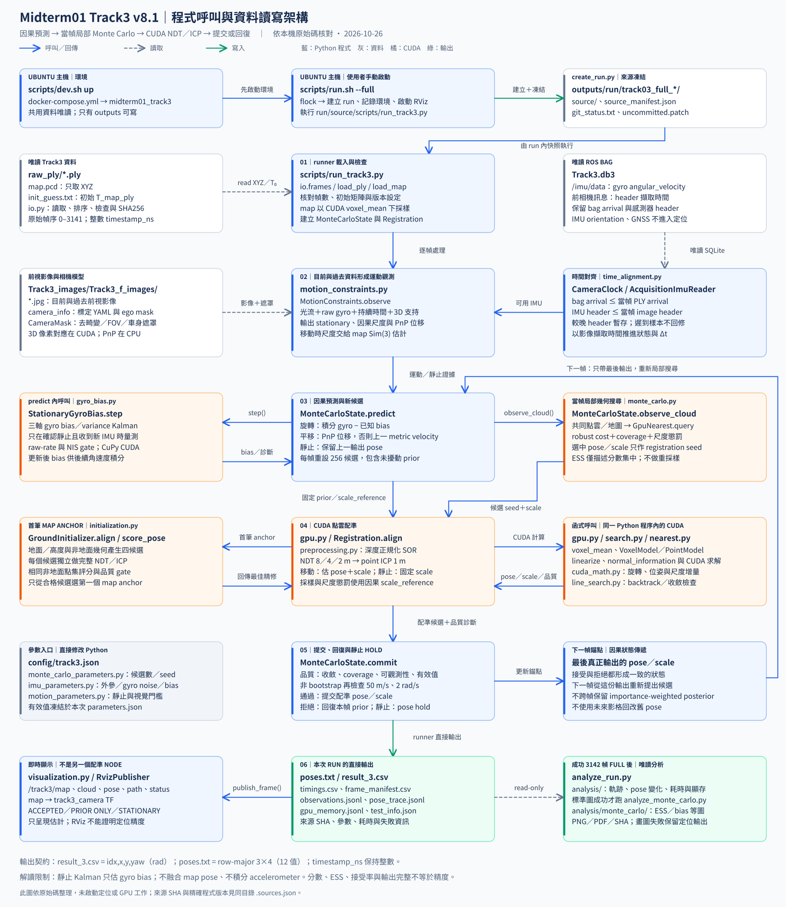

# 63｜Track3 v8.1 程式呼叫與資料讀寫架構

這份文件把 Track3 v8.1 從主機啟動、讀取影像／IMU／點雲，到輸出每幀 pose 的程式關係畫清楚。它依本機程式與設定整理，讓你能沿著箭頭找到資料在哪裡讀、何時做預測、配準結果如何提交，以及產生哪些紀錄。

目前設定版本為 `track3_cuda_v8.1_committed_anchor_stationary_gyro_bias_kalman`。主流程先依當前及過去影像、陀螺儀和 3D 特徵檢查車輛是否靜止；再從最後一個已輸出的 pose／scale 形成因果預測，在附近做當幀 GPU Monte Carlo（隨機候選）幾何搜尋，並用 GPU NDT（常態分布轉換）→ ICP（迭代最近點）對齊 LiDAR map。只有通過品質與運動閘門的 map pose 才成為新的錨點；拒絕時回到本幀預測。

## 一張圖看主流程

[開啟 SVG 向量圖](63_V8_1_PROGRAM_ARCHITECTURE.svg) · [開啟 PNG 圖片](63_V8_1_PROGRAM_ARCHITECTURE.png)。SVG 可放大，PNG 可放進報告或簡報。下方 Mermaid 是可編輯的主要程式／資料關係。

圖中方框是實際入口、模組或檔案。實線藍箭頭表示呼叫／回傳，虛線灰箭頭表示讀取，實線綠箭頭表示寫入；橘色標示 CUDA 計算。Track3 v8.1 沒有 Track1／2 的 GNSS prior、RTS 軌跡平滑或 C++ `sensor_guided` 呼叫鏈。

## 可編輯的程式／檔案關係

```mermaid
flowchart LR
    HOST["Ubuntu 主機<br/>scripts/dev.sh up"] -->|啟動專用環境| CONTAINER["midterm01_track3<br/>ROS 2 / CUDA container"]
    RUN["scripts/run.sh --full<br/>使用者手動啟動"] -->|flock + 建立唯一 run| CREATE["scripts/create_run.py"]
    CREATE -->|凍結來源、設定、SHA| SNAP["outputs/run/track03_full_*/source<br/>source_manifest.json / patch"]
    RUN -->|啟動 RViz、執行快照| ENTRY["source/scripts/run_track3.py"]
    SNAP -.->|讀取 run 內快照| ENTRY

    PLY["Track3/raw_ply/*.ply<br/>timestamp 排序的前視點雲"] -.-> ENTRY
    MAP["map.pcd + init_guess.txt<br/>map 只用 XYZ"] -.-> ENTRY
    CAMERA["前視 JPG + camera_info<br/>標定 / ego mask"] -.-> MASK["CameraMask<br/>FOV 與車身遮罩"]
    PLY -.->|逐幀讀取| MASK
    MASK -->|遮罩後點雲| CONSTRAINTS["MotionConstraints<br/>影像 flow / 靜止 / 尺度 / PnP"]
    CAMERA -.-> CONSTRAINTS

    BAG["Track3.db3<br/>/imu/data + camera header"] -.-> CLOCK["CameraClock<br/>AcquisitionImuReader"]
    CLOCK -->|僅交付目前影像可用的 IMU| STATE["MonteCarloState.predict<br/>gyro 姿態 / 視覺位移 / 靜止 hold"]
    CONSTRAINTS -->|因果 PnP、停車與尺度證據| STATE
    STATE -->|確認靜止時，raw gyro 零速量測| BIAS["StationaryGyroBias<br/>三軸 bias Kalman"]
    BIAS -->|後續 gyro 旋轉積分| STATE
    STATE -->|輸出 prior + 每幀局部候選| MC["MonteCarloState.observe_cloud<br/>共同幾何分數、coverage、ESS"]

    MAP -.->|XYZ map| REG["Registration.align<br/>品質 gate"]
    MC -->|局部 seed；固定 prior scale reference| REG
    MASK -->|遮罩點雲| REG
    REG -->|呼叫預處理| PRE["filter_camera_cloud<br/>深度正規化 SOR"]
    PRE -->|回傳去噪點雲| REG
    REG -->|首幀：GroundInitializer 多候選完整配準| INIT["GroundInitializer.align<br/>共同非地面幾何選 anchor"]
    INIT --> REG
    REG -->|CUDA 對應、Hessian/gradient、NDT → ICP| CUDA["gpu.py / search.py / nearest.py<br/>CuPy CUDA solver"]
    CUDA -->|回傳配準數值| REG
    REG -->|pose、scale、品質診斷| COMMIT["MonteCarloState.commit<br/>運動 gate、提交或回復"]
    COMMIT -->|最後輸出成為下一幀錨點| STATE
    COMMIT -->|runner 直接寫入| OUTPUT["poses.txt / result_3.csv<br/>timings.csv / observations.jsonl<br/>pose_trace / manifests / SHA"]
    COMMIT -->|store 最後尺度與影像狀態| CONSTRAINTS
    OUTPUT -.->|成功 full 後唯讀分析| PLOTS["analyze_run.py → analyze_monte_carlo.py<br/>analysis/*.png,pdf<br/>analysis/monte_carlo/*"]
    ENTRY -->|即時顯示估計狀態| RVIZ["RvizPublisher<br/>map / cloud / pose / path / status"]
    classDef program fill:#eff6ff,stroke:#2563eb,color:#172554;
    classDef data fill:#f8fafc,stroke:#94a3b8,color:#334155;
    classDef gpu fill:#fff7ed,stroke:#ea580c,color:#7c2d12;
    classDef output fill:#ecfdf5,stroke:#059669,color:#064e3b;
    class HOST,CONTAINER,RUN,CREATE,ENTRY,MASK,CONSTRAINTS,CLOCK,STATE,COMMIT,RVIZ program;
    class PLY,MAP,CAMERA,BAG,SNAP data;
    class MC,PRE,REG,INIT,CUDA,BIAS gpu;
    class OUTPUT,PLOTS output;
```

實際呼叫鏈由 Python `run_track3.py` 組合各模組；`gpu.py` 內的 registration 不會另起一個 ROS 配準 node。RViz 由 runner 啟動 publisher 來呈現估計中的 map、點雲和 pose；畫面是診斷輸出，不是逐幀真值。

### 首幀與後續影格

第 0 幀沒有過去影像可估運動，因而以 `init_guess.txt` 和初始尺度作初始化先驗。`GroundInitializer` 產生四個幾何候選；每個候選都各自完整跑 NDT／ICP，再以共同非地面特徵分數與配準品質條件選出第一個 map anchor。這次選擇只用當前幀和 map，不讀未來影格。

後續影格由上一個已提交的 pose／scale 形成因果預測。可用的前後影像 3D 對應經 PnP 估計視覺位移；沒有可用 PnP 位移時沿用上一個 metric velocity。陀螺儀預測姿態。確認靜止時輸出 pose hold，且不提交當幀 map 候選；若已確認靜止且有新的、通過門檻的 gyro 樣本，才更新三軸 gyro bias。

Monte Carlo 每幀重設局部候選，含一個不受擾動的因果預測。目前設定為 256 個候選，seed 為 `20261025`。候選一起使用目前點雲、同一 map 區域和同一組幾何權重；分數只供本幀搜尋排序。被選候選可作 registration 起始值，卻不能移動輸出 prior 或尺度懲罰中心。配準通過品質檢查且平移速度／角速度沒有超出既有合理性門檻後，pose 與 scale 一起提交，成為下一幀錨點；否則兩者回復至本幀因果預測。

移動時以 Sim(3)（旋轉、平移與尺度）共同配準，點的轉換為 `p_map = scale × R × p_ply + t`。`ENABLE_MOVING_VISUAL_SCALE = False`，因此移動時不串乘視覺尺度；靜止時只有可靠的近距離 3D 比例才可提供尺度，並固定當幀配準尺度。靜止 pose hold 仍可計算配準作診斷，但不能把它提交成 map 更新。`StationaryGyroBias` 的 Kalman filter（卡爾曼濾波）只更新三軸 gyro bias，供後續旋轉積分使用。

### 時間與計算位置

`CameraClock` 以 PLY 對應的 bag arrival 找到當幀前相機 header 時間。IMU reader 只先讀到不晚於 PLY arrival 的訊息，再只交付 header 時間不晚於目前影像的樣本；header 時間較晚的樣本留到後續影格，遲到的舊樣本不回頭改 pose。frame manifest 保留原始整數奈秒時間戳。

| 工作 | 執行位置 | 說明 |
| --- | --- | --- |
| 檔案讀寫、ROS bag／影像解碼、相機光流與 PnP 求解 | Python／CPU | bag 以唯讀方式開啟；依目前與過去資料形成量測。 |
| 點雲遮罩後索引、深度正規化 SOR、候選最近鄰幾何分數 | CuPy／CUDA | 不靜默改用 CPU 點雲 fallback。 |
| NDT／ICP 對應、目標函數及 Hessian／gradient 累加、線搜尋／求解 | CuPy／CUDA | scale reference 固定來自因果 prior；首幀候選皆走完整配準。 |
| stationary gyro-bias 的三軸預測、NIS 檢查與 Kalman 更新 | CuPy／CUDA | 只量測靜止時的 gyro 零速偏差；不融合 map pose，也不積分 accelerometer。 |
| CSV／TXT／JSONL、RViz 訊息與 Matplotlib 圖檔 | Python／CPU + I/O | 圖表只讀 run 輸出，不修改 pose 或定位結果。 |

50 m/s 與 2 rad/s gate 沿用現有 visual motion 限制，是用於排除明顯異常跳動的條件，並非由 ground truth 標定的車輛物理極限。gyro noise、bias random walk、相機 IMU 外參及初始 scale 也仍包含未標定假設。

## Run 輸出與圖表

`scripts/run.sh --full` 由使用者在 Ubuntu 主機執行。它取得 GPU 工作鎖，呼叫 `create_run.py` 建立唯一 `outputs/run/track03_full_YYMMDDHHmm/`，凍結 `source/`、Git 狀態、差異、來源 SHA、container image 和環境套件，再用 run 快照啟動 ROS runner 及 RViz。runner 從頭到尾直接輸出結果，不依賴另一支事後 pose converter。

| 檔案 | 內容 |
| --- | --- |
| `result_3.csv` | `idx,x,y,yaw`；local 0-based idx，yaw 為 `atan2(R10,R00)` 弧度。 |
| `poses.txt` | 每幀一行 row-major 3×4 矩陣，12 個值，不含 timestamp。 |
| `timings.csv` | `idx,original_idx,timestamp_ns,backend,load_ms,registration_ms,total_ms,map_accepted,scale`。 |
| `frame_manifest.csv` | local／original idx、整數奈秒、PLY 路徑與 SHA256。 |
| `observations.jsonl`、`pose_trace.jsonl` | 各階段診斷、預測／配準／最終 pose、尺度、commit／rollback、靜止與 gyro-bias 更新。 |
| `parameters.json`、`input_sources.json`、`camera_sources.json`、`imu_sources.json` | 凍結的有效設定及來源、SHA、時間與座標契約。 |
| `gpu_memory.jsonl`、`test_info.json`、`console.log` | 記憶體抽樣、狀態／耗時／失敗原因及執行訊息。 |
| `source/`、`source_manifest.json`、`uncommitted.patch` | 本次程式快照、來源摘要及未提交差異。 |

定位成功且完整處理 3142 幀後，`analyze_run.py` 產生 `analysis/` 的軌跡、pose 變化、配準計時 PNG/PDF 和來源 manifest；有完整記憶體記錄時另出 GPU memory 圖。該分析成功後才執行 `analyze_monte_carlo.py`，在 `analysis/monte_carlo/` 產生當幀 score／ESS（有效樣本數）集中度、幾何支持、耗時及 gyro-bias 診斷圖和 manifest。ESS 是當幀分數集中指標，不是校準機率、跨幀 posterior（後驗分布）或精度量測。若畫圖失敗，失敗另記分析狀態檔，原定位狀態和輸出仍保留。

完整 Track3 應有 3142 幀。CSV 欄名、弧度慣例與檔案可讀性屬目前程式契約；仍須對照 Kaggle 官方模板確認評分 frame 對應、欄位及單位，不能只因為 CSV 可讀或上傳成功就視為交付契約已驗證。

## 閱讀入口與來源

以下程式路徑相對 `midterm01_gpu/`。

| 想追的內容 | 檔案 |
| --- | --- |
| 主機 run、唯一目錄與快照 | [scripts/run.sh](../scripts/run.sh)、[scripts/create_run.py](../scripts/create_run.py) |
| 主迴圈、讀檔、IMU 與時間配對 | [scripts/run_track3.py](../scripts/run_track3.py)、[track3/io.py](../track3/io.py)、[track3/imu.py](../track3/imu.py)、[track3/time_alignment.py](../track3/time_alignment.py) |
| 因果 pose／尺度、Monte Carlo 搜尋與提交／回復 | [track3/monte_carlo.py](../track3/monte_carlo.py)；`localization.py` 的 `PoseState` 是其他 prediction 分支，並非圖中 v8.1 的狀態類別。 |
| 靜止偵測、PnP、尺度及相機遮罩 | [track3/motion_constraints.py](../track3/motion_constraints.py)、[track3/visual_prior.py](../track3/visual_prior.py)、[track3/motion_parameters.py](../track3/motion_parameters.py) |
| 靜止 gyro-bias filter 與設定 | [track3/gyro_bias.py](../track3/gyro_bias.py)、[track3/imu_parameters.py](../track3/imu_parameters.py)、[track3/monte_carlo_parameters.py](../track3/monte_carlo_parameters.py) |
| 初始化、預處理、CUDA 配準／搜尋 | [track3/initialization.py](../track3/initialization.py)、[track3/preprocessing.py](../track3/preprocessing.py)、[track3/gpu.py](../track3/gpu.py)、[track3/search.py](../track3/search.py)、[track3/nearest.py](../track3/nearest.py)、[track3/cuda_math.py](../track3/cuda_math.py)、[track3/line_search.py](../track3/line_search.py) |
| RViz、顯存與 full 圖表 | [track3/visualization.py](../track3/visualization.py)、[track3/memory.py](../track3/memory.py)、[scripts/analyze_run.py](../scripts/analyze_run.py)、[scripts/analyze_monte_carlo.py](../scripts/analyze_monte_carlo.py) |
| 版本設定與實作限制 | [config/track3.json](../config/track3.json)、[v8.1 診斷與修正 doc61](61_V8_1_V8_FAILURE_AND_COMMITTED_SEARCH_20261025.md)、[gyro-bias 模型 doc62](62_V8_1_STATIONARY_GYRO_BIAS_KALMAN_20261026.md) |
| 本文件使用的來源 SHA | [63_V8_1_PROGRAM_ARCHITECTURE.sources.json](63_V8_1_PROGRAM_ARCHITECTURE.sources.json) |

來源 SHA 清單供讀者檢查本圖建立時對應的檔案版本；需要重畫時，使用 [SVG 產生器](analysis/render_v8_1_architecture.py)。圖檔與文件的視覺配置沿用 Track1／2 參考資料夾的 Markdown、SVG、PNG 三件組，但程式節點和資料流程只對應 Track3 v8.1。

doc61 是加入 gyro-bias filter 前的局部搜尋修正紀錄；最新 bias 子模型與本圖版本以 doc62 及本次來源 SHA 為準。製作本文件時，使用者手動啟動的 `track03_full_2610261433` 尚在執行；本次只核對來源快照，沒有啟動定位或對未完成結果作精度判讀。

本文件整理的是實作結構與可追溯輸出。192 項合成資料／CUDA／輸出契約檢查結果見 doc62 所列 run；它們驗證程式機制，不證明真實 Track3 定位精度。Acceptance、coverage、ESS、收斂、RViz 畫面或輸出完整都不是 ground truth。分析 v8.1 full 的精度或成績時，須使用獨立真值或正式成績來源；本文件不宣稱 v8.1 已改善 Track3 精度。
