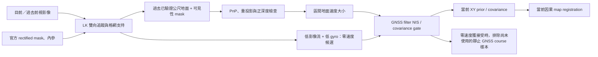

# Track2 v5.7：用前視影像補充地面車速

## 現況與下一步

v5.6 full 的 Public Score 為使用者回報 `0.45455`，來自 `track02_full_2611022032`：3299 幀完成，耗時 1570.36 秒。開工時六項 live 程式與該 full 的來源 SHA 一致；目前 live 已更新為 v5.7。歷史 `test_info.json` 的 `score` 仍是 `null`，保留原樣。v5.7 目前尚無真實定位、full 或新成績。

本輪獲准讀取參照檔 [`result_2_0.30488.csv`](analysis%20doc/result_2_0.30488.csv) 進行同索引輸出差異診斷。該檔是 non-causal 參照，不是逐幀真值。診斷只用來找值得檢查的場景；沒有讀它來估時間差、轉換、參數，也沒有改動或重建任何 pose。

最值得先看的是 `idx=308–399` 的持續差異，以及開頭只有兩幀的短暫差異。最大 XY 輸出差出現在 `idx=1390`，為 `0.75973 m`（前向 `−0.73306 m`、側向 `0.19954 m`），該幀 map update 雖接受但只有 rank 1，照片聯絡表可見開闊道路。本輪沒有取得 Track2 實際 Public 評分的 frame 清單；若先前規則說明的 5–40% 前綴也適用 Track2，1390 會在該範圍之外。因此不把這一幀的差直接歸因於 `0.45455`；它是完整序列的幾何診斷重點。

v5.7 在既有 GNSS 位置／速度先驗內加入一筆由前視影像估算的地面車速量測。影像只提供速度大小或低流量時的零速度觀測，不直接決定絕對位置或航向。實作和量測限制見下文；全部定位仍由使用者親自啟動，命令維持不變：

```bash
cd /home/ricky/sdc_ros2/midterm01_gpu
./scripts/run_track2.sh --full
```

## 觀察與差異診斷

診斷將 v5.6 的 3299 筆輸出和參照 CSV 依相同 `idx` 配對。參照檔沒有可用時間戳，因此沒有套用時間位移、旋轉、平移或尺度擬合。整體差異摘要如下：

| 指標 | 結果 |
| --- | ---: |
| 平均 XY 輸出差 | `0.18291 m` |
| XY 輸出差中位數／P95 | `0.15998 m`／`0.44046 m` |
| 最大 XY 輸出差 | `0.75973 m`，`idx=1390` |
| 平均絕對 yaw 輸出差 | `0.64395°` |
| 最大絕對 yaw 輸出差 | `3.64439°`，`idx=0` |

這些都是兩份輸出的差，不能稱為 pose 誤差。起始差異約 `0.652 m`、yaw `−3.644°`，只延續最初兩幀；到 `idx=2` 已約為 `0.0014 m`、`−0.0503°`，不應把 `idx=0–400` 整段當作 startup 大偏差。最值得優先分析的是 `idx=308–399`：`idx=307` 的 XY／yaw 差約 `0.0832 m`／`−0.0689°`，`idx=308` 跳至 `0.3746 m`／`+1.7193°`，`idx=376` 為 `0.3451 m`／`+2.3847°`。這些是依索引對齊的輸出差，仍不是地面真值。

唯讀 sensor 診斷顯示 `idx=308` 首次使用 GNSS course（由過去 GNSS 位移推算的行駛方向）窗口：7.750253541 秒、32 個樣本，擬合速度 `0.45283143 m/s`、觀測標準差 `2.9725656°`；heading bias 從 `0.06269291 rad` 變為 `0.10591712 rad`（約 `2.4766°`）。照片中的 `idx=0`、`100` 可見停車場景，但影像不能證明靜態真值。這提出一個具體風險：長時間停車時 GNSS 位置雜訊可能進入尚未使用的 course 窗口，影響之後方向估計。`idx=954`、`1750`、`2057`、`2173`、`2508`、`2547`、`3294` 與完整 `1300–1499` 區間保留作後續序列檢視。完整逐幀差異及 map rank 在 run 的 `reference_difference.csv` 與 summary 中。

這些觀察同時指出兩個可檢查的問題：部分 rank 的 map update 可能留下未受約束的運動方向；尚未使用的 GNSS course 窗口也可能含有停車樣本。v5.7 的影像速度量測為 GNSS CV（constant velocity，等速）先驗補充當下運動資訊；當影像與 gyro 支持低流量且 GNSS NIS 接受零速度時，另將相應的尚未使用 GNSS 樣本排除於未來 course 窗口。此處不以參照軌跡當測量，也不使用地圖時間欄位重建行駛路徑。

## v5.7 的資料與計算流程

新量測只使用前視相機、目前已到達的影像和過去影格：

1. JPG 檔名精確配對目前 PLY 的 bag arrival timestamp（訊息抵達時間）；擷取時間則由 `CameraClock` 配對的相機 header 提供，不把抵達時間當成擷取時間。兩張影像的實際 header 時差達 `0.25 s` 後才形成下一個不重疊區間，不讀未來影像。
2. 使用相機內參、官方 rectified ego mask，並在前後影格追蹤角點。Lucas–Kanade (LK) 雙向追蹤必須互相一致。低流量靜止候選要求角點涵蓋 `8×6` 格中的至少 8 格，且至少有 40 個 track；這個全畫面格網條件只用於靜止判斷。
3. 過去影格必須通過 map registration、feature scale 驗證及法向一致性檢查，才保存其 metric ground（公尺尺度地面）模型。將地面角點射線投影到這個平面；CUDA 可見性 mask 用 z-buffer 排除被前景遮住的地面點。沒有可信的過去公尺地面模型時，不產生移動車速觀測。
4. 以前後影格的 3D 地面對應點與目前影像角點執行 RANSAC PnP（Perspective-n-Point，相機姿態估計）及重投影檢查。移動道路上的地面特徵天然呈梯形，因此不要求它們覆蓋 8 個全畫面格；地面特徵採 `4 px` 間距，高於 `1.5 px` reprojection 預算的兩倍（靜止候選仍採 `8 px`）。PnP 至少需 40 個 track、inlier 比例至少 60%，並以 `cv2.projectPoints` 實際 6 維 Jacobian 評估 rank 與 covariance。退化的零資訊方向拒絕；資訊弱但為正的方向保留，並以較大速度變異數降低權重。
5. PnP 平移先投影到地面，再除以兩張影像的實際 header 時差，得到平面速度向量與 covariance。先傳播向量 covariance，再以最大特徵值作為純量速度的保守變異數，避免速度接近零時對 norm 直接微分而得到虛假的零不確定度。量測只輸出速度大小，不輸出位置或 yaw。
6. 若地面圖像流量很低且 gyro 角速度也低，流程可提出二維零速度觀測。這表示「目前低速／靜止」的軟量測，不會凍結或覆寫 pose；仍需原 GNSS filter 的 NIS（正規化創新平方）檢查接受後才更新狀態。當這個零速度觀測被接受時，只將符合影像／gyro 靜止條件的過去 GNSS 樣本從尚未使用的 course 視窗移除；GNSS XY filter 仍保留所有 fix，不回寫已接受的 heading bias 或 pose。後續移動樣本自然重新累積 course，不設硬性最低車速門檻。
7. 速度候選還須通過前方可見性、正深度／cheirality 及 gyro 旋轉預算等檢查。通過後以 scalar（純量）速度更新 GNSS filter 的 `[x,y,v_x,v_y]`，並同步更新該相機時刻的 XY prior 與 covariance。

可將移動狀態下的基本關係寫成

\[
v_{ground}=\frac{\lVert (I-nn^T)t_{PnP}\rVert}{\Delta t},\qquad
\Delta t=(t_{camera,k}-t_{camera,key})\times10^{-9}\;\mathrm{s},
\]

其中 \(n\) 是過去地面的單位法向，\(t_{PnP}\) 是在已知平面尺度下估得的區間平移，兩個時間戳都是整數奈秒；`0.25 s` 是形成量測的最低間隔。重投影殘差衡量影像對應與 PnP 預測像點的差，不代表與競賽真值一致。量測方差另包含過去高度 covariance、地面法向 `0.5°` floor 經距離／高度投影的項目、`1 m/s` 模型 floor、區間平均速度近似當下速度的 acceleration PSD 項，以及未知 lever arm 與 gyro 項目。這些是工程預算，尚未由真實標定資料驗證。

靜止量測和移動速度量測都使用 GNSS filter 既有的 NIS soft／hard gate 及 Joseph covariance 更新。GNSS 狀態創新會更新當前位置先驗，但不被標記成 map calibration-reference 變化；速度量測本身不直接更新 heading bias；靜止排除只影響後續尚未形成的 course 觀測，不重算或修改已輸出的舊 pose。GNSS、map、height 與影像速度的跨狀態 covariance 仍未完整聯合建模。



## 設定與驗證

在 [`track2/parameters.py`](../track2/parameters.py) 直接調整 `IMAGE_GROUND_SPEED_ENABLED = True` 及 `IMAGE_SPEED*` 參數；不需改命令列。v5.7 沿用 v5.6 的 map fusion profile `v52_directional_memory` 和其既有參數。`IMAGE_SPEED_MIN_GRID_CELLS` 是整幅影像靜止候選的格網條件；移動 PnP 不以這個格數硬拒絕，而由至少 40 個 tracks、60% inlier、實際 Jacobian rank 與速度 covariance 評估。若調參，分開檢查靜止門檻、追蹤數、PnP covariance 與視窗；不要只憑 score 或這份 non-causal CSV 擬合參數。

最終 candidate 為 [`track00_test_2611022302/source`](../outputs/run/track00_test_2611022302/source/)，單輪完整回歸 **191 passed、1 項既有 Matplotlib `Axes3D` warning、24.44 秒**，見 [pytest XML](../outputs/run/track00_test_2611022302/pytest_regression.xml) 與 [log](../outputs/run/track00_test_2611022302/pytest_regression.log)。該輪也檢查未來成功 full 的 07 影像速度分析流程可唯讀產生圖、可重試且 frame index 對齊；生成輸入是 3299 列 fixture，並非正式 full 的定位分析結果。各輪測試不可相加。

本輪沒有用參照 CSV 建立定位量測；真實影像未執行 PnP，也沒有重新執行 map registration 或 v5.7 full。candidate `analysis/04_real_image_tracks_1..4` 是實際相機影像上的 LK／地面可見性 component 計數與來源核對，**未執行真實 PnP，也沒有新 pose 或 map localization**。新 4 px 統計見 [image component metrics](../outputs/run/track00_test_2611022302/analysis/image_component_metrics.json)。未來成功 full 才會自動在該 full run 的 `analysis/` 新增正式 `07_image_ground_speed.png/pdf` 與 `image_speed_summary.json`，記錄 accepted 移動／靜止 interval 與 frame、未採用量測、NIS、讀圖和 ground-model 時間；本次 3299 列 fixture 測試圖不當作 v5.7 full 圖，也不回補或改寫歷史 v5.6 full。

生成圖 05／06 用於檢查模型機制，不代表真實定位效果：05 的速度案例從 `4/8/12/20 m/s`（含 1／7 錯配的 2D 案例）恢復為 `4.000000000000077`／`8.00000000000025`／`12.000000000000334`／`19.999999999999986 m/s`；06 是固定合成案例（4 Hz GNSS，`σ=0.3 m`，每 `0.25 s` 互不重疊的 Gaussian 影像速度量測，80 次更新），位置 RMSE `0.292402→0.206819 m`、速度 RMSE `0.787297→0.587071 m/s`。輸入與場景設定見 [generated metrics](../outputs/run/track00_test_2611022302/analysis/generated_metrics.json)。這些結果只驗證合成機制，不能推成實際改善。

最終圖表與驗證見 [分析索引](../outputs/run/track00_test_2611022302/analysis/README.md)；原始照片聯絡表保留在先前的唯讀診斷 run：

- [reference 差異圖 PNG](../outputs/run/track00_test_2611022302/analysis/01_reference_difference.png)／[PDF](../outputs/run/track00_test_2611022302/analysis/01_reference_difference.pdf)
- [軌跡對照圖 PNG](../outputs/run/track00_test_2611022302/analysis/02_reference_trajectory.png)／[PDF](../outputs/run/track00_test_2611022302/analysis/02_reference_trajectory.pdf)
- [照片聯絡表 1](../outputs/run/track00_test_2611022225/analysis/03_photo_contact_1.png)、[照片聯絡表 2](../outputs/run/track00_test_2611022225/analysis/03_photo_contact_2.png)、[照片聯絡表 3](../outputs/run/track00_test_2611022225/analysis/03_photo_contact_3.png)
- [逐幀差異 CSV](../outputs/run/track00_test_2611022302/analysis/reference_difference.csv)、[摘要 JSON](../outputs/run/track00_test_2611022302/analysis/reference_difference_summary.json)、[照片來源 manifest](../outputs/run/track00_test_2611022225/analysis/photo_manifest.json)
- [舊版 `8 px` 真實 LK／可見性抽樣](../outputs/run/track00_test_2611022225/analysis/image_component_metrics.json)：這是新 `4 px` 間距前的舊抽樣，不可用來代表目前 moving-PnP 的 track 數。
- [candidate 2302 的新 `4 px` component metrics](../outputs/run/track00_test_2611022302/analysis/image_component_metrics.json)
- [04 真實影像 LK／地面可見性圖 1](../outputs/run/track00_test_2611022302/analysis/04_real_image_tracks_1.png)／[PDF](../outputs/run/track00_test_2611022302/analysis/04_real_image_tracks_1.pdf)、[圖 2](../outputs/run/track00_test_2611022302/analysis/04_real_image_tracks_2.png)／[PDF](../outputs/run/track00_test_2611022302/analysis/04_real_image_tracks_2.pdf)、[圖 3](../outputs/run/track00_test_2611022302/analysis/04_real_image_tracks_3.png)／[PDF](../outputs/run/track00_test_2611022302/analysis/04_real_image_tracks_3.pdf)、[圖 4](../outputs/run/track00_test_2611022302/analysis/04_real_image_tracks_4.png)／[PDF](../outputs/run/track00_test_2611022302/analysis/04_real_image_tracks_4.pdf)
- [05 合成 ground-speed PNG](../outputs/run/track00_test_2611022302/analysis/05_generated_ground_speed.png)／[PDF](../outputs/run/track00_test_2611022302/analysis/05_generated_ground_speed.pdf)、[06 合成融合 PNG](../outputs/run/track00_test_2611022302/analysis/06_generated_fusion.png)／[PDF](../outputs/run/track00_test_2611022302/analysis/06_generated_fusion.pdf)、[生成統計 JSON](../outputs/run/track00_test_2611022302/analysis/generated_metrics.json)

舊 `8 px` 抽樣中，`0→7` 有 580 tracks／32 格，median flow `0.02030 px`、P90 `0.05389 px`；`43→50` 為 `0.0161`／`0.0523 px`，`93→100` 的 P90 已到 `1.3104 px`，所以不能只看 median 判斷靜止；`143→150` 為 `0.0134`／`0.1083 px`。`193→200` 增至 `0.7218`／`6.5638 px`，顯示起步訊號，不能把 `0–200` 全段標為靜止。視野中的車流／物件可能讓靜止候選被拒絕，這些只是 LK／mask 元件觀察，不是真值。舊 `8 px` 間距下 `1383→1390` 有 41 個地面 tracks／6 格、`1443→1450` 有 63／9 格；新 `4 px` 統計對應為 78／7 與 135／9。它們都只是 image tracks／mask，不是真實 PnP 位姿；梯形路面不滿全畫面格網，正是改用實際 PnP Jacobian 評估可觀測性的原因。

照片聯絡表是影像上下文，不能確認靜態語義、地面真值或速度真值。新方法目前只使用 front camera；沒有融合 left/right camera。

## 程式入口

- [前視影像地面速度估計](../track2/image_speed.py)
- [因果 GNSS 速度更新](../track2/visual_update.py)
- [GNSS course 先驗與靜止樣本排除](../track2/causal_prior.py)
- [直接編輯的參數](../track2/parameters.py)
- [Track2 操作入口](../track2/README.md)


<details>
<summary>附錄：歷史開發輪次與數值修正</summary>

image-ground-speed component 檢查 `track00_test_2611022241` 為 18 passed（6.41 秒）。後續 2243、2253、2257、2300 是不同 source／fixture 的歷史開發輪次，數字不相加：2243 的舊候選為 190 passed、1 項既有 `Axes3D` warning、22.12 秒，當時尚未加入靜止 GNSS course 樣本排除。2253 的舊 cluster fixture 要求零速度一定硬拒絕；該輪 190 passed、1 failed，之後改以平面速度向量 covariance 傳播，避免接近零速時 norm 導數造成虛假的高精確度。2257 的舊 fixture 使用自訂 `100 (m/s)^2` 絕對門檻，沒有依據；該輪 190 passed、1 failed，改為相同點數下比較窄／寬點分布的速度變異數：窄分布例值 `0.72445`，寬分布 `0.0001013`，前者變異數約大 7000 倍。2300 核心輪為 191 passed、22.87 秒。**這些歷史輪次不累加，也不是最終 regression 結果。**

</details>
