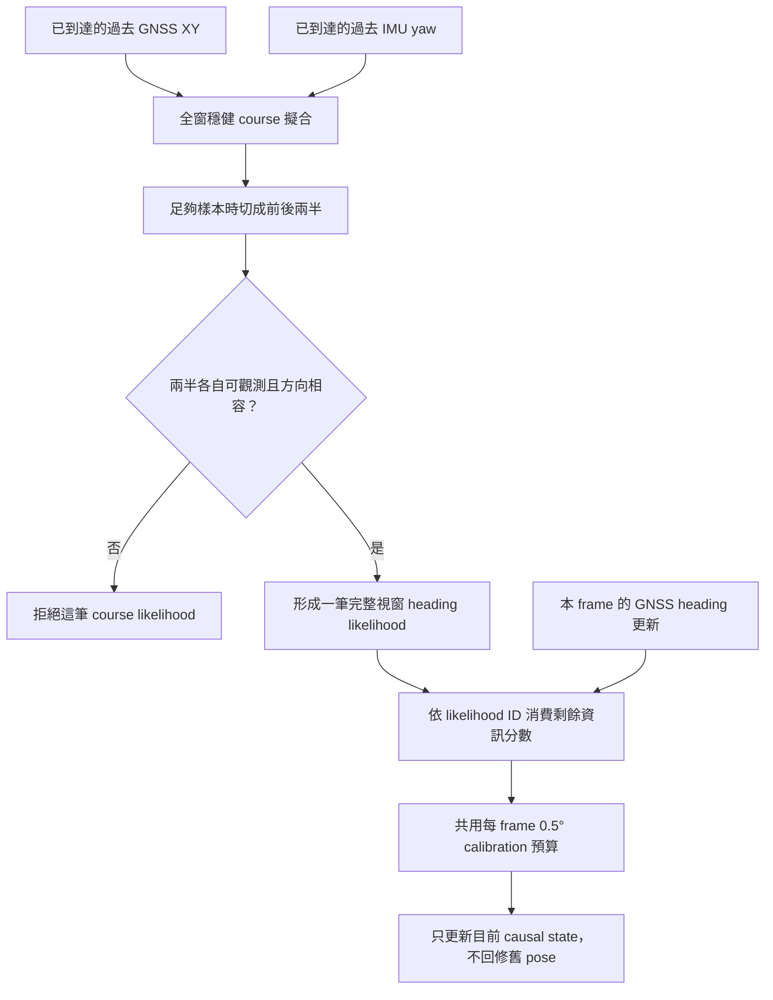

# Track2 v5.10：以 v5.7 為基線的航向觀測檢查

## 現況與下一步

v5.10 版本為 `track2_v57_course_heading_budget_v5_10_perf2`，以 v5.7 full `track02_full_2611031204_0002` 為基準。這次只加兩項 GNSS course／heading 更新保護：有足夠樣本的 course 視窗，其前後半都要各自有可用方向且彼此相容；每筆 heading likelihood 最多消費一次，且同一影格所有 heading bias 更新共用 `0.5°` 預算。影像速度、尺度配準與 visual update 回到 v5.7 實作。

v5.10 已套用。Track2 GPU regression 為 **201 passed**，有 1 項既有 Matplotlib `Axes3D` warning，耗時 26.53 秒（[JUnit XML](../outputs/run/track00_test_2611031923/pytest_gpu_0002.xml)、[log](../outputs/run/track00_test_2611031923/pytest_gpu_0002.log)）；116 個凍結 Python 來源 SHA 一致。恢復的 `image_speed.py`、`metric_registration.py`、`visual_update.py` 與 v5.7 來源 SHA 相同；v5.7 參數除 `VERSION` 外相同，另增加 v5.10 開關與 metadata。run 記錄真實定位、PnP 都是 0 幀，`score=null`，所以沒有 v5.10 full 或新 Public Score（[run metadata](../outputs/run/track00_test_2611031923/test_info.json)）。

完整定位命令維持原樣，是否啟動仍由使用者決定：

```bash
cd /home/ricky/sdc_ros2/midterm01_gpu
./scripts/run_track2.sh --full
```

## 觀察與改動範圍

v5.7 使用過去 GNSS XY 擬合一個 course（地面行進方向），再和相同過去時間範圍的 IMU yaw 比較。視窗整體可以很長，但停車後起步時，兩段 GNSS 點各自能否提供方向、前後估計是否相容，值得分開檢查。v5.7 full 的第一筆 course 更新出現在 `idx=314`；當時窗口約 `7.9945 s`、26 個樣本，擬合速度約 `0.4861 m/s`、方向標準差約 `2.9773°`，接近既有 `3°` 上限。這是需要檢視的航向觀測，不足以證明它造成該版分數或其他區段的差異；實際紀錄見 [v5.7 observations](../outputs/run/track02_full_2611031204_0002/observations.jsonl)。

本版採用 v5.7 作為完整算法基線，只加這兩類 heading 檢查。三個恢復模組已核對為 v5.7 原始 SHA；116 個凍結 Python 來源 SHA 亦一致。

| 元件 | v5.10 範圍 |
| --- | --- |
| `image_speed.py` | 回到 v5.7：EPNP、至少 40 個 tracks、跨 keyframe 直接 LK；不使用 v5.8 的 IPPE／逐影格 LK |
| `metric_registration.py` | 回到 v5.7：固定 `40 m` feature range 與 MAP height；不使用 v5.9 的多 range 或 data-only height likelihood |
| `visual_update.py` | 回到 v5.7 實作 |
| `causal_prior.py` | 保留既有 `v52_directional_memory`；只加 course 半段一致性閘門與 heading likelihood 資訊／逐影格更新預算 |
| 其他 v5.8／v5.9 項目 | 不移植相鄰影格 LK、gyro 約束的道路平移、多 range、高度更新或 gyro-bias 學習 |

`BASELINE_RUN_ID` 指向上述 v5.7 full。`V510_ENABLED=True` 啟用新檢查；關閉只用於生成資料的 v5.7 baseline-equivalence 對照，不是一般執行建議。runner 保留 `camera_ply` 作輸出參考座標；官方評分所用參考點與 GNSS／IMU 到相機的實際外參仍未確認。

## Course 半段檢查：兩半都要有方向且相容

對已到達的 GNSS 平面位置 \(p_i=(x_i,y_i)\)，course 視窗先用穩健加權直線擬合：

\[
p_i \approx p_0 + v(t_i-\bar t) + \epsilon_i,
\qquad
\psi_{course}=\operatorname{atan2}(v_y,v_x).
\]

`v` 是視窗平均平面速度，`ψ_course` 是其方向。程式沿用「低轉向時車頭近似沿行進方向」的模型，為 IMU→map yaw bias 提供 map 座標中的航向基準。course residual 是

\[
r_{course}=\operatorname{wrap}\!\left(\psi_{course}-\bar\psi_{IMU}\right),
\]

其中 `\barψ_IMU` 是同一批已到達時間的 IMU yaw 加權平均。此量測作用在 heading bias 的 `[1,0]` 方向，更新仍走原有 robust gate 與 covariance filter。

當視窗至少有 `2 × HEADING_MIN_SAMPLES = 10` 個位置樣本時，程式把時間序列拆成前後兩個互不重用樣本的半段。各自擬合 `v₁`、`v₂` 和 course 方向 `ψ₁`、`ψ₂`，再檢查：

1. 每半段方向標準差都不超過 `HEADING_MAX_COURSE_STD_DEG = 3°`，否則該半段方向不可觀測。
2. 兩半的方向差符合既有一自由度門檻：半段不確定度使用速度與時間跨度估算，並設 `HEADING_STD_FLOOR_DEG = 0.5°` 下限：

   \[
   \sigma_j=\max\!\left(0.5^\circ,\frac{\sigma_{GNSS}}{\lVert v_j\rVert\sqrt{\sum_{i\in j}(t_i-\bar t_j)^2}}\right),
   \qquad
   q_{half}=\frac{\operatorname{wrap}(\psi_1-\psi_2)^2}{\sigma_1^2+\sigma_2^2}
   \le 10.828.
   \]

   `10.828` 是目前採用的 1 DoF 99.9% 參考閾值；GNSS 點的時間相關、實際加速度和標定誤差未由此完整模型描述，因此這只是保守的一致性 gate，不是校準後的統計保證。

任一半段資訊不足或兩半不相容，就拒絕整筆 course 更新。通過後仍只形成原視窗的一筆 course likelihood；兩半只作檢查，不各自再融合一次。既有視窗、轉向率、整體 heading span、殘差與 NIS 檢查也都保留。若總樣本少於 10 筆，新增的半段比較不執行，原有整窗門檻仍生效。

整個流程只使用已到達且時間不晚於當前相機 frame 的 GNSS／IMU 資料。若 IMU 歷史尚未覆蓋 GNSS block，course 會等候必要的過去 IMU，不以未來資料或地圖時間欄位補值；已輸出的 pose 不回修。

## Heading likelihood 與每影格更新預算

heading likelihood 描述一筆已接收方向觀測及其 measurement variance `R`。若同一筆資訊分配到多次更新，每次使用資訊分數 `f_k`，以 `R/f_k` 降低該次權重；對每個 likelihood ID 都有

\[
0\le f_k,\qquad \sum_k f_k\le 1.
\]

這避免同一筆延遲 course 或 GNSS heading 被重複當成全新量測。剩餘資訊超過 `HEADING_MAX_WINDOW_S = 8 s` 就失效；程式不重算舊狀態。線性固定模型下，分數總和為 1 等價於使用原 covariance 的一次更新；若延遲期間 bias random walk 已增加不確定度，程式在剩餘分數上加大有效 `R`，這是因果近似，不是完整 joint smoother。

每一個輸出 frame 開始時，heading bias calibration 的更新預算重設為零。該 frame 收到的所有 heading 更新——包括待消費的舊 likelihood、GNSS heading pair 及新 course——共用總量 `HEADING_MAX_UPDATE_DEG = 0.5°`。若剩餘預算不足，濾波器只消費該筆 likelihood 的一部分資訊，未消費部分留待後續 frame，直到用完或過期。首幀 bootstrap 不受此限；其他 frame 累加的是每次 bias 更新的絕對幅度，總和最多 `0.5°`。

這個角度限制作用在 heading bias calibration，並非車輛實際轉向速度、gyro 旋轉角或 pose yaw 的每幀上限。它是工程預算，不是感測器標定精度。



## 參數位置與驗證狀態

直接編輯 [Track2 parameters.py](../track2/parameters.py)。v5.10 相關值如下：

| 參數 | 目前值 | 用途 |
| --- | ---: | --- |
| `V510_ENABLED` | `True` | 開啟半段 course 閘門與 heading 資訊預算 |
| `BASELINE_RUN_ID` | `track02_full_2611031204_0002` | 明記 v5.7 比較基準 |
| `HEADING_MIN_WINDOW_S`／`HEADING_MAX_WINDOW_S` | `1`／`8 s` | course 使用的過去資料視窗 |
| `HEADING_MIN_SAMPLES` | `5` | 整窗原有最低樣本；切半檢查須至少 10 筆才能讓兩半各達 5 筆 |
| `HEADING_STD_FLOOR_DEG` | `0.5°` | course 方向不確定度的最低標準差 |
| `HEADING_MAX_COURSE_STD_DEG` | `3°` | 整窗與各半方向不確定度門檻 |
| `CORRECTION_NIS_REJECT_BY_DOF[0]` | `10.828` | 兩半方向差的 1 DoF 一致性閾值 |
| `HEADING_MAX_UPDATE_DEG` | `0.5°` | 首幀 bootstrap 以外，同 frame 所有 heading bias updates 的合計絕對幅度上限 |

這些參數延用既有工程預算，沒有用 non-causal 參照 CSV 或 leaderboard 分數擬合。GNSS course 的樣本誤差可能相關，GNSS quaternion 的座標語意／物理 epoch、GNSS／IMU／相機外參與 lever arm 尚未完整標定；GNSS、IMU、map 與 heading bias 間也不是一個完整聯合估計器。

本次 GPU regression 和生成檢查通過，但沒有真實定位影格或分數。這裡列出的 course／heading 圖是合成機制檢查，不代表真實精度改善： [heading 資訊預算 PNG/PDF](../outputs/run/track00_test_2611031923/analysis/01_generated_heading_budget.png)／[PDF](../outputs/run/track00_test_2611031923/analysis/01_generated_heading_budget.pdf)、[course 半段檢查 PNG/PDF](../outputs/run/track00_test_2611031923/analysis/02_generated_course_guard.png)／[PDF](../outputs/run/track00_test_2611031923/analysis/02_generated_course_guard.pdf)、[生成檢查數值](../outputs/run/track00_test_2611031923/analysis/generated_heading_checks.json)。 runner 以 3299 列生成 fixture 執行唯讀分析與重試，產生 [08 heading-information fixture 圖](../outputs/run/track00_test_2611031923/pytest_gpu_0002/test_full_analysis_read_only_a0/full_analysis/analysis/08_heading_information.png)／[PDF](../outputs/run/track00_test_2611031923/pytest_gpu_0002/test_full_analysis_read_only_a0/full_analysis/analysis/08_heading_information.pdf)；這不是 v5.10 真實 full 圖表。runtime `algorithm_scope.json` 的 runner fixture 產物見[生成 run](../outputs/run/track00_test_2611031923/pytest_gpu_0002/test_generated_output_runner0/generated_run/algorithm_scope.json)。使用者之後親自啟動並成功完成 v5.10 full 時，該 full 才會在自己的 `analysis/` 產生唯讀 `08_heading_information.png/pdf`，不修改 pose 或定位結果。

<details>
<summary>附錄：生成回歸的精確場景與數值</summary>

- 強化的停車起步案例先靜止 4 秒，再以 `1 m/s` 行駛 4 秒。全窗擬合會得到表面可用的 `0.5 m/s` 及 `2.5295°` 方向標準差，舊 v5.7 整窗 gate 會接受；v5.10 前半段速度為零、course 不可觀測，因此拒絕整筆 course likelihood。
- 300 幀生成 stream 中，`V510_ENABLED=False` 時所有 pose 與 prior diagnostics 均精確重現 v5.7（比較時排除 3 個新增 log 欄位）。啟用 v5.10 時，75 幀 prefix 與相同 run 的 300 幀輸出前綴一致。
- 單筆 `8°` heading observation、`2°` 標準差及零 random walk 案例中，所有 frame 消費的 information fraction 合計為 `0.9999999999999998`；最終 joint mean/covariance 與 v5.7 對該量測做一次完整更新相同。
- 來源核對涵蓋 17 個 Track2 Python modules；恢復的 `image_speed.py`、`metric_registration.py`、`visual_update.py`、`correction_filter.py`、`observability.py`、`plane_geometry.py` 與 v5.7 的 exact SHA 一致。v5.7 參數除 `VERSION` 外相同，v5.10 僅新增開關與 metadata；整份 frozen source 的 116 個 Python SHA 亦一致。`algorithm_scope.json` 是 runner runtime 產物，可在[生成 run fixture](../outputs/run/track00_test_2611031923/pytest_gpu_0002/test_generated_output_runner0/generated_run/algorithm_scope.json)查看。
- GPU 測試同一輪總計 201 passed、1 warning、26.53 秒。較早的 200 passed／26.16 秒是加入強化案例前的中途輪次，不與最終輪加總。

</details>

v5.7 full 使用者回報 `0.44296`，是目前已知最佳歷史分數；v5.9 full 使用者回報 `0.44917`。這些是不同整體版本的 Public Score，不能推出 v5.10 必然改善，也不能指定是哪個 frame 導致分數差異。
