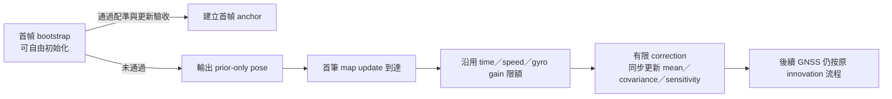

# Track2 v5.11.1：修正 prior-only 啟動後的首筆 map 交接

## 現況與下一步

目前已套用的修正版為 `track2_startup_candidates_current_validation_v5_11_1_perf2`，以 v5.10 full `track02_full_2611031941` 為基準。v5.10 的 3299 幀完整輸出與使用者回報 Public Score `0.42699` 是目前最後一筆完整版本結果。v5.11.1 保留 v5.11 的啟動候選、配準品質檢查、course／heading、40 m feature range、MAP height、IMU 與 GNSS 模型，只修正 prior-only 啟動後首筆 map 更新略過既有限幅的交接問題。

本修正版 Track2 GPU suite **214 passed**、1 項既有 Matplotlib `Axes3D` warning、44.80 秒；118 個候選 Python SHA 已核對。新增的 7 個 handoff 生成機制案例全數通過（[JUnit XML](../outputs/run/track00_test_2611032103/pytest_gpu_0002.xml)、[log](../outputs/run/track00_test_2611032103/pytest_gpu_0002.log)、[candidate manifest](../outputs/run/track00_test_2611032103/candidate_python_manifest.json)）。v5.11.1 程式與文件已套用，live 來源與凍結測試版本的 SHA 一致。此次沒有執行 v5.11.1 真實定位或 PnP，也沒有新 Public Score。

前版 v5.11 full `track02_full_2611032051` 由使用者停止於 **351 幀（idx 0–350）**，`score=null`，不是完整 full 或正式成績。停止後的 `test_info.json` 仍記錄 `running`；這份歷史 metadata 與該 run 的 **185 個來源 SHA** 都保持原樣，沒有回寫修正。此次啟動折返診斷保存在 [診斷 run](../outputs/run/track00_test_2611032056/analysis/README.md)。

完整定位仍由使用者手動啟動：

```bash
cd /home/ricky/sdc_ros2/midterm01_gpu
./scripts/run_track2.sh --full
```

## Y 字軌跡的原因

在 v5.11 的停止 run 中，frame 1 是第一筆 accepted map update，當時沒有 GNSS 觀測。這筆更新使 pose 移動 **1.353227 m**。frame 2 首筆 GNSS 到達後，pose 又折回 **0.744337 m**。RViz 把各幀 pose 連成線，因此啟動附近形成 Y 字形。

原有 correction filter 只在已經有 map `last_update` 時啟用既有的每幀 correction gain 限制。首次 map update 發生前沒有這個 anchor，所以 frame 1 繞過了限幅；下一幀 GNSS 更新再移動時，輸出就接出第二段。固定 associations 下的 map data-cost 驗收只檢查該 proposal 是否改善局部幾何成本，不能限制首次 map 修正與前一個 prior-only pose 之間的跳距，因此沒有阻止這次交接折返。這是依該 run 的輸出與 filter 狀態所做的機制診斷，不代表 init guess 或 map 已被證明有多大真實誤差。

## v5.11.1 修正方式

修正版只擴充 correction filter 原有的 gain 限制條件。當已有 map `last_update` 時照舊限幅；此外，若 `V511_ENABLED`、`STARTUP_BOUND_AFTER_FIRST_FRAME` 和 v5.2 fusion 同時啟用，且已有 `previous_stamp`，也套用相同限制。這代表系統先輸出過 prior-only pose 後，接著到達的第一筆 map update 會受到當幀既有的時間、車速與 gyro 限額約束。

真正的首幀仍可自由建立初始解：它沒有前一筆輸出時間戳，因此不會因這個條件被誤當作一般 tracking correction。有限 gain 同步進入 correction mean、Joseph covariance 更新與 calibration sensitivity，讓狀態、uncertainty 和校正敏感度使用同一個受限增益。GNSS innovation 仍照原流程更新；程式不事後裁剪輸出 pose、不回修先前 pose，也不等待未來影格。

在被停止 run 的 frame 1 輸入條件下，既有預算推算約為 **0.0186075 m**；這是該條件下限幅公式的數值上限，不是 v5.11.1 真實輸出或新 full 的量測結果。修正版尚未執行真實定位，不能宣稱 Y 字已在 full 成績上消失或精度已提升。



## 保留的 v5.11 模型與參數

完整 startup candidate 求解、candidate quality／common score、40 m feature range、MAP height、IMU／GNSS、course split 與 heading budget 都維持不變。沒有加入 frame number 特定的座標或 yaw 修正，沒有使用 reference CSV 擬合，也沒有做未來資訊回修。

直接編輯 [Track2 parameters.py](../track2/parameters.py)：

| 參數 | 值 | 作用 |
| --- | ---: | --- |
| `V511_ENABLED` | `True` | 開啟 v5.11 startup candidate、fallback 與 proposal 驗收 |
| `STARTUP_BOUND_AFTER_FIRST_FRAME` | `True` | prior-only pose 已輸出後，讓首次 map update 使用既有 correction 限額 |
| `BASELINE_RUN_ID` | `track02_full_2611031941` | v5.10 完整基準 |
| `STARTUP_HEIGHT_SEED_SIGMAS` | `(-1, 0, 1)` | 原 height prior 的 `h−σ`、`h`、`h+σ` optimizer seeds |
| `STARTUP_INCLUDE_GIVEN_YAW` | `True` | 納入初始姿態 yaw seed |
| `STARTUP_INCLUDE_MAP_AXIS` | `True` | 納入 GPU map-feature PCA 無向軸 seed |
| `TRACKING_RETRY_ON_GEOMETRY_FAILURE` | `True` | 既有 geometry gate 失敗時才試 alternate |
| `VALIDATE_EMITTED_MAP_PROPOSAL` | `True` | 依固定 associations 驗收有限 gain 的非線性 data cost |

所有候選仍完整執行 registration；map、raw sample、association 與配準運算留在 CUDA。Startup 候選是最佳化起點，不是多筆量測；height seeds 不改 MAP height objective。tracking 只有既有 geometry gate 失敗才 retry。此次 gain handoff 也不會將普通的第一幀限制成上一幀追蹤更新。

## 驗證狀態與限制

- 最終 Track2 GPU suite：**214 passed**、1 項既有 Matplotlib `Axes3D` warning、44.80 秒；118 個候選 Python SHA 凍結於 manifest（[JUnit XML](../outputs/run/track00_test_2611032103/pytest_gpu_0002.xml)、[log](../outputs/run/track00_test_2611032103/pytest_gpu_0002.log)、[manifest](../outputs/run/track00_test_2611032103/candidate_python_manifest.json)）。新增 7 個 handoff 生成測試全數通過。
- 首輪為 **213 passed、1 failed**、44.86 秒（[XML](../outputs/run/track00_test_2611032103/pytest_gpu.xml)、[log](../outputs/run/track00_test_2611032103/pytest_gpu.log)）。唯一失敗是測試 assertion 將 2D XY 與 3D correction 相加；以 `[:2]` 修正 assertion 後重跑，修正的是測試維度比較，原演算法 gate 未變。
- 小矩陣 filter 的 CPU 生成對照檢查：關閉 handoff 修正時，31 幀的 XY、covariance、calibration sensitivity 與 v5.11 逐項一致；另一個首幀立即可接受 map 的 31 幀生成場景也與 v5.11 逐項一致。對延遲首筆 map 的生成場景，候選 correction 從 **1.344392 m** 限到 **0.020000 m**，與該場景現有的 40 ms、0 speed、0 gyro 限額相等。數值與參數保存在[檢查 JSON](../outputs/run/track00_test_2611032103/analysis/generated_handoff_checks.json)，圖表見[PNG](../outputs/run/track00_test_2611032103/analysis/01_generated_handoff.png)／[PDF](../outputs/run/track00_test_2611032103/analysis/01_generated_handoff.pdf)。這些是生成機制結果，不是真實定位精度，也不能據此宣稱使用者看到的真實 Y 字已消失。
- [candidate manifest](../outputs/run/track00_test_2611032103/candidate_python_manifest.json) 凍結 118 個 Python SHA；live source SHA 已核對一致。SHA 核對不代表精度提升。
- 沒有執行真實 v5.11.1 localization／PnP，沒有新的 full 或 Public Score。v5.10 `0.42699` 仍是使用者回報的最後完整版本成績；v5.11 中止 run 的 `score=null`。Y 字機制依據首版 v5.11 frame 1／2 輸出及 diagnostics，不以畫面當 ground truth；該 run 的 metadata 沒有被改寫。

<details>
<summary>歷史附錄：v5.11 首版診斷、測試與資料保留</summary>

### 使用者標記與相似診斷區段

使用者先前檢視 v5.10 submap 所標的位置是視覺線索，不是 ground-truth pose：

| 線索 | frame／區段 |
| --- | --- |
| 左偏 | `700`、`1150`、`1220`、`1250`、`1330`、`1860`、`2165`、`2395`、`3025`、`3290` 附近 |
| 右偏 | `2146` 附近 |
| yaw | `2575`、`2715` 附近 |
| 相對穩定控制 | `800–1000`、約 `1500`（相機非地面特徵較少） |

唯讀分析從 v5.10 已保存 observations 找到 62 段類似的診斷區段。篩選條件是弱 rank 連續至少 30 幀或拒絕至少 10 幀；其中也有穩定控制，不能當作錯誤標籤。代表區間包括 714–954、1003–1160、1752–1865、1998–2115、2299–2408、2740–2870、3030–3276。rank 與點數本身不能區分好壞，這些統計也不是定位誤差。[v5.10 診斷圖](../outputs/run/track00_test_2611032013/analysis/01_saved_v510_diagnostics.png)、[穩定控制視窗圖](../outputs/run/track00_test_2611032013/analysis/02_reported_control_windows.png)及[診斷 JSON](../outputs/run/track00_test_2611032013/analysis/saved_observation_diagnosis.json)保留原始來源與 SHA。

### v5.11 首版算法與合成驗證（歷史結果）

首版 v5.11 以 v5.10 full `track02_full_2611031941` 為基準，增加首次接受 map update 前的完整 yaw／height candidate 配準與共同評分、geometry failure 時 alternate retry，以及固定 final associations 下有限 gain posterior pose+scale data-cost gate。它沒有使用使用者標記的 frame 當逐幀規則。

- Track2 GPU regression：**207 passed**、1 項既有 Matplotlib `Axes3D` warning、43.76 秒；當時凍結 117 個 Python SHA 一致。結果屬於首版 v5.11，不能算作 v5.11.1 suite。[JUnit XML](../outputs/run/track00_test_2611032013/pytest_gpu_0004.xml)／[log](../outputs/run/track00_test_2611032013/pytest_gpu_0004.log)。
- 獨立機制測試：**6 passed**、3.09 秒，與 GPU regression 分開。[XML](../outputs/run/track00_test_2611032013/pytest_mechanism.xml)／[log](../outputs/run/track00_test_2611032013/pytest_mechanism.log)。
- 生成等價檢查中，關閉 v5.11 時 3 幀的 pose、scale、height、height variance 與凍結 v5.10 完全相同；開啟後生成場景的 12 個候選完成配準且通過 posterior loss gate，但收斂至幾乎相同解，不能據此宣稱精度改善。[生成檢查 JSON](../outputs/run/track00_test_2611032013/analysis/generated_registration_checks.json)、[候選圖](../outputs/run/track00_test_2611032013/analysis/03_generated_startup_candidates.png)／[PDF](../outputs/run/track00_test_2611032013/analysis/03_generated_startup_candidates.pdf)。
- 3299 列 full-analysis fixture 通過唯讀／retry 檢查；其 [09 候選驗收圖](../outputs/run/track00_test_2611032013/pytest_gpu_0004/test_full_analysis_read_only_a0/full_analysis/analysis/09_candidate_validation.png)與摘要 JSON 都是生成 fixture，並非真實 v5.11 full 分析。
- 早期 regression 曾有 200 passed、7 failed，原因是 helper refactor 後 experimental final stage 漏取 `radius` locals，觸發 `NameError`；修正後才得到上列 207 passed。另有一輪命令環境導致 2 項 collection error，修正執行環境後通過，歷史 XML 均留在 `track00_test_2611032013/`，不能和此次 v5.11.1 測試合併。

### v5.11 首版 full 停止紀錄

使用者啟動首版 v5.11 full `track02_full_2611032051` 後因啟動 Y 字軌跡停止執行。已輸出 **351 幀，idx 0–350**，frame 1 首筆 map update 前沒有 GNSS，位移 1.353227 m；frame 2 首筆 GNSS 到達後折返 0.744337 m。沒有完成 3299 幀、沒有正式分數；`score=null`。此 run 的 `test_info.json` 仍記錄 `running`，並刻意保留原狀；185 個來源 SHA 也原樣保留，供稽核中止 run 使用，不會將其當成已完成 full。

</details>
