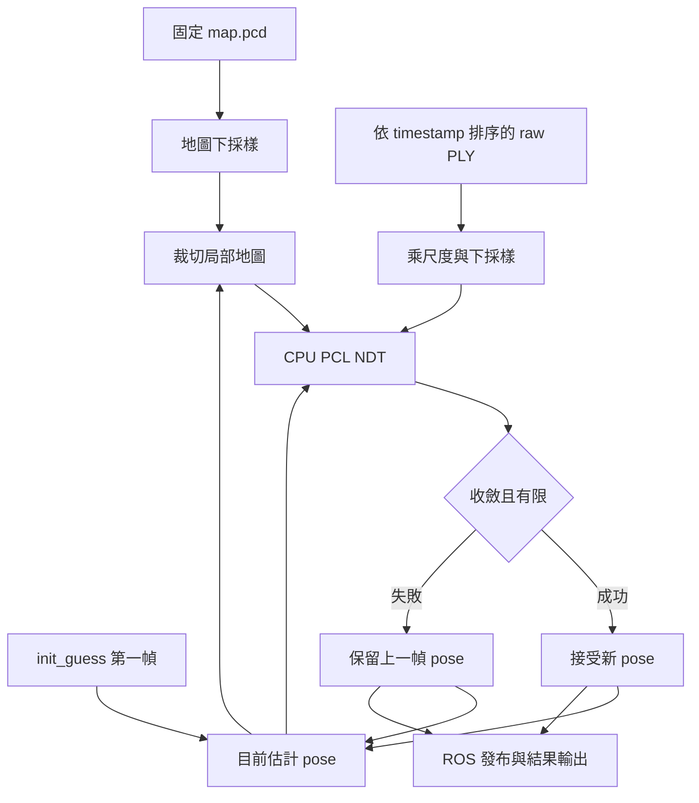
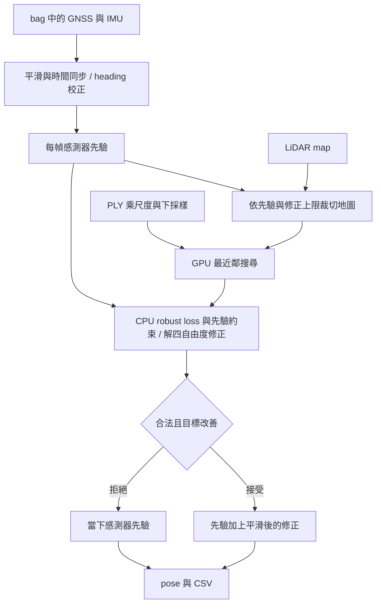

# 從老師模板到 GPU 感測器約束定位

本文件對照本專案取得的模板、第一次 CUDA NDT 整合、以及目前 `sensor_guided` 版本。程式以實際 checkout 為準：官方 PDF 將定位區塊標示 TODO，但我們取得的模板已經含基礎 PCL NDT，並非只有空架構。老師 leaderboard baseline 的設定沒有提供，不能把本地模板結果直接等同助教 baseline。

2026-10-17 使用者提供的 Track1 Kaggle 截圖：舊 CUDA D2D **573.36983**，新版 **1.22369**，同圖 baseline **1.79075**。這是越低越好的誤差指標；新版較 baseline 低約 **31.67%**。成績來源是使用者手動提交及截圖，對應 `result_1.csv` SHA256 為 `6684960053a0ff393b83011891dd26095401aa822876ab0e6281990bf2c6015a`。Track2 尚無回報分數。

## 1. 老師給的架構：資料流、配準與輸出

### 任務是求哪個矩陣？

每幀有一份影像重建點雲 `raw_ply`，另一側是固定的 LiDAR `map.pcd`。兩者來自不同座標系，要找旋轉 R 與平移 t，把這幀點雲放進地圖：

$$
p_{map}=R(3p_{raw})+t
$$

`3` 是目前沿用的 `ply_scale=3.0`，不是本次新估出的尺度。R 與 t 組成 4×4 的 `T_map_source`；最後一列是 `[0,0,0,1]`。先不要把它直接解讀成任意相機／車體外參；整條管線沒有額外重套初始矩陣或外參。

### 已有功能的分工

| 模組 | 原有職責 |
| --- | --- |
| Docker／ROS 2 | 提供可建置執行的環境，參數與 launch 啟動節點 |
| PCD／PLY 讀取 | 讀固定地圖與每幀重建點雲 |
| 檔名 timestamp 索引 | 解析 `_ts_<奈秒>`，按時間順序處理 PLY |
| 點雲預處理 | source 乘 3、清除非有限點、0.3 m voxel 下採樣；map 以 1 m voxel 下採樣 |
| 初始姿態 | `init_guess.txt` 的矩陣只初始化第一幀 |
| 局部地圖 | 以目前估計位置裁切 XY 半寬 100 m、Z 半高 30 m 的 submap |
| PCL NDT | 由初值估計 6 自由度 pose：x、y、z、roll、pitch、yaw |
| bag 介面 | 可讀 GNSS／IMU；原定位函式沒有將它們用於姿態修正，且原試跑停用 bag |
| ROS 發布 | 發布點雲、TF、pose、path，供 RViz 檢視 |
| TXT／CSV | TXT 每幀輸出 3×4 的 12 個數值，CSV 擷取 idx、x、y、yaw |

這些讀檔、下採樣、submap 與基本 NDT 原本就存在，不能說是這次 GPU 改善新增的演算法。

### NDT 在做什麼？

NDT 把地圖切成 voxel，每格統計平均位置與共變異數，形成三維高斯模型。它嘗試調整 R、t，讓 source 點變換後更符合地圖的分布；會反覆計算目標函數、梯度與 Hessian，更新姿態直到停止。[PCL 官方 NDT 教學](https://pointclouds.org/documentation/tutorials/normal_distributions_transform.html)

要區分 **預處理 voxel** 與 **NDT voxel**：前者減少點數，本案 map=1 m、source=0.3 m；後者用來建立分布模型，舊版 resolution=8 m。不是所有 voxel 參數都控制同一件事。

原模板後續初值直接使用上一幀接受的 pose。這代表它是一個有記憶的局部追蹤器；一旦接受錯誤 pose，下幀的初值與 submap 也可能跟著錯。`hasConverged()` 只告訴你最佳化程序符合停止條件，不會驗證這是不是車輛的真實位置。

## 2. 加入 GPU：先前到底改了什麼？

### 環境與效能工程

建立獨立 `midterm01_gpu`、CUDA 12.8、RTX 5060 編譯目標與 GPU 容器，資料仍唯讀共用 `midterm01/data`。原 CPU 環境與其執行工作沒有被移動或覆寫。

另外改用 Release 建置、保存逐階段耗時、提供選用的衍生 map 快取與固定幀數 benchmark。這些改善執行與重現方式，不能把所有加速都算在 GPU 上；例如 Release 下的 CPU 前 50 幀與原 R0 輸出逐 byte 相同。

`benchmark.py` 只是啟動與量測工具：決定 Track、幀數、profile、參數與輸出位置。真正估計 pose 的演算法在 C++／CUDA 程式內。

### 第一次 GPU 整合改到了演算法

第一次接入的是現成 `fast_gicp::NDTCuda` 的 D2D／DIRECT7 模式。D2D 代表 distribution-to-distribution：source 也先統計成 voxel 分布，再與 target 的分布比較。它與原 PCL NDT 並不是同一套公式的 GPU 編譯版本。

| 比較項目 | 本地原 PCL NDT | 第一次 CUDA D2D |
| --- | --- | --- |
| 配準資訊 | source 點與 target 高斯模型 | source／target voxel 分布 |
| 目標與鄰域 | PCL NDT 分數、radius 鄰域 | 上游 D2D 加權 Mahalanobis 殘差、DIRECT7 |
| 最佳化 | Newton 方向、SVD、More–Thuente 線搜尋 | Levenberg–Marquardt（LM） |
| 大量運算 | CPU | GPU voxel／對應／cost／梯度／Hessian |
| 小型方程 | CPU | CPU 的 6×6 解算 |
| 使用 GNSS／IMU 約束 | 沒有 | 當時也沒有 |

來源是固定 commit 的 [fast_gicp](https://github.com/koide3/fast_gicp/tree/0e7ec1441c99f7be453db2ea216d5de029387417)。因此 **573.36983 是這次 CUDA D2D 管線的分數，不能說是原 CPU 模板的分數**；原 CPU 完整提交分數沒有在此取得。

CUDA voxel 統計會受到大座標 float 精度影響，當時另做局部原點平移：目標與初值一起平移、結果再移回。這是數值處理，不是重套外參；也沒有解決不良初值與局部錯配的根本問題。

## 3. 新版為何改善？使用的是什麼演算法？

### 先找失效，而不是先調參數

舊 CUDA D2D 完整 Track1 有 3011 筆 pose、只有 8 幀未收斂，但 XY 一直困在起點附近約 40 m 的範圍，roll／pitch 還曾翻轉。同段 GNSS 顯示路線約一公里，兩者 XY 差異 RMS 為 557.895 m。GNSS 不是評分真值，但足以指出追蹤器已無法跟隨實際運動。

例如：車已開到幾百公尺外，配準卻仍在起點附近尋找一小塊「看起來能貼合」的道路。影像重建單幀的範圍有限，道路幾何又容易重複，局部殘差可能不高；這個錯誤仍會被傳到下一幀。

從程式與軌跡證據判斷，阻止這種全域失效是這次改善的主要方向。各改動單獨能改善幾分，尚未有 Kaggle 消融實驗，不應把總改善完全歸功於某個權重或 GPU。

### A. 每幀重新取得感測器先驗

GNSS 給 map 中的大致位置；IMU 給姿態 quaternion。先將它們同步到每個 PLY 時間：

- GNSS 使用 5 筆觀測的二次 Savitzky–Golay 平滑，再線性內插位置。
- IMU 使用 quaternion SLERP 內插旋轉，避免直接內插 Euler angle 時跨越 ±180 度的問題。[SciPy SLERP](https://docs.scipy.org/doc/scipy/reference/generated/scipy.spatial.transform.Slerp.html)
- 在高速且接近直行的片段，用 GNSS 速度方向與 IMU yaw 的中位差估計固定 heading bias。本次 Track1 約 **+3.911 度**。
- GNSS bag 的高度是常數，因此初幀用 GNSS 高度，之後沿用上一幀 map 細修後的高度作先驗；XY 每幀重新由 GNSS 提供。

這叫「先驗」：先給最佳化一個可信的搜尋起點與限制。GNSS 本身仍有誤差，所以不能直接視為定位答案；還要利用地圖修正。

### B. 把自由配準改成受約束的四自由度配準

新版固定 IMU 提供的 roll／pitch，只估計小量修正：

$$
\delta=[\delta x,\delta y,\delta z,\delta\psi]^T
$$

若感測器先驗是 `R₀,t₀`，已縮放 source 點是 `pᵢ`，它在地圖中的位置為：

$$
u_i(\delta)=R_z(\delta\psi)R_0p_i+t_0+\delta t
$$

也就是位置可細修、yaw 可細修，但不允許配準自由把車翻過來。這是四自由度而非只估 XY／yaw 的三自由度方法；高度仍有 map 修正。

### C. 由 NDT 改為帶先驗的 robust 點到點 ICP

ICP 每輪為變換後的 source 點找到最近的 map 點，依這些對應更新姿態，再找一次對應直到停止。[PCL 官方 ICP 教學](https://pointclouds.org/documentation/tutorials/iterative_closest_point.html)

本案不是直接呼叫預設 PCL ICP，也不是 point-to-plane ICP：我們實作的是**點到點最近鄰殘差＋Huber robust loss＋感測器先驗懲罰**。

令 `dᵢ` 為 `uᵢ` 到最近 map 點的距離，目前實際目標為：

$$
E(\delta)=\frac{1}{N\sigma_c^2}\sum_{i=1}^{N}\rho_{0.5}\!\left(\min(d_i,2)\right)
+\frac12\left[
\frac{\delta x^2+\delta y^2}{0.5^2}
+\frac{\delta z^2}{1.0^2}
+\frac{\delta\psi^2}{(3\pi/180)^2}
\right],\qquad\sigma_c=0.3\ \mathrm{m}
$$

讀這個式子時先看兩部分：第一部分要求點雲貼合地圖，第二部分要求修正別離感測器先驗太遠。

Huber loss 在距離小時用平方誤差，超過 0.5 m 後改為線性成長，減少壞點的拉力。距離超過 2 m 的點保留固定 cost，但不提供更新梯度；這避免「把不合的點直接刪掉，就讓分數變低」的假改善。source 點數不同也以 N 正規化，讓先驗權重不會因點數多寡突然改變。

0.5 m、1 m、3 度等是目前設計的正則化尺度，並非經真值校準得到的感測器標準差。演算法可解讀為帶先驗的穩健估計；目前沒有實作 EKF 的狀態／共變異數傳播。

### D. 用硬門檻與時間平滑保護輸出

| 保護措施 | 目前值／作用 |
| --- | --- |
| XY 修正上限 | 每幀相對 GNSS 先驗，距離不超過 1.5 m |
| yaw 修正上限 | 每幀相對 IMU heading 先驗，不超過 8 度 |
| Z 修正上限 | 每幀相對高度先驗，不超過 1.5 m |
| 線搜尋 | 更新必須降低同一個正則化目標，否則縮小更新 |
| 平滑修正 | `δ_filtered = 0.75 δ_previous + 0.25 δ_current`，再檢查當下目標 |
| 無有效配準 | 使用當下感測器先驗；不沿用上一幀靜止 pose |

平滑的是「對先驗的修正」，沒有把整條 GNSS 位置軌跡做強烈的慢速追隨，因此仍能跟上車輛移動。平滑之後若目標變差，改用當幀合法修正；無法安全接受時回到當下先驗。

### E. GPU 在新版負責哪裡？

新版 `cuda_robust_icp` 沒有跑 NDT。GPU 負責最近鄰搜尋：每個 source query 配一個 CUDA block，256 個 threads 分攤搜尋候選 map 點，再用平行 reduction 找出最近點；CPU 在 double 精度下計算 robust 目標、梯度與 Hessian，解 4×4 的小型方程。

先以可涵蓋所有合法修正的包圍盒減少 map 候選點，GPU 再完整搜尋該集合。這裡用的是完整搜尋 kernel，不是宣稱建立 GPU KDTree。搜尋在局部原點進行，避免公里級座標削弱 float 距離精度。

新版決定改用這個後端，也有穩定性原因：早期「感測器先驗＋CUDA D2D 候選」在完整序列觸發上游 CUDA 記憶體錯誤，且此前 D2D 候選沒有被修正器採用。最終版本直接使用新 CUDA 搜尋核心，避免繼續依賴該 D2D 最佳化器。

## 實測證據怎麼解讀？

| 項目 | 舊 CUDA D2D Track1 | 新 sensor_guided Track1 |
| --- | ---: | ---: |
| Kaggle 誤差分數 | 573.36983 | **1.22369** |
| 最大相鄰平移 | 10.823 m | 0.589 m |
| 完整路線 | 困在起點附近 | 起終點 XY 距離 1038.486 m |
| 姿態 | 出現 roll／pitch 翻轉 | roll 約 0.50～3.28 度，pitch 約 4.81～8.06 度 |

Kaggle 證實的是這組完整修改後的 Track1 提交改善。軌跡與姿態檢查提供失效機制的證據；另外，沿路抽 40 幀的共同 map 殘差，從僅 GNSS／IMU 先驗的 1.627 m 降到新版 1.253 m，顯示 map 修正確實改變並改善點雲貼合。它們都不能分別當成 Kaggle 的平移／旋轉 RMSE；也不能拿 1.253 與 Kaggle 1.22369 當同一指標比較。

GPU 搜尋與 CPU 完整搜尋 2190 個 query 逐筆相同。兩條真實 50 幀中，CPU／GPU 搜尋細修結果最大平移差 <2 mm、yaw 差 <0.002 度。因此從現有證據看，GPU 支援大量搜尋；定位大幅改善的主要機制，是每幀全域先驗與合理約束讓估計不再困在錯誤位置。各元件的獨立貢獻仍需只改一個因素的消融比較。

## 建議讀程式的順序

| 順序 | 檔案／入口 | 看懂的重點 |
| --- | --- | --- |
| 1 | `../../midterm01/workspace/src/localization/src/localization.cpp`：`RunLocalization()`、`AlignNDT()` | 原模板如何使用上一幀 pose、NDT 成功後怎麼更新 |
| 2 | `../scripts/prepare_sensor_prior.py`：`make_priors()`（路徑以 GPU 根目錄計為 `scripts/prepare_sensor_prior.py`） | GNSS／IMU 同步與 heading 校正 |
| 3 | `../workspace/src/localization/src/localization.cpp`：`RunLocalization()` | 每幀先驗如何交給新版配準 |
| 4 | `../workspace/src/localization/src/sensor_guided.cpp`：`RefineSensorGuided()` | robust 目標、先驗權重、Jacobian、解算與修正門檻 |
| 5 | `../workspace/src/cuda_ndt_backend/src/nearest_neighbor.cu`：`NearestKernel()` | CUDA threads 如何分攤距離計算與找最小值 |
| 6 | `../scripts/accuracy/benchmark.py` | CLI 參數如何選 profile／後端並保存可重現結果 |

上表 `../` 程式路徑相對本文件所在 `doc/`；原模板的 `../../midterm01/` 也從本文件目錄解析。

對應來源、參數、候選 SHA256 與詳細驗證見 [SENSOR_GUIDED_20261017.md](../SENSOR_GUIDED_20261017.md)。目前以 `--profile sensor_guided` 選用新版；後續完整測試與 Kaggle 提交依使用者要求由使用者手動執行，回報結果後再調整。
