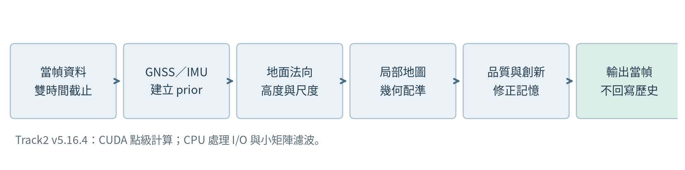
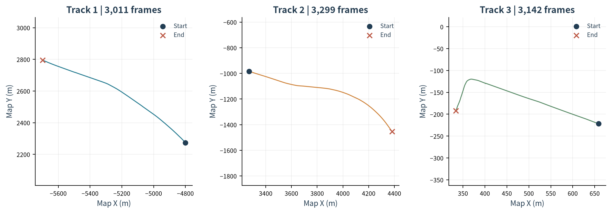
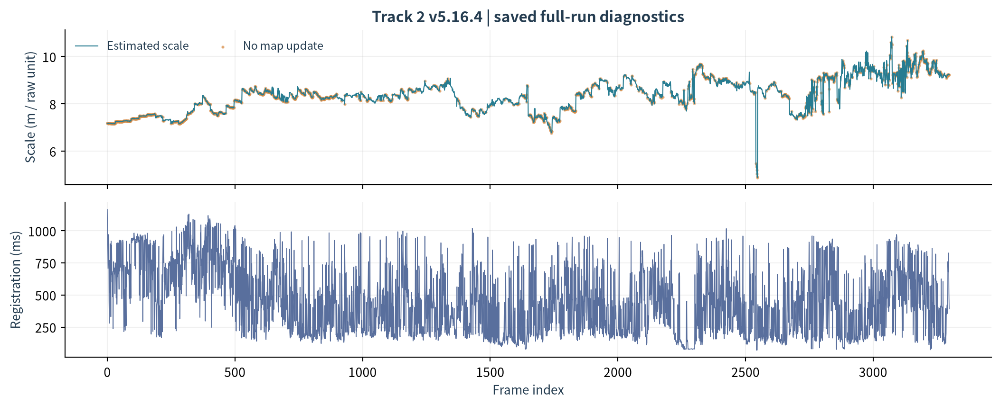
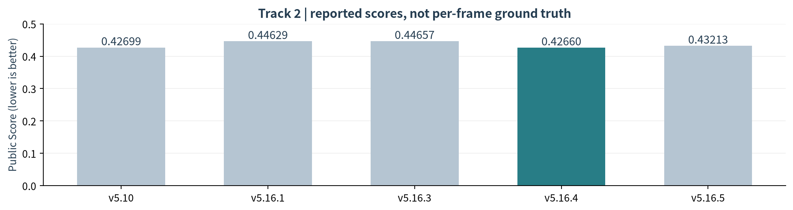
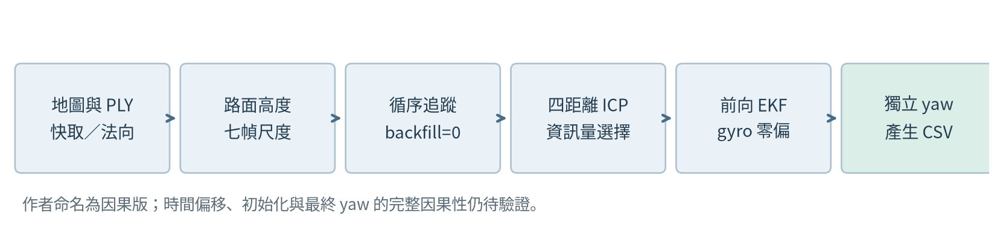

# 影像重建點雲與 LiDAR 地圖定位

## SDC Midterm01 Localization Report

王祈淳｜112611054

個人完成｜工作貢獻 100%｜2026 年 11 月 5 日

本專題將前視相機重建的三維點雲對齊預建 LiDAR 地圖，估計每一幀相機的位置與航向。報告依使用的方法分為兩部分：Track1／2 整理 GPU 因果定位架構，以 Track2 v5.16.4 為主要實作說明；Track3 採用指定的外部 Python 程式包，說明無 GNSS 的地圖配準、前向濾波與航向估計。

核心困難在於重建點雲的尺度會變、場景對水平位姿的約束不均勻，而且感測器與配準結果都有偏差。因此，流程先處理時間與座標契約，再從地面建立公尺尺度，以非地面幾何估計可觀測的位姿方向，最後只用當前及歷史資料更新輸出。

| Track | 最終指定 CSV 筆數 | 使用者提供的成績 | 報告定位 |
| --- | --- | --- | --- |
| Track1 | 3011 | Public 0.56188 | 與 Track2 共用方法章節；檔案來源差異見附錄 |
| Track2 | 3299 | Public 0.42660 | v5.16.4，CSV 與保存的 full run 完全相同 |
| Track3 | 3142 | Public 0.57380；Private 0.86831 | 指定作者程式包；本機重現範圍另述 |

Track2 上傳紀錄更正：先前上傳的 0.30488 使用全段平滑，不符合本專題的因果定位要求，不能列為本報告 v5.16.4 的成績。本報告採用 0.42660 及其對應 CSV。此更正只針對 Track2；Track1 成績依使用者確認記錄。

閱讀順序：任務與資料 → Track1／2 方法與實驗 → Track3 方法與限制 → 原創貢獻與分工 → 執行方式與來源證據。

<!-- page -->

# 1｜任務、資料與輸出定義

## 1.1 要估計的是什麼

LiDAR 地圖提供固定的 map 座標系；相機重建 PLY 提供當幀看到的局部幾何。對相機點 p，目標是找到旋轉 R、平移 t 與尺度 s，使轉換後的點能對齊地圖：

$$ p_map = R (s p_camera) + t $$

s 把重建的 raw units 轉成公尺；R 與 t 描述相機在地圖中的姿態與位置。輸出的 yaw 為水平航向角；實作由旋轉矩陣計算 atan2(R10, R00)，以弧度儲存。尺度不是車輛位置，也不能直接當成相機高度。

## 1.2 各 Track 可用資料

| 資料或條件 | Track1／2 | Track3 |
| --- | --- | --- |
| 每幀重建 PLY、LiDAR map、初始 pose | 使用 | 使用 |
| GNSS pose | 可作帶雜訊的融合輸入 | 不使用 GNSS |
| IMU | 時間對齊後建立姿態／運動 prior | gyro 與靜止、零偏估計 |
| 前視影像 | Track2 補充速度與靜止線索 | 指定流程主要用 PLY 與 IMU |
| 幀數 | 3011／3299 | 3142 |

本研究直接使用官方提供的重建點雲，沒有另外訓練重建模型。地圖只取 XYZ；Track2 地圖的時間相關欄位不作為定位軌跡來源。GNSS 是感測器觀測，不能當作 ground truth。[S1, S2]

## 1.3 結果與因果原則

CSV 固定為 idx,x,y,yaw，idx 從 0 開始。GPU runner 另保存每幀 12 值的 row-major 3×4 pose、整數奈秒時間戳及來源 manifest。報告對三份最終 CSV 檢查了筆數、索引與有限數值；這些檢查不能單獨證明官方評分參考點、frame 或單位已完整標定。

因果定位表示：第 k 幀輸出只能依賴截至該幀已可取得的資訊；第 k+1 幀到來後不得回寫第 k 幀。前向 Kalman filter 可使用歷史狀態；整段 RTS、backward smoothing 或定位完成後平移、旋轉軌跡不屬於本報告採用的 GPU 流程。[S1]

<!-- page -->

# 2｜Track1／2：從感測器先驗到地圖修正

## 2.1 每幀處理流程



流程將「車輛如何移動」與「地圖對目前估計提供什麼修正」分開處理。前者由 GNSS／IMU 與已接受的影像觀測建立 prior（先驗）；後者由當幀點雲與局部地圖求解。配準失敗時仍可輸出 prior 與保留的歷史修正，不必直接把上一幀 pose 當成目前位置。[S2, S3]

1. 讀取當幀 PLY 與對應的相機擷取時間；按時間處理已抵達的 GNSS／IMU。
2. 使用官方相機 mask 與視野限制，排除車體及不可用的重建點；地圖依 prior 裁成局部區域。
3. 分別估計 source 與 map 地面，以地面法向建立傾斜方向，以高度建立尺度起點。
4. 使用非地面結構估計水平平移、yaw 與 log scale；由弱方向資訊判斷可採用的 map 約束。
5. 配準候選通過幾何與 innovation 檢查後，更新當前 correction state；隨即寫出該幀結果。

## 2.2 共通設計與版本差異

Track1 的現有獨立 GPU 入口沿用 v4 的尺度、GNSS／IMU prior 與地圖修正記憶。Track2 在同一架構上持續加入局部平面／線結構、方向性資訊、影像速度與航向觀測保護；本報告主要描述其 v5.16.4。兩條 Track 不能僅因架構相近，就視為使用相同程式或已取得相同驗證結果。

依本次指定，Track1／2 歸為同一方法部分，最終 CSV 採用使用者指定檔案。Track2 已建立 CSV 到 v5.16.4 full run 的對照；Track1 的版本對照限制集中列於附錄，不把 Track2 測試成績套用到 Track1。[S2, S4]

<!-- page -->

# 3｜尺度與地圖幾何：避免「貼得上卻定位錯」

## 3.1 觀察與原因假說

單目重建的尺度可能逐幀改變；只使用固定倍率，可能讓道路高度與遠處結構同時錯位。另一方面，一片平面可以限制垂直方向與傾斜，卻很難限制沿平面滑動。因此，低殘差不一定代表 XY 或 yaw 正確；尺度、傾斜與平移還可能互相補償。[S3]

## 3.2 地面提供尺度與傾斜起點

設 h_raw 為 source 地面到相機原點的 raw-unit 距離，H 為相機到地面的公尺高度估計，尺度起點為：

$$ s_seed = H / h_raw $$

GPU 方法以官方初始 pose 與局部 map ground 建立高度起點，再以前向高度 anchor 保存過去可信配準的資訊。source／map 地面法向提供 roll、pitch 與地面基底；非地面配準在這個基底中估計水平平移與 yaw。地面缺乏支持時必須標示回退狀態，不能稱為可靠地圖更新。

## 3.3 非地面結構決定水平位姿

GPU metric registration（公尺尺度配準）的主要未知量可寫為 u=[dx_plane,dy_plane,dyaw,log(s)]。可靠局部平面以法向殘差限制點到面的距離；可靠線結構則提供其有支持的幾何方向。以下為平面殘差的示意：

$$ r_i = n_i^T [ R (s p_i) + t - q_i ] $$

其中 p_i 為 source 點、q_i 為地圖對應點，n_i 是地圖法向。穩健權重降低錯誤配對影響；按角度區塊聚合，避免把同一視角的大量深度點都當成彼此獨立的量測。Track2 保留 40 m feature range，採粗到細的搜尋與線搜尋，不直接套用 Track3 的四種距離切換。[S3, S4]

## 3.4 用資訊方向決定可採信的修正

尺度與位置有耦合，求 map pose 不確定度時須將尺度等 nuisance variables（附帶未知量）邊際化，而不是把尺度當成完全已知。以資訊矩陣分塊表示，其概念為：

$$ H_pose = H_pp - H_pn inverse(H_nn) H_np $$

幾何薄弱的方向不應因點數多而獲得很高信心。配準的覆蓋率、殘差、有效資訊方向與收斂共同參與判斷；即使接受，也只代表通過現有模型檢查，不能視為真實精度證明。

<!-- page -->

# 4｜前向融合、時間契約與 v5.16.4 改進

## 4.1 先確定資料在當幀是否已可用

bag 的抵達時間和 sensor header 的量測時間扮演不同角色。GPU runner 同時要求 arrival 不晚於當幀 PLY bag time，且 header 不晚於相機 header time。已抵達但量測時間較新的樣本先緩存；遲到的舊樣本不回修已輸出的 pose。整數奈秒保留原時間精度。[S2, S4]

GNSS XY 使用前向位置／速度估計；IMU 提供姿態與轉動資訊。Track2 另以過去 GNSS 位移方向校準航向偏差，但 GNSS heading、IMU heading 與 camera lever arm 的座標及不確定度仍有工程假設。全零或缺失的 covariance 不表示零誤差。

## 4.2 地圖修正需要記憶，也需要拒絕突跳

correction state（修正狀態）c=[dx_map,dy_map,dyaw_map] 表示 map 對 sensor prior 的緩變修正，另保存 covariance P。它不是車輛位置；即使 c 不變，車仍隨新的 prior 前進。當幀候選與預測修正比較，使用 innovation 及 NIS（正規化創新平方）降權或拒絕異常觀測。

短暫沒有 map 更新時，修正先保留 0.5 秒，之後以 3 秒 time constant 逐漸退回 sensor prior；不確定度隨時間與運動增加。更新量過大時，縮放 Kalman gain，並以同一 gain 更新均值與 covariance。這能避免配準「接受／失敗／接受」切換時，歷史修正瞬間消失又回來。[S3]

## 4.3 Track2 的新增保護

| 機制 | 解決的問題 | v5.16.4 做法 |
| --- | --- | --- |
| 航向觀測檢查 | 低速、混合運動窗口的 course 不可靠 | 過去窗口前後半皆須有方向且相容；同一 likelihood 不重複消費 |
| 航向更新預算 | 多筆更新在一幀累加成跳動 | 同幀 calibration 共用 0.5 度預算；不限制車輛實際轉彎 |
| 影像速度與靜止線索 | GNSS 單獨難辨停車與起步 | 前視 LK 特徵及道路深度／PnP，通過可見性和資訊檢查後融合 |
| 因果轉彎模型 | 固定 XY 速度難描述轉向 | 已抵達 gyro 轉速旋轉 XY 速度；不強迫速度方向等於絕對 heading |
| 保留原地圖配對 | 新配對可能吸收重建偏差 | 關閉表面 fallback；保留 40 m、轉彎與完整路面視窗支持 |

轉彎模型的連續形式為 p_dot=v、v_dot=omega Jv+w；J 表示平面旋轉 90 度。精確離散化讓直線與轉彎連續銜接。gyro 零偏只由過去已確認靜止的區間更新，之後才用於新的 prediction。[S4, S5]

<!-- page -->

# 5｜三份最終指定 CSV 與軌跡



圖 1：直接繪製使用者指定的 track1.csv、track2.csv、track3.csv；沒有平移、旋轉、重採樣或平滑。各圖使用各自的 map 座標與等比例 XY 軸。這是輸出軌跡，不含真值對照，不能由線條平順判斷精度。

| 項目 | Track1 | Track2 | Track3 |
| --- | --- | --- | --- |
| 資料列數 | 3011 | 3299 | 3142 |
| idx 範圍 | 0-3010 | 0-3298 | 0-3141 |
| Public Score | 0.56188 | 0.42660 | 0.57380 |
| Private Score | 未提供 | 未提供 | 0.86831 |
| 分數來源 | 本次使用者回報 | 本次使用者回報及既有收據 | 本次使用者回報 |

三份 CSV 均通過 header、連續索引、預期筆數及 finite 數值檢查。Track2 的 track2.csv 與 v5.16.4 full 的 result_2.csv SHA256 完全相同；Track1 的 track1.csv 與資料夾內 result_1_0.56188.csv 相同；Track3 使用本次指定的 track3.csv。完整來源與 SHA 見附錄及隨附 manifest。[S8]

Track3 Private 0.86831 低於官方文件的 1.40 基本門檻；這是使用者回報分數與門檻的數值比較，不代表本報告已核驗 Kaggle 最終排名、正式選定提交或整條程式的合規性。[S1]

<!-- page -->

# 6｜Track2 v5.16.4：尺度、耗時與弱幾何



圖 2：由 v5.16.4 保存的 timings.csv 與 test_info.json 繪圖。橘色區段表示該幀未接受 map 更新，仍可能輸出有效的 sensor prior 與 correction memory；它不等同於定位整體失敗。

| 保存的 full 紀錄 | 實測值 |
| --- | --- |
| 幀數／GPU | 3299／NVIDIA GeForce RTX 5060 |
| map 更新採用數 | 1753 幀（53.14%）；只是模型診斷 |
| 準備／CUDA 暖機／地圖載入 | 6.90 s／0.21 s／2.72 s；後兩者屬準備內細項 |
| 定位總耗時／其中配準時間 | 1578.76 s／1479.84 s |
| 平均逐幀配準時間 | 448.57 ms |
| 尺度最小值／最大值 | 4.88860／10.83878；不是尺度真值 |
| RViz／離線 graph optimizer | 此 run 未開啟／未使用 |

全段仍存在沒有 map 更新的區域，例如 idx 2643-2671、2773-2864。這些區間指出幾何或驗收可能不足，不能直接推論為相同大小的真實位置誤差。定位、準備與畫圖分開記錄；平均耗時包含該次條件，不能當成跨環境的速度保證。[S4]

<!-- page -->

# 7｜問題、解法與未成功的改動



圖 3：同一 Track 的 Public Score 比較，數值依使用者回報及保存收據。較低較好；沒有評分不確定度，不能宣稱 v5.16.4 與 v5.10 的 0.00039 差異具有統計顯著性。0.30488 未放入比較，因為其來源使用全段平滑。[S8]

| 觀察 | 原因假說 | 採用的處理與驗證結論 |
| --- | --- | --- |
| 固定尺度可能讓地面貼合、非地面仍錯位 | raw PLY 尺度變化與高度耦合 | 地面 seed 加非地面公尺尺度求解；標示 fallback 與尺度資訊 |
| map 更新中斷造成 pose 來回跳 | 每幀重設修正會丟失歷史資訊 | 前向 correction memory 與 innovation gate；不回修歷史 |
| 接受更多配對，分數仍較差 | 配對偏向有系統誤差的重建結構 | v5.16.4 停用 surface fallback；保留受控比較與原始結果 |
| 新高度更新通過數值檢查，正式卻退步 | 高度與位置、尺度及歷史 map 共享誤差 | v5.16.5 為 0.43213，回復 v5.16.4 的 0.42660 |

v5.16.5 的 map 更新由 1753 降到 1614 次，高度與 XY 輸出也發生變化；這些只顯示影響鏈，不能指定哪幀導致分數退步。來源平面、配對、尺度與歷史高度 anchor 存在相關性，單純將資料項與 prior 分開，不代表已獲得獨立量測。[S4]

這次開發的重要經驗是：合成測試驗證數學與程式行為，真實資料檢查驗證實際分支；正式分數則提供另一層整體結果。殘差更低、接受率更高或 GPU 使用率較高，都不能替代精度證據。回復最佳已知版本後的 329 項 suite 與 4 幀生成 CUDA 等價檢查屬機制證據，不是再跑一次 full 或逐位元重現整段的證明。[S4]

<!-- page -->

# 8｜Track3：指定外部程式的無 GNSS 方法

## 8.1 方法來源與設計直覺

本部分使用 midterm01/others code track3 的 Python／CPU 程式，以 run_track3_causal.sh 為說明入口。地圖、尺度、ICP、EKF 及 yaw 方法取自該作者程式包；不列為本人的原創演算法。作者另附的離線版不納入本報告採用的方法。[S6]

沒有 GNSS 時，位置須由地圖幾何提供絕對約束；gyro 可描述相對轉向，卻會累積零偏。作者把不同距離的配準與前向狀態估計組合，盡量在近距離深度品質與足夠場景結構間取得平衡。



## 8.2 由原始資料到當幀配準

1. 將 ASCII PCD 轉成數值地圖，以 0.2 m voxel 降採樣，計算法向；PLY 轉成快取，保留 frame 順序。
2. 用相機離地高度 H=1.573 m 除以當幀路面 raw 高度求尺度，再取當幀與過去最多六幀的中位數。此高度是作者沿用的假設，沒有在本機獨立標定。
3. track_sequential.py 在初始 pose 附近搜尋候選，後續使用歷史運動提供 ICP 初值；backfill=0 關閉向前面影格回補。
4. 每幀分別採 12、15、18、25 m 範圍進行粗細兩階段點到面 ICP。地面點與地面配、非地面點與非地面配，減少跨類誤配。
5. merge_regs.py 優先使用 12 m 候選；XY 資訊不足 2.0 時，依序退到 15、18、25 m。距離較大可增加結構支持，但也可能引入較大的重建深度偏差。

上述是程式機制，不是本機對每一段已證明的最佳距離選擇。作者 README 的距離比較與約 35 分鐘耗時屬作者環境敘述，沒有當作本機實驗結果。

<!-- page -->

# 9｜Track3：前向 EKF、航向與驗證範圍

## 9.1 狀態、量測與航向估計

作者前向 EKF（擴展卡爾曼濾波）使用狀態 x=[x,y,psi,b_g]，其中 b_g 為 gyro 零偏。gyro 積分扣除當時的零偏估計，描述相鄰影格轉角；位置則依最近最多 20 筆已接受姿態的歷史差分前進。原碼以 frame index 差分估計每幀位移，不把這個中間量直接宣稱為已標定的 m/s 速度。[S6]

當幀 map 配準提供位置與航向觀測。Cauchy 權重降低大 innovation 的影響；連續拒絕過多時，原碼另有強制接受與放大不確定度分支。靜止判定使用 IMU 的過去一秒視窗，降低位置／航向 process noise，並以 gyro 平均更新零偏；靜止時位置仍可能由配準更新，不是保證完全固定。

yaw_from_motion.py 再以扣零偏的 gyro 維持航向形狀，以過去約兩秒的位移方向估計絕對方向偏移，採過去約二十秒的偏移中位數；轉彎、低速或靜止樣本另作限制。輸出為前相機參考點，沒有另加車體 lever。這是作者程式的參考點選擇，不能據此推定官方 ground truth 的參考點。

## 9.2 已完成的本機檢查

既有紀錄包含 22 項作者合成測試與 4 項包裝器檢查通過。ASCII PLY／PCD 曾因 buffered reader 與 Polars 的底層讀取位置不一致而讀到空資料；僅在執行副本的 ply.py 與 convert_map.py 使用 buffering=0，保留作者原檔。這是 I/O 相容修正，沒有改 ICP、尺度、EKF 或 yaw 參數。[S7]

本次使用者指定 track3.csv，並回報 Public 0.57380、Private 0.86831；這取代作者 README 只有兩位小數的自述作為本報告成績來源。本次未執行新的 Track3 定位，也未將該 CSV 與作者實際評分輸出逐位元重現。

## 9.3 尚待釐清的因果性與重現限制

作者入口使用 gyro-dt=0.14，讀取影格時刻之後 0.14 秒的 IMU；目前尚無雙時間對照證明這些資料在當幀可用。EKF 從全段搜尋首個 good 配準初始化，如果首個 good 不是第零幀，早期輸出可能依賴後續資訊。最後獨立產生 yaw 的流程也尚缺逐段 prefix 一致性驗證。[S6, S7]

因此，作者稱為「因果版」及本機合成測試通過，不等於整條流程的線上合規性已被證明。報告如實說明指定方法與已回報成績，保留上述限制，不將它包裝成已完成本機正式重現。

<!-- page -->

# 10｜個人貢獻、問題解決與工作分配

## 10.1 原創工作與既有方法的界線

本專題不是重新提出 ICP 或 Kalman filter，而是針對相機重建點雲的尺度變化、地圖幾何退化及線上資料時序，整合可追溯的定位流程。原創貢獻以本專案可辨識的實作與問題解決為範圍；Track3 作者演算法明確歸屬第三方。[S2-S7]

| 工作範圍 | 本專案完成的內容 | 來源或限制 |
| --- | --- | --- |
| 因果整合與輸出 | 當幀資料截止、前向 runner、即時輸出、歷史結果保護 | 使用標準濾波與配準概念；不使用 RTS |
| 尺度與地圖幾何 | 地面尺度起點、非地面資訊、covariance 與弱方向判斷 | 以現有版本紀錄與數值檢查支持，不等於新理論 |
| 穩定融合 | correction memory、innovation 檢查、航向資訊預算與因果轉彎 | 各機制的證據範圍依 Track 和版本分開 |
| GPU 與資料處理 | CUDA 對應／累加、讀檔與發布處理、顯存與來源紀錄 | 小矩陣和 I/O 仍在 CPU；不宣稱全流程皆在 GPU |
| Track3 整合 | 作者流程理解、獨立執行入口、兩處 I/O 相容修正與驗證 | 作者 ICP／尺度／EKF／yaw 不列為本人原創 |
| 結果與報告 | 保存失敗版本、分數來源、SHA、唯讀圖表及執行說明 | 不將平順度或 GNSS 預測誤差冒充真值精度 |

## 10.2 工作分配

| 成員 | 負責工作 | 個人貢獻比例 |
| --- | --- | --- |
| 王祈淳（112611054） | 問題分析、方法理解與整合、環境管理、實驗執行與判讀、結果選定、文件與報告 | 100% |

本組由一人完成，沒有組員分工。開發與文件整理使用 AI 工具協助；AI 不是組員，不另列人員比例。100% 表示個人工作占本組工作比例，不表示全部依賴套件或第三方方法皆為本人原創。

## 10.3 學習與改進方向

最重要的收穫是先區分「模型可解」、「程式正確」、「真實量測可靠」與「正式分數較好」。未來應優先釐清 camera／IMU／GNSS 外參、時間與評分參考點，並描述高度、尺度及 correction 的共享誤差；Track3 則需先驗證完整 prefix 因果性與 CSV 重現，之後再討論增加觀測或改善配準。

<!-- page -->

# 11｜執行說明與 E3 交付對照

## 11.1 Track1／2 GPU 入口

使用 Ubuntu、NVIDIA driver／Container Toolkit 與專案 CUDA／ROS 2 Humble 容器。Docker 操作在主機執行；ROS／colcon 在容器執行。原始資料位於 midterm01/data/Track1 或 Track2，以唯讀方式使用。三條 Track 共用 GPU lock，依序執行。[S2, S4]

```bash
cd /home/ricky/sdc_ros2/midterm01_gpu
./scripts/dev.sh up
./scripts/run_track1.sh --full
# 等 Track1 結束後，再執行 Track2
./scripts/run_track2.sh --full
```

以上為現有入口的操作命令，由使用者手動啟動。Track1 現有入口仍為 v4；不可將執行這條命令宣稱為已重現指定 track1.csv。Track2 live 已回復 v5.16.4 數值分支，但精確來源仍以已評分 run 的 source 快照及 manifest 為準。沒有為本報告重新定位或改寫既有結果。

## 11.2 Track3 作者流程入口

原始資料需包含 raw_ply、map.pcd、init_guess.txt、Track3.db3。作者程式為 Python CPU 流程，依其 requirements 安裝依賴；本專案包裝器會保留原碼與執行副本，將結果放入新的唯一 run。[S6, S7]

```bash
cd /home/ricky/sdc_ros2/midterm01_gpu
./scripts/run_external_track3.sh --check
# 資料齊備後，由使用者啟動 full
./scripts/run_external_track3.sh --full
```

--check 是環境／合成與資料前置檢查，不執行真實定位。這個入口尚有前章所述因果與重現限制，不能單憑成功產生 CSV 宣稱符合正式規則。

## 11.3 對照官方 E3 要求

| 官方要求 | 本次整理方式 |
| --- | --- |
| 程式，不含原始 dataset | 應附 localization 原程式、GPU 程式與指定 Track3 作者程式；保留來源說明 |
| 三條 Track 結果 | 指定三份 CSV 原樣複製，命名 result_1.csv、result_2.csv、result_3.csv |
| 報告 PDF | localization_report_112611054.pdf；單人學號命名 |
| README | 隨附 README.md，說明環境、入口、版本與結果對應限制 |
| 壓縮與上傳 | 單人壓縮檔可命名 112611054_localization.zip；實際 E3 上傳由使用者執行 |

本次完成報告、README 與指定 CSV 的整理；未打包完整程式或上傳 E3。官方投影片為雙人檔名範例，本報告使用單人學號，不虛構第二位成員。

<!-- page -->

# 附錄 A｜結果來源、版本對照與更正

下列路徑以專案根目錄為起點。完整 SHA256、來源檔案與輸出檢查保存在隨附 manifest.json；本頁保留閱讀所需的關鍵對照。

| 最終指定來源 | 對照結果 | 使用界線 |
| --- | --- | --- |
| midterm01_gpu/doc/analysis doc/track1.csv | 與 result_1_0.56188.csv 相同，3011 幀 | 使用者確認成績 0.56188；不是現有 Track1 v4 run 的 CSV |
| midterm01_gpu/doc/analysis doc/track2.csv | 與 track02_full_2611050123/result_2.csv 相同，3299 幀 | 對應 v5.16.4 與 0.42660 |
| midterm01_gpu/doc/analysis doc/track3.csv | 3142 幀；使用者本次指定 | Public 0.57380／Private 0.86831，尚無本機重現收據 |

使用者指定 Track1／2 採 v5.16.4 作報告方案；工作區可證實的 v5.16.4 實作與已評分 full 為 Track2。現有 Track1 獨立入口的 VERSION 為 track1_causal_metric_correction_memory_v4；本次未找到能把最終 track1.csv 對回 v5.16.4 執行來源的 manifest。因此，本文介紹共通設計並採指定 CSV 呈現成績，不主張已驗證 Track1 v5.16.4 的整段重現。這是程式版本追溯限制，不等同於判定 Track1 使用非因果方法。

Track2 的 0.30488 更正：使用者說明該上傳結果誤用全段平滑，故本報告不將其列為因果定位成果、不作真值或訓練目標，也不混入 v5.16.4 的分數比較。其歷史檔案保留原樣。正式採用的 track2.csv SHA 與 0.42660 run 一致。

Track3 的 0.57380 與 0.86831 依使用者本次回報記錄。作者 README 曾自述約 0.57，但不是這兩個五位小數分數的獨立驗證來源；也不能由作者文字推定本次檔案已於本機重現。Private 排名與正式提交選定狀態未提供。

報告本次只有讀取與繪圖。原始資料、CPU 結果、既有 CSV、矩陣、manifest 及來源 SHA 均不回寫；指定結果的交付副本與原檔 bytes 相同。

<!-- page -->

# 附錄 B｜參考資料與證據索引

本報告依本地官方文件、程式與 run 紀錄撰寫。引用代號對照如下；分數的最新更正以本次使用者明確說明為準，沒有回寫歷史 run metadata。

## [S1] 官方題目與規則

midterm01/docs/Competition Regulations/00_SDC_2026_Midterm01_Localization.pdf

midterm01/docs/Competition Regulations/01_Mid01_Updates_Rules.pdf

涵蓋任務、Report／Presentation 要求、E3 交付、GNSS 使用、因果原則與 Track3 Private 基本門檻。投影片及更新規則的適用範圍優先於作者 README 的自述。

## [S2] Track1／2 入口與資料契約

midterm01_gpu/track1/README.md；track1/parameters.py；track2/README.md；scripts/run_track1.py；scripts/run_track2.py。

Track1 的歷史 GPU full 為 outputs/run/track01_full_2610290445，其版本為 v4；本報告沒有將它的耗時或接受率當成最終指定 Track1 CSV 的實驗結果。

## [S3] 尺度、傾斜與前向 correction memory

midterm01_gpu/doc/66_TRACK2_METRIC_SCALE_20261029.md

midterm01_gpu/doc/67_TRACK2_CAUSAL_CORRECTION_MEMORY_20261029.md

歷史文件用來說明模型演進，當前啟用分支與結論以 [S4] 為準。

## [S4] Track2 v5.16.4 與高度分支對照

midterm01_gpu/doc/98_TRACK2_V5164_ASSOCIATION_ABLATION_20261105.md

midterm01_gpu/doc/101_TRACK2_V5164_BEST_HEIGHT_REGRESSION_20261105.md

outputs/run/track02_full_2611050123/{test_info.json,timings.csv,source_manifest.json,analysis/manifest.json}（相對 midterm01_gpu）。

## [S5] 影像速度、航向預算與轉彎

midterm01_gpu/doc/83_TRACK2_V57_IMAGE_GROUND_SPEED_20261102.md

midterm01_gpu/doc/86_TRACK2_V510_V57_HEADING_20261103.md

midterm01_gpu/doc/96_TRACK2_V5162_CAUSAL_TURN_20261104.md

## [S6] Track3 外部方法來源

midterm01/others code track3/README.md、run_track3_causal.sh，以及 scripts/ 下的 scale_from_height.py、track_sequential.py、register_all.py、merge_regs.py、build_causal.py、yaw_from_motion.py。作者姓名與上游網址未隨包提供，本報告不虛構作者身分。

## [S7] Track3 本機相容與驗證

midterm01_gpu/doc/70_EXTERNAL_TRACK3_LOCAL_VALIDATION.md；outputs/run/track00_test_2610291342/ 的既有檢查紀錄。

## [S8] 分數、CSV 與本次回報

midterm01_gpu/outputs/run/track00_test_2611050118/score_receipt.json；track00_test_2611051137/score_receipt.json；doc/analysis doc/ 的 track1.csv、track2.csv、track3.csv，以及 2026-11-05 本次使用者對姓名、版本、最終檔案與分數更正的明確回報。
